# UI·디자인 화면 점검 (2026-11-25)

사용자 지시(2026-11-24): "전체적인 게임 UI와 디자인도 개선해야 해." → D53, 「UI·디자인 담당」 세션의 첫 단계입니다.
게임의 모든 화면을 한국어와 영어로 찍고, 화면마다 문제를 적었습니다. 이 문서는 **무엇이 문제인지**만 다룹니다. 어떻게 바꿀지는 다음 단계(방향 시안, 시안 월드컵)에서 사용자가 고릅니다.

## 확인 부탁 (한 가지)

**특히 불편했던 화면이 있으면 알려 주세요.** 아래 점검은 캡처를 보고 찾은 것이라, 실제로 플레이하며 느낀 불편과 다를 수 있습니다. 답이 없으면 아래 "가장 큰 문제" 순서대로 시안을 만듭니다.

## 한눈에

- 찍은 것: 화면 59종 × 3묶음(한국어 1280×720, 영어 1280×720, 한국어 1470×720 넓은 창) = 177장. 웹 빌드에서도 같은 화면이 같은 모습인지 확인했습니다.
- 찾은 것: 문제 73개(높음 11, 중간 34, 낮음 28). 그 가운데 방향과 상관없는 버그 8개(B1~B8)는 같은 날 고쳤습니다(아래 "고친 버그").
- 가장 완성된 화면은 **스토리 대화**와 **스토리 시작 카드**이고, 가장 손이 필요한 화면은 **경기 HUD**입니다.

### 가장 큰 문제 여섯 가지

| | 문제 | 어디 |
|---|---|---|
| 1 | **경기 중 글자가 너무 작다.** HUD 글자 18종 가운데 9종이 16px 미만이다(미니맵 8px, 봇 패널 10px, 스킬 키 11px, 조작 줄 12px). 창이 작으면 더 작아진다 | 경기 HUD |
| 2 | **내 상태 글자가 체력 막대 위에 겹쳐 있다.** 체력·처치·소울·다음 카드가 한 줄 글자로 막대를 가로지른다 | 경기 HUD 오른쪽 위 |
| 3 | **무엇이 중요한지 크기로 드러나지 않는다.** 내 체력, 생존자 수, 붕괴까지 남은 시간, 소울이 모두 16~17px 흰 글자다. 내 캐릭터 표시는 머리 위 작은 금색 "P1"뿐이다 | 경기 HUD |
| 4 | **소울 카드가 배경 위에 떠 있다.** 카드 틀 가운데가 투명해서 글자가 발판·구름과 섞이고, 5초 제한이 "(5초)" 글자뿐이다 | 카드 고르기 |
| 5 | **급한 경고가 묻힌다.** 붕괴 경고는 붉어진 화면 위의 주황 글자이고, 그 밖의 알림(탈락·정예 등장·붕괴)은 모두 왼쪽 아래 15px 한 줄이다 | 경고·알림 |
| 6 | **화면마다 모양이 다르다.** 글자 크기가 24가지이고, 버튼 틀은 옆선이 없으며, 매끈한 고딕 글꼴과 픽셀 그림이 섞여 있다 | 모든 화면 |

### 방향과 상관없는 버그 (8개, 모두 고침)

| | 버그 | 원인 |
|---|---|---|
| B1 | 창이 16:9보다 넓으면 스킬 바가 넓어진 만큼 안쪽에 남는다(1470 폭에서 190px, 조작 줄은 끝에 붙음). 웹은 브라우저 창 모양을 그대로 쓰므로 자주 보인다 | `MatchHud._layout_skill_bar`가 x 위치를 1280 기준으로 다시 씀 |
| B2 | 영어 미니맵에서 렐름별 인원수가 잘린다("STABLE x") | 32px 칸에 8px 글자 "STABLE x2"가 넘침 |
| B3 | 조작 안내의 "1~5 / V / B (메뉴)". 캐릭터가 6명이 된 뒤 안 고쳐졌다(타이틀은 1~6) | `strings.csv` |
| B4 | 결과 화면에서 표의 피해량과 "최다 피해" 상의 숫자가 1 다르다(표 28, 상 27) | 표는 반올림, 상은 버림 |
| B5 | 옵션의 "설정은 이번 플레이 동안 유지됩니다"가 사실과 다르다. 속도·언어·음량 4개는 저장되고, 아트·참가 인원·봇 패널만 이번 실행 동안이다 | 문구 |
| B6 | 캐릭터 선택의 기술 설명이 두 줄이 되면 다음 줄과 붙는다(영어 시온은 6줄 중 5줄, 한국어 시온 U 1줄) | 줄 간격 41px에 15px 글자 두 줄 |
| B7 | 내 상태 글자와 체력 막대가 겹친다(위 2번) | 글자 둘째 줄이 y 52까지, 막대는 y 42부터 |
| B8 | 렐름 배경 그림이 화면 가장자리에서 끊긴다. 아스가르드 왼쪽에 어두운 띠, 니플헤임 오른쪽에 밋밋한 삼각형이 보인다 | 카메라는 렐름 끝에서 80px 더 보여 주는데 배경 그림은 렐름 끝에서 끝남 |

총괄 결정(2026-11-25)으로 방향을 고르기 전에 먼저 고쳤습니다. B8은 총괄이 더한 항목입니다. HUD를 크게 바꾸는 방향이 뽑히면 사라질 B1·B2·B7은 가장 작은 수정으로 했습니다.

## 고친 버그

| | 고친 방법 | 검사 |
|---|---|---|
| B1 | 스킬 바를 다시 배치할 때 오른쪽 아래 기준 거리(offset)를 고친다. x 위치를 직접 쓰지 않는다 | `test_hud_layout`: 1280·1470 폭, 4칸·5칸 |
| B2 | 문장 옆 칸에서는 인원수를 둘째 줄에 쓴다("STABLE" 아래 "x2") | `test_hud_layout`: 영어·한국어, 인원 16명 |
| B3 | 숫자 키 안내가 캐릭터 수를 직접 읽는다(조작법, 타이틀·선택·스토리 선택의 아래 안내 줄). 스토리 선택 줄의 표기도 다른 줄에 맞췄다 | `test_menu_text`: 네 화면, 두 언어 |
| B4 | 상의 피해량도 표처럼 반올림한다 | `test_menu_text`: 27.6 → 표 28, 상 28 |
| B5 | 문구를 "속도·언어·음량은 저장됩니다. 나머지는 이번 실행 동안만 유지됩니다."로 바꿨다 | 번역 표 검사(`test_language`) |
| B6 | 기술 설명 줄의 높이를 글자 줄 수에 맞추고 줄 사이를 12px 이상 띄운다 | `test_menu_text`: 여섯 캐릭터, 두 언어, 66줄 |
| B7 | 체력 막대를 14px 내려 상태 글자 아래에 둔다(막대 아래 끝이 얼굴 그림과 맞음) | `test_hud_layout` |
| B8 | 배경 그림 아래에 같은 그림을 거울처럼 이어 붙인 128px 테두리를 깐다. 원래 그림의 자리와 크기는 그대로다 | `test_backdrop_edges`: 9렐름 18장 |

세 검사는 고치기 전 코드에서 실패하는 것을 확인한 뒤 `tests/run_all.ps1`에 더했습니다. 전체 검사는 ALL PASSED(검사 60개와 봇 경기 소크 1판)였고, main에는 `31d0e6bf`로 병합했습니다.

- **경기 진행은 그대로입니다.** 같은 시드의 봇 경기(시드 1001, 480초)를 고치기 전 코드와 고친 코드로 돌린 결과가 같습니다(탈락 순서·시각·피해량 모두 같음). 다른 것은 노드 수 하나입니다(1,678 → 1,696, B8에서 깐 테두리 그림 18장). B8은 그림만 더했고 충돌·카메라 한계·발판은 건드리지 않았습니다.
- **B8 뒤에 조작 줄 뒤의 어두운 판이 보입니다.** 새로 생긴 것이 아니라 전부터 있던 반투명 판(검정 55%)입니다. 전에는 그 자리 배경이 거의 검은색이라 보이지 않았고, 이제 배경 그림이 화면 끝까지 이어져서 드러났습니다(아래 B8 니플헤임 그림). B2에서 영어 "COLLAPSED"가 칸보다 긴 것은 그대로입니다(인원수가 없는 칸이라 읽는 데는 지장이 없고, 새 미니맵에서 글자 자체가 없어집니다).

B1 넓은 창의 스킬 바:

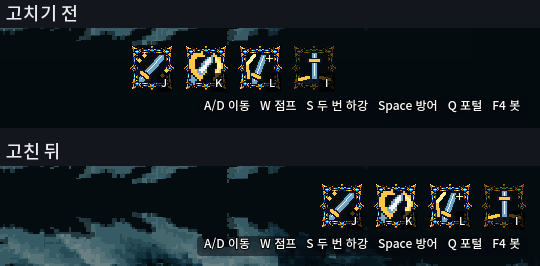

B2 영어 미니맵(3배 확대):

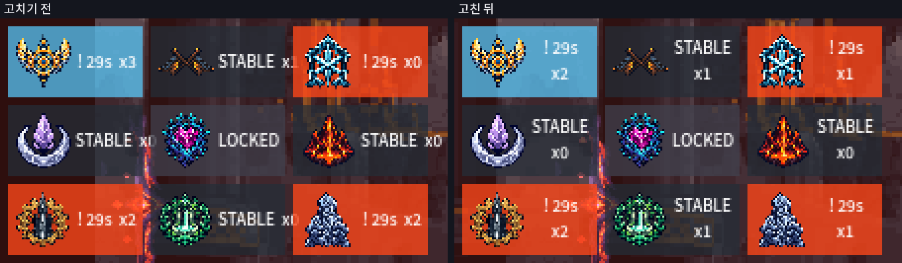

B3 조작법의 숫자 키 줄, B5 설정 안내 문구:

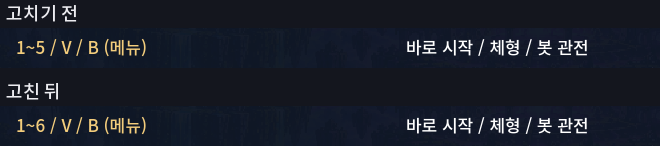

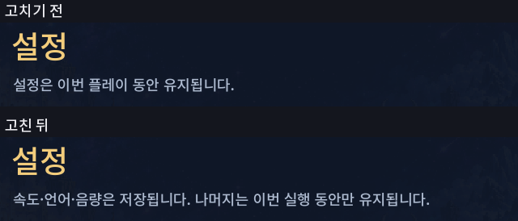

B4 결과 화면(경기가 달라 숫자는 다르지만, 고친 뒤에는 표와 상이 같습니다):

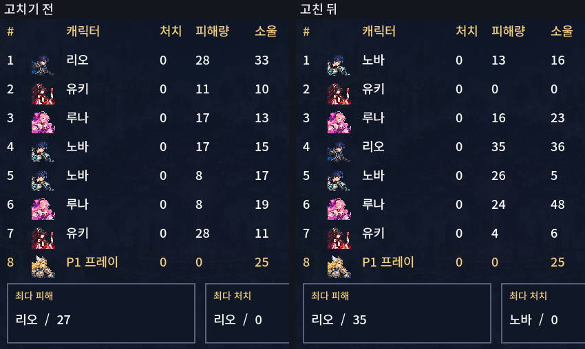

B6 기술 설명(영어, 한국어):

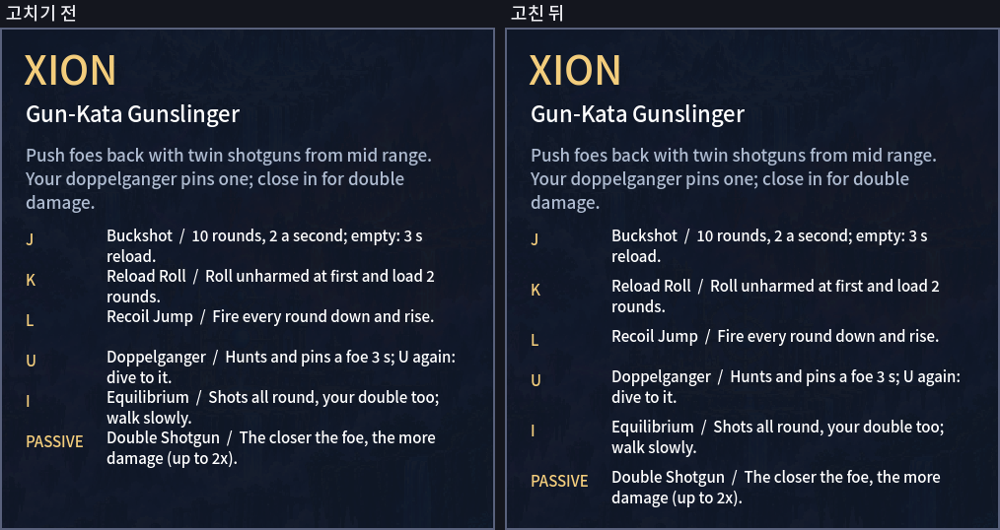

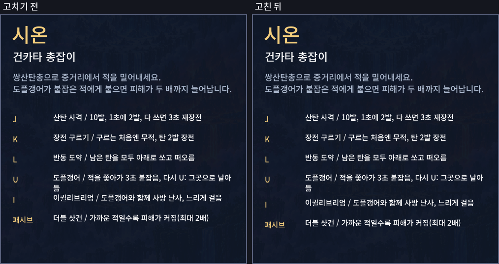

B7 상태 글자와 체력 막대(2배 확대):

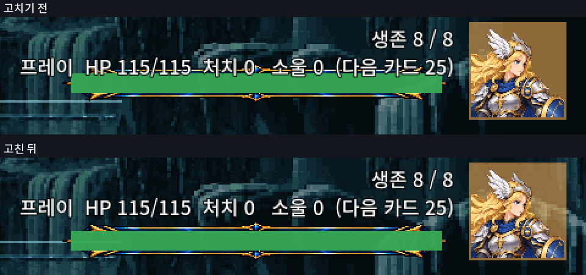

B8 아스가르드 왼쪽 끝, 니플헤임 오른쪽 끝:

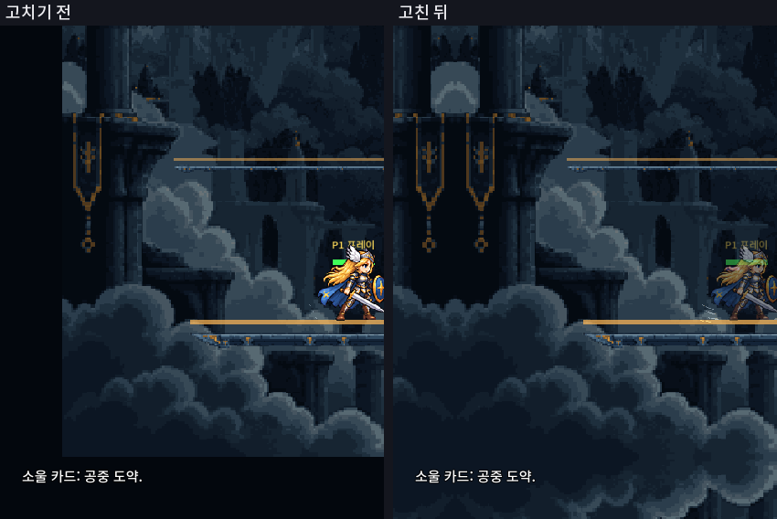

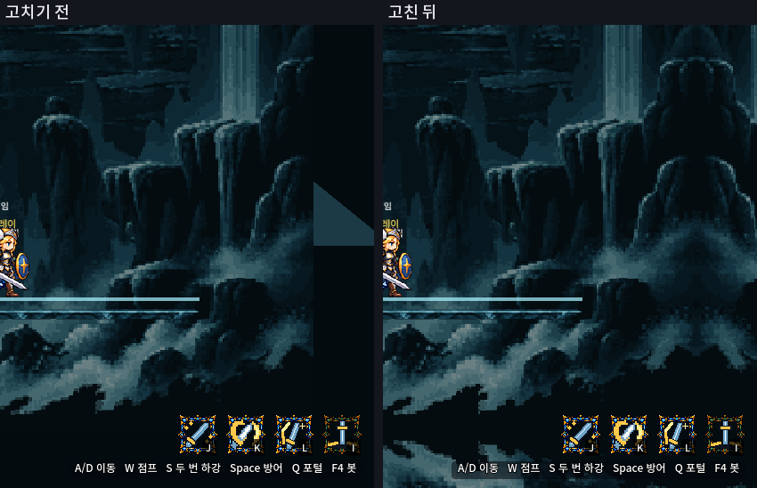

아래 "화면별 점검"의 그림과 표는 고치기 전 모습 그대로 두었습니다.

## 찍은 방법

- 스크립트: `smash-nine-prototype/tests/analysis/ui_audit/capture_ui_audit.gd` (창 모드, 소리 끔). 한 번에 한 언어·한 창 크기로 모든 화면을 PNG로 저장합니다. 경기는 시드를 고정했고, 경기 시간은 `MatchDirector`로 건너뜁니다. 실제 저장 파일(언어·스토리 진행)은 읽지도 쓰지도 않습니다.
  ```
  <godot> --audio-driver Dummy --path . -s tests/analysis/ui_audit/capture_ui_audit.gd -- --lang=ko --size=1280x720 --out=<폴더> [--only=menu,match,brawl,story,bars]
  ```
- 그림: `reports/ui-audit-2026-11-25/make_figures.py <캡처 폴더>`가 번호 상자, 확대 조각, 모아 보기를 `img/`에 만듭니다. 원본 PNG 177장(약 90MB)은 저장소에 넣지 않았습니다. 위 명령으로 다시 만들 수 있습니다.
- 웹 빌드: `tools/build_web.ps1`로 만든 빌드(내려받는 양 44.2MiB, 예산 45MiB 안)를 포트 8063에서 열어 타이틀과 경기 HUD를 비교했습니다. 창 모드 캡처와 배치·글꼴이 같습니다. 8060은 다른 세션의 서버가 쓰고 있어 `.claude/launch.json`에 `smashnine-web-ui`(8063)를 더했습니다.
- 모아 보기: [한국어 59장](img/sheet-ko.jpg), [영어 59장](img/sheet-en.jpg)

"정도"는 이렇게 나눴습니다.

- **높음:** 전투 중에 필요한 정보를 읽기 어렵거나, 틀리게 보인다.
- **중간:** 읽을 수는 있지만 헷갈리거나, 화면마다 다르다.
- **낮음:** 마감 품질.

## 화면별 점검

### 1. 타이틀

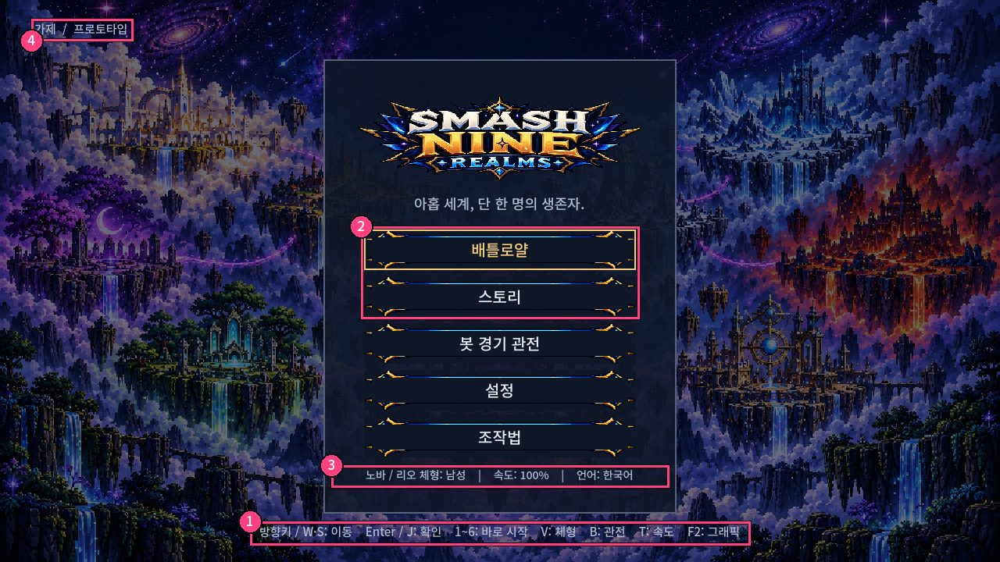

| | 문제 | 정도 |
|---|---|---|
| 1 | 맨 아래 조작 안내 한 줄이 배경 그림 위에 뒤판 없이 놓여 있다(15px, 옅은 색). 배경이 밝은 곳에서는 거의 안 읽힌다. **모든 메뉴 화면에 똑같이 있다** | 중간 |
| 2 | 버튼 틀이 위아래 장식 선뿐이고 옆선이 없어 버튼보다 "줄"로 보인다. 선택 표시는 장식과 결이 다른 노란 사각형이다 | 중간 |
| 3 | 패널 아래 상태 줄(14px). "노바 / 리오 체형: 남성"은 타이틀에서 무슨 뜻인지 알기 어렵다 | 낮음 |
| 4 | "가제 / 프로토타입" 표시(의도된 것, D41) | 낮음 |
| - | 처음 실행하면 영어다. 브라우저 언어를 보지 않고, 한국어는 설정에서 바꿔야 한다 | 중간 |
| - | 메뉴 다섯 줄의 무게가 같다. 구경용인 "봇 경기 관전"이 "배틀로얄"과 같은 크기다 | 낮음 |

### 2. 캐릭터 선택

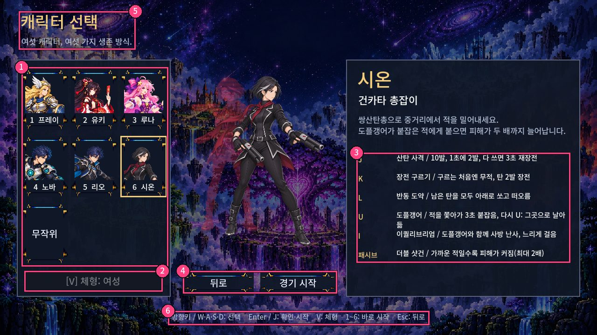

| | 문제 | 정도 |
|---|---|---|
| 1 | 초상 칸이 작다(100×132, 얼굴 84px). 6명 + 무작위 = 7칸이라 "무작위"가 셋째 줄에 혼자 남고 옆 두 칸이 빈다 | 중간 |
| 2 | 체형 버튼은 체형이 하나뿐인 캐릭터에서도 꺼진 채 자리를 차지한다 | 낮음 |
| 3 | 기술 설명이 15px이고, 두 줄이 되면 다음 줄과 붙는다(B6). 스킬 아이콘 30개가 있는데 여기서는 쓰지 않고 글자 "J / K / L"만 보인다 | 높음 |
| 4 | "경기 시작"이 작고(162px) 일러스트 아래에 있어 주된 버튼으로 보이지 않는다. "뒤로"와 모양이 같다 | 중간 |
| 5 | 제목과 부제가 밝은 은하 그림 위에 뒤판 없이 놓여 있다 | 낮음 |
| 6 | 조작 안내 줄(타이틀 1번과 같음) | 중간 |

기술 설명 칸을 한국어와 영어로 나란히 본 것입니다. 영어는 여섯 줄이 한 덩어리로 붙습니다.

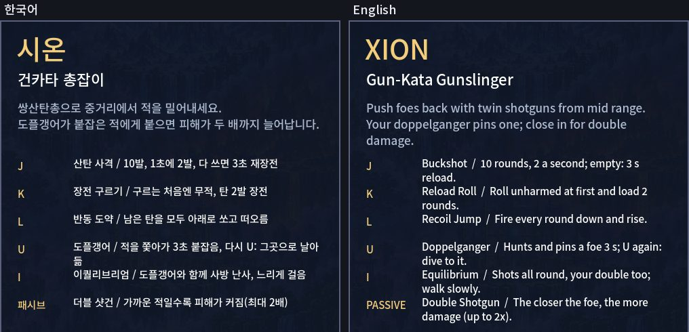

### 3. 설정

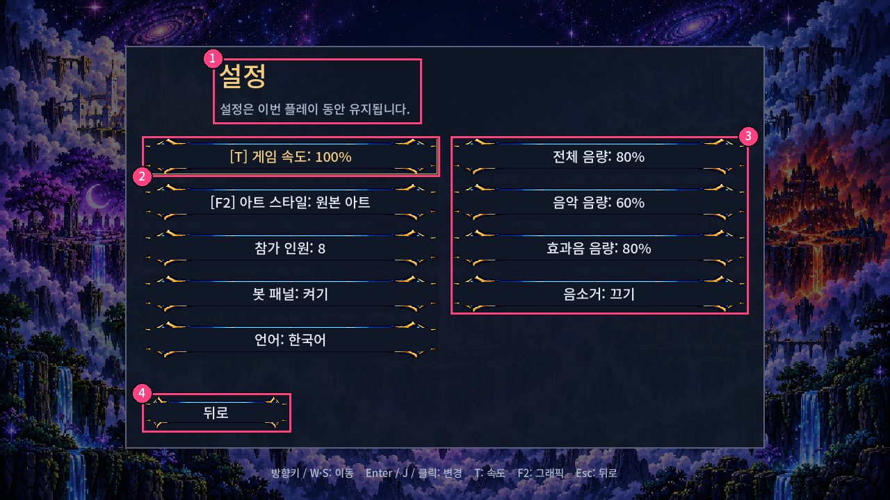

| | 문제 | 정도 |
|---|---|---|
| 1 | 제목 "설정"이 버튼 열(x 206)과 다른 자리(x 314)에서 시작한다. 안내 문구는 사실과 다르다(B5) | 중간 |
| 2 | 값을 바꾸는 줄이 이동 버튼과 똑같이 생겼다. 어디가 이름이고 어디가 값인지, 누르면 어떻게 되는지 보이지 않는다 | 중간 |
| 3 | 음량은 누를 때마다 10씩 오르기만 하고 100 다음에 0이 된다. 줄이려면 한 바퀴를 돌아야 한다 | 중간 |
| 4 | "뒤로"가 멀리 왼쪽 아래에 있고, 패널 오른쪽 아래가 비어 있다 | 낮음 |
| - | 개발용 항목(아트 스타일, 봇 패널)이 플레이어 설정과 섞여 있다 | 낮음 |

### 4. 조작법

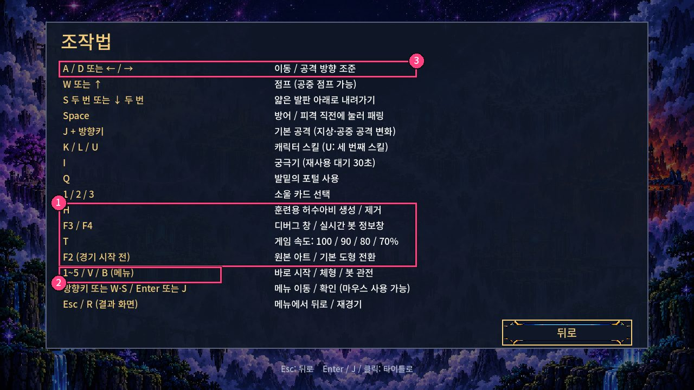

| | 문제 | 정도 |
|---|---|---|
| 1 | 개발용 키(H 허수아비, F3·F4, T 속도, F2 그림)가 플레이 키와 한 표에 섞여 있다 | 중간 |
| 2 | "1~5"는 6명이 된 뒤 안 고쳐진 글이다(B3) | 낮음 |
| 3 | 열여섯 줄짜리 글 표다. 이동·전투·메뉴 같은 묶음도, 키 모양 그림도 없고 오른쪽 절반이 비어 있다 | 중간 |

### 5. 경기 HUD

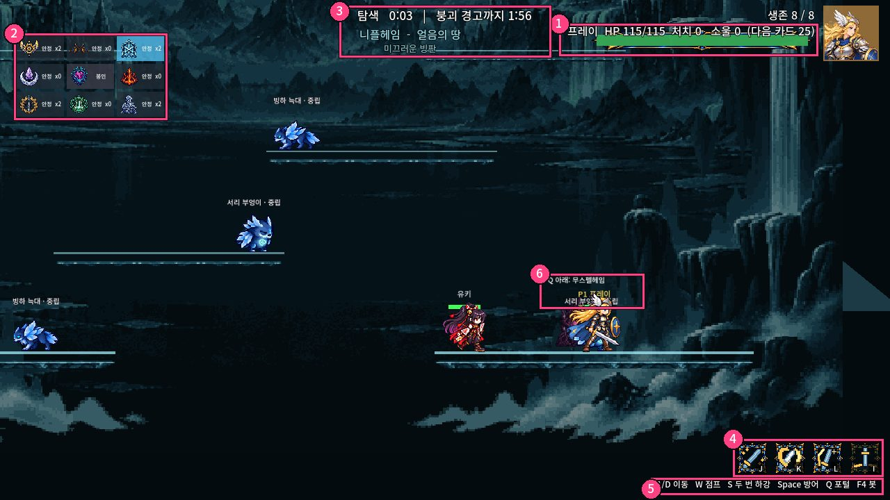

| | 문제 | 정도 |
|---|---|---|
| 1 | 내 상태 둘째 줄("프레이 HP 115/115 처치 0 소울 0 (다음 카드 25)")이 체력 막대와 겹친다(B7). 체력은 막대와 글자 두 번 나오는데 둘 다 읽기 어렵다 | 높음 |
| 2 | 미니맵 칸이 68×36이고 글자가 8px다. 렐름 상태를 색이 아니라 글자("안정", "봉인", "붕괴")로 읽어야 한다. 영어는 인원수가 잘린다(B2) | 높음 |
| 3 | 위 가운데 세 줄(시계 17px, 렐름 이름 16px, 위험 요소 13px). 렐름 색으로 칠한 글자라 배경이 같은 계열이면 흐려진다 | 중간 |
| 4 | 스킬 칸의 키 글자가 11px 배지다(궁극기 칸의 "I"는 거의 안 보인다). 칸 틀 가운데가 투명해 아이콘이 배경과 섞인다 | 중간 |
| 5 | 조작 줄이 12px이고 경기 내내 떠 있다. 개발용 "F4 봇"도 들어 있다 | 중간 |
| 6 | 머리 위 글자가 서로 겹친다. 내 이름 "P1 프레이", 몬스터 이름·상태, 포털 안내가 같은 자리에 쌓인다(월드 글자 12px에 카메라 0.85배) | 중간 |
| - | 소울은 성장의 중심인데 글자 한 줄 속 숫자다. 다음 카드까지 얼마나 남았는지 보여 주는 막대가 없다 | 중간 |
| - | 생존자 수("생존 8 / 8")는 배틀로얄의 중심 정보인데 오른쪽 위의 작은 글자다 | 중간 |

상태 글자와 체력 막대(2배 확대):

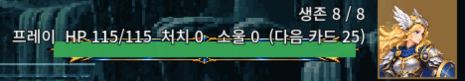

미니맵(3배 확대, 한국어와 영어):

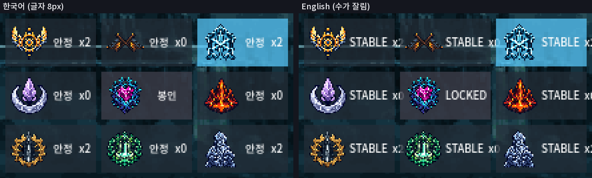

여섯 캐릭터의 스킬 바(2배 확대, 위부터 프레이·유키·루나·노바·리오·시온). 리오의 U 칸은 아이콘이 없어 글자만 나옵니다(「캐릭터 스킬 담당」의 Rio 그림 범위).

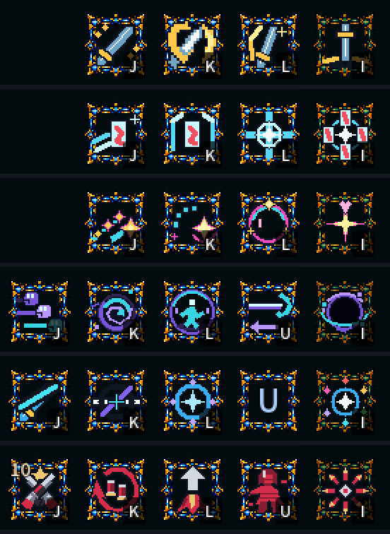

창이 작을 때의 모습입니다. 웹 빌드를 800×450 창으로 연 것이고, 글자가 0.625배가 되어 미니맵은 5px, 봇 패널은 6px가 됩니다. 처음 실행이라 영어입니다.

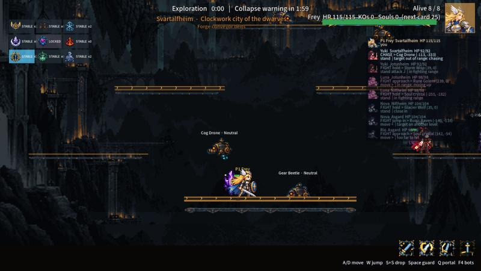

### 6. 봇 패널 (F4)

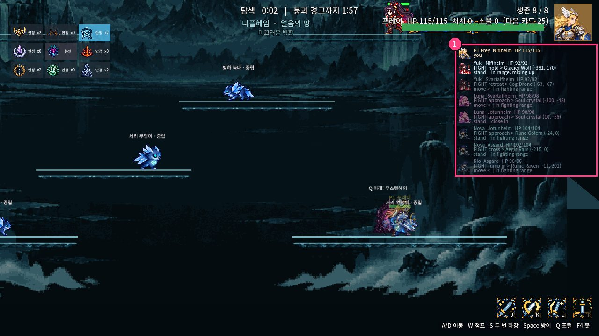

| | 문제 | 정도 |
|---|---|---|
| 1 | 개발용 표시인데 기본으로 켜져 있다(D29: "개발 테스트 중 기본으로 켬"). 10px 영어 글자가 화면 오른쪽 300px를 덮고, F3 디버그 창과 켜면 서로 겹친다. 한국어를 골라도 영어다 | 높음 |

테스트 중이라 켜 둔 결정이므로 버그는 아닙니다. 다만 새로 온 플레이어가 처음 보는 경기 화면이 이 모습입니다. **기본을 끌지는 사용자가 정할 일**입니다.

### 7. 소울 카드 고르기

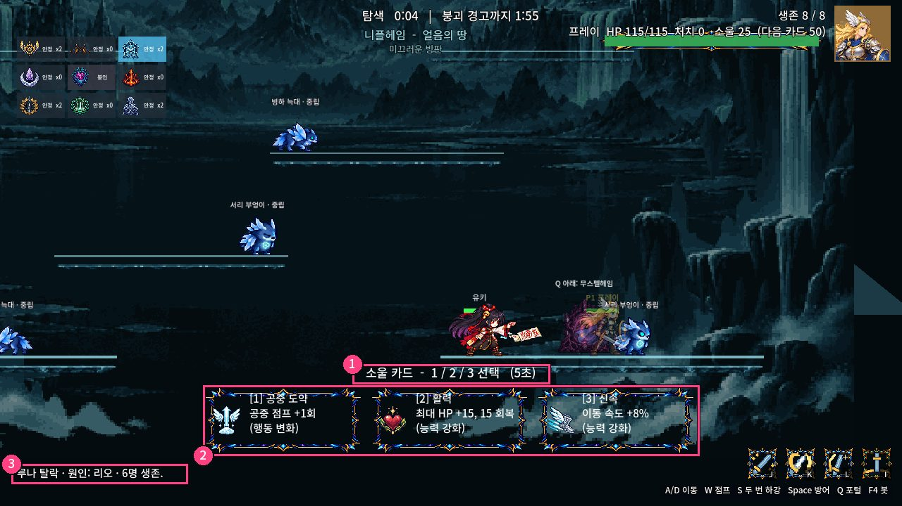

| | 문제 | 정도 |
|---|---|---|
| 1 | 5초 안에 골라야 하는데 남은 시간이 제목 속 "(5초)" 글자뿐이다. 줄어드는 막대가 없다 | 높음 |
| 2 | 카드 틀 가운데가 투명해서 글자가 배경·발판 위에 그대로 놓인다. 카드 제목은 틀 윗선과 겹친다. 카드는 224×96, 글자 15px다 | 높음 |
| 3 | 고른 결과와 다른 알림이 모두 왼쪽 아래 15px 한 줄로 나온다 | 중간 |
| - | 카드 종류가 괄호 글자("(행동 변화)", "(능력 강화)")다. 색이나 틀로 구분되지 않는다 | 중간 |
| - | 카드가 화면 아래 가운데에 떠서 바닥에서 싸우는 자리를 덮는다 | 중간 |

스토리 모드에서 카드가 발판 위에 놓인 모습(2배 확대):

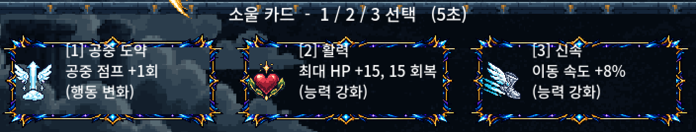

카드 고르기는 「시스템 담당」의 소울 카드 풀 작업과 겹칩니다. 고치기 전에 총괄에게 알립니다.

### 8. 경고와 알림

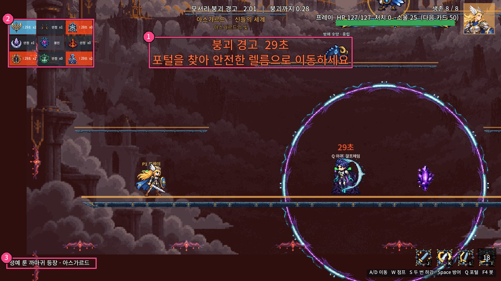

| | 문제 | 정도 |
|---|---|---|
| 1 | 붕괴 경고(30px 주황)가 붉게 물든 화면 위에 뒤판 없이 놓여 대비가 약하다. 경기에서 가장 급한 정보다 | 높음 |
| 2 | 미니맵의 경고 칸도 8px 글자("! 29초 x2")다. 어느 렐름이 안전한지 한눈에 보이지 않는다 | 높음 |
| 3 | 정예 등장, 탈락, 붕괴, 카드 결과가 모두 같은 자리 같은 크기(왼쪽 아래 15px, 4초)로 나온다. 중요한 것과 덜 중요한 것이 구분되지 않는다 | 중간 |

### 9. 궁극기 컷인

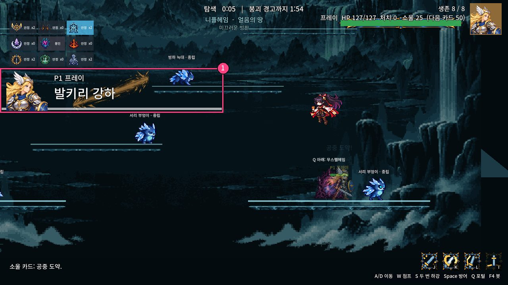

| | 문제 | 정도 |
|---|---|---|
| 1 | 띠 그림이 붓 자국 한 줄이라 거의 보이지 않고, 아래의 회색 줄만 눈에 띈다. 얼굴과 글자가 허공에 떠 있는 모양이다. 띠가 캐릭터 색을 받도록 만들어졌지만 그 색이 보이지 않는다 | 중간 |

### 10. 여럿이 싸울 때

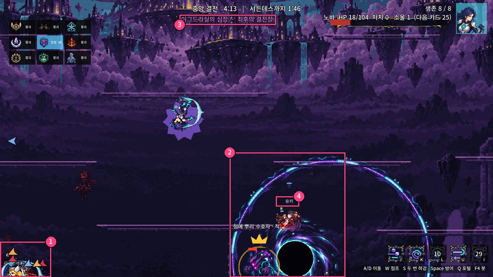

| | 문제 | 정도 |
|---|---|---|
| 1 | 화면 밖 상대 화살표가 작고(25px), 같은 쪽에 여럿이면 한 점에 겹친다. 색만으로는 누구인지 알기 어렵다 | 중간 |
| 2 | 스킬 바와 조작 줄이 화면 아래의 싸움과 겹친다 | 중간 |
| 3 | 렐름 이름이 분홍 글자인데 배경도 보라·분홍이다 | 낮음 |
| 4 | 머리 위 이름이 작은 회색 글자다. 여덟 명이 섞이면 내 캐릭터를 찾을 단서가 금색 "P1" 글자 하나다 | 높음 |

### 11. 탈락한 뒤 (관전)

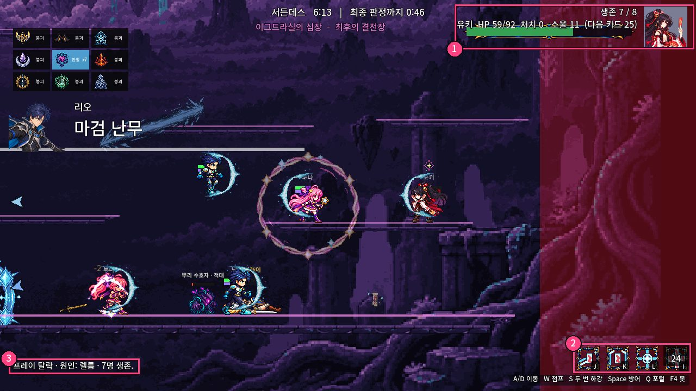

| | 문제 | 정도 |
|---|---|---|
| 1 | 탈락하면 "관전 중" 표시 없이 오른쪽 위가 봇의 이름·체력으로 바뀐다. 내가 죽었는지, 지금 누구를 보는지 헷갈린다 | 중간 |
| 2 | 스킬 바도 봇의 것으로 바뀐다 | 낮음 |
| 3 | 탈락 소식이 왼쪽 아래 한 줄이다("프레이 탈락 · 원인: 렐름 · 7명 생존.") | 중간 |

### 12. 넓은 창 (1470×720)

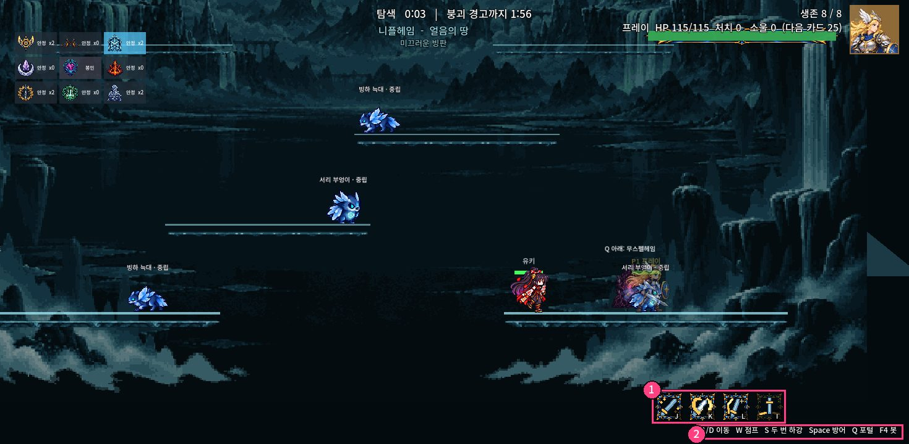

| | 문제 | 정도 |
|---|---|---|
| 1·2 | 스킬 바가 오른쪽 끝에 붙지 않는다(B1). 조작 줄은 끝에 붙어서 둘이 어긋난다 | 높음 |
| - | 메뉴 화면은 가운데 1280 폭 안에 그대로 있고 배경 그림만 가로로 늘어난다(그림이 15% 넓어짐) | 낮음 |

### 13. 결과 화면

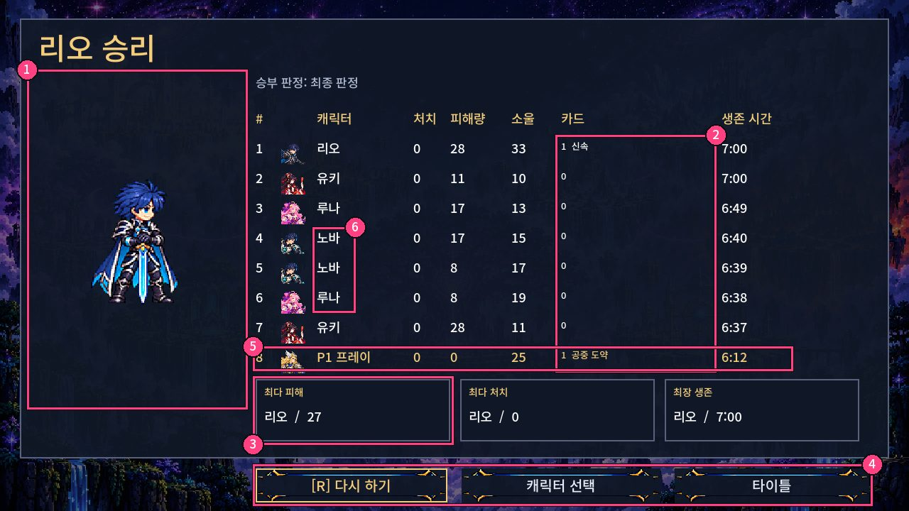

| | 문제 | 정도 |
|---|---|---|
| 1 | 우승 동작 그림이 작다. 높이 478px 칸에 약 175px로 서 있고 주변이 비어 있다 | 중간 |
| 2 | 카드 열만 글자가 13px이고 다른 칸보다 위로 치우쳐 있다. 옆 열과의 사이가 크게 빈다 | 낮음 |
| 3 | "최다 피해" 숫자가 표와 1 다르다(B4) | 낮음 |
| 4 | 버튼 세 개가 패널 밖 아래에 걸쳐 있다 | 낮음 |
| 5 | 내 순위가 금색 줄 하나로만 표시된다. "8위" 같은 큰 표시가 없어서 졌을 때는 남의 승리 화면처럼 보인다 | 중간 |
| 6 | 같은 캐릭터가 둘씩 나오면 이름만으로 구분되지 않는다(노바·노바, 루나·루나). 16인이 되면 더 심해진다 | 중간 |

### 14. 스토리: 주인공 선택

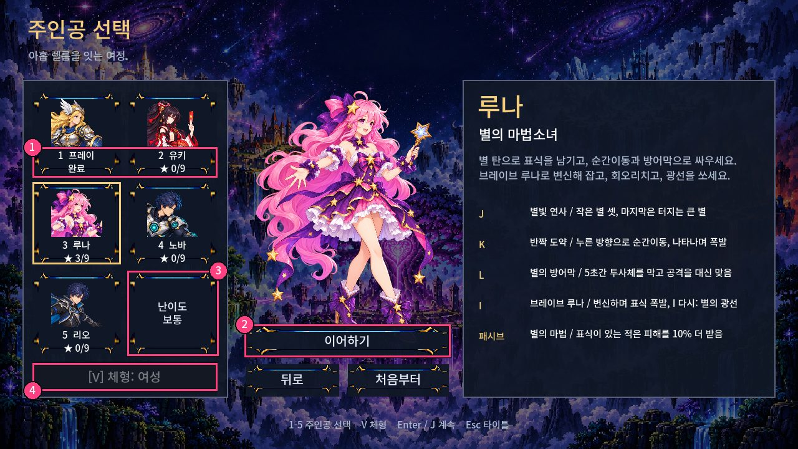

| | 문제 | 정도 |
|---|---|---|
| 1 | 진행도 글자("★ 3/9", "완료")가 칸 아래 장식과 겹친다 | 낮음 |
| 2 | "이어하기" 버튼이 일러스트의 발을 가린다 | 낮음 |
| 3 | 난이도 칸이 캐릭터 칸과 똑같이 생겼다 | 낮음 |
| 4 | 체형 버튼(캐릭터 선택 2번과 같음) | 낮음 |

### 15. 스토리: 지도

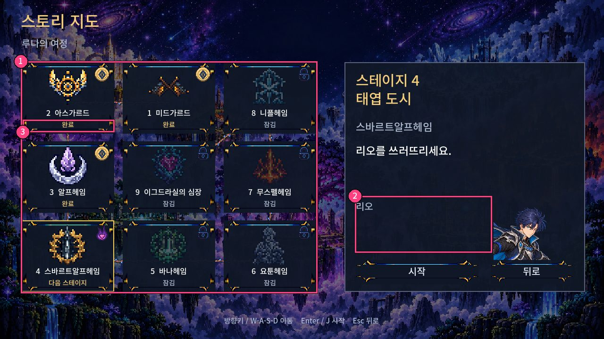

| | 문제 | 정도 |
|---|---|---|
| 1 | 칸 번호가 2·1·8 / 3·9·7 / 4·5·6 순서다(렐름의 실제 자리를 따름). 길 그림은 칸 사이 틈에만 보여서 다음 스테이지를 눈으로 따라가기 어렵다 | 중간 |
| 2 | 오른쪽 패널 가운데가 비어 있고 "리오"가 목표 문장과 그 아래에 두 번 나온다 | 낮음 |
| 3 | 칸 상태 글자가 14px다. 영어는 "CLEAR"만 대문자다 | 낮음 |

### 16. 스토리: 시작 카드

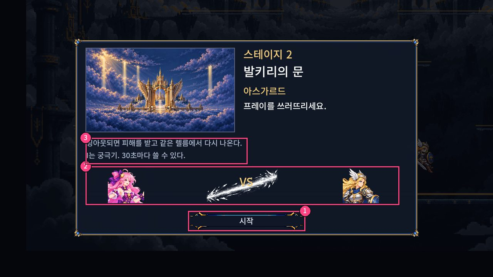

| | 문제 | 정도 |
|---|---|---|
| 1 | 2.5초 뒤에 저절로 넘어간다. 그 표시가 없어서 팁 두 줄을 읽다가 화면이 바뀐다 | 중간 |
| 2 | VS 띠가 흰 붓 자국이고 두 얼굴이 작다(94px) | 낮음 |
| 3 | 팁 글자가 옅은 색이다 | 낮음 |

### 17. 스토리: 대화

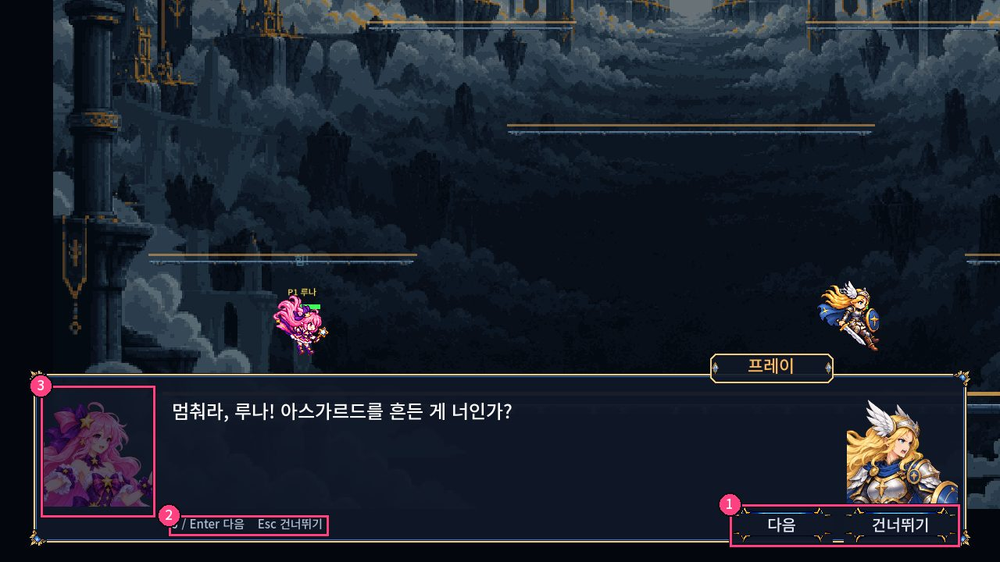

| | 문제 | 정도 |
|---|---|---|
| 1 | "다음", "건너뛰기" 버튼의 뒤판이 대화 상자의 아래 테두리를 끊는다 | 낮음 |
| 2 | 조작 안내가 15px 옅은 글자다 | 낮음 |
| 3 | 얼굴 그림이 틀 없이 사각형으로 잘려 있다 | 낮음 |

게임에서 가장 완성된 화면입니다. 틀·이름판·글자 크기(24px)·말하는 쪽 강조가 모두 한 가지 결로 맞아 있습니다.

### 18. 스토리: 전투 HUD

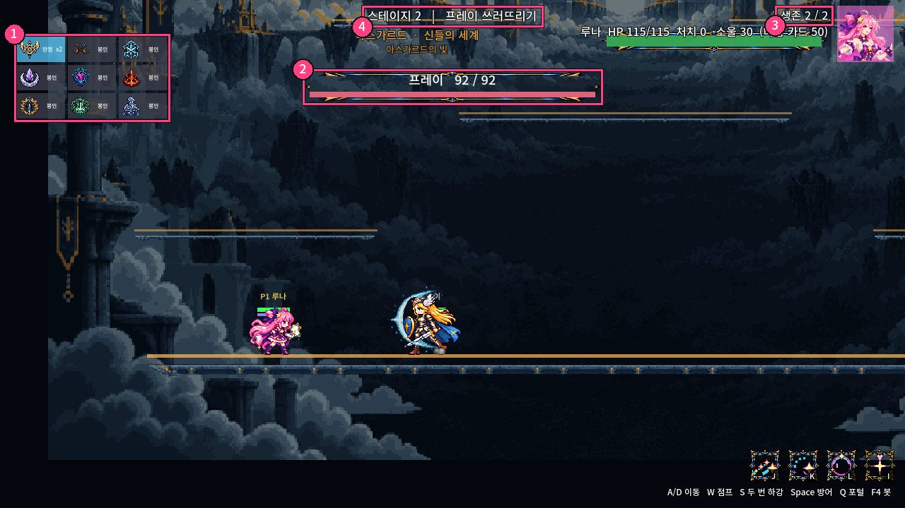

| | 문제 | 정도 |
|---|---|---|
| 1 | 스토리에서도 미니맵이 나온다. 한 칸 말고는 모두 "봉인"이라 쓸 정보가 없다 | 중간 |
| 2 | 라이벌 체력 막대: 이름이 틀 장식과 겹치고, 막대 자체는 높이 8px다 | 중간 |
| 3 | "생존 2 / 2"는 스토리에서 뜻이 없다 | 낮음 |
| 4 | 목표("프레이 쓰러뜨리기", "출구 포털 ↓ Q")가 위쪽 17px 글자 한 줄이다. 출구가 열려도 포털을 가리키는 표시가 없다 | 중간 |

### 19. 스토리: 붕괴 탈출 (스테이지 5)

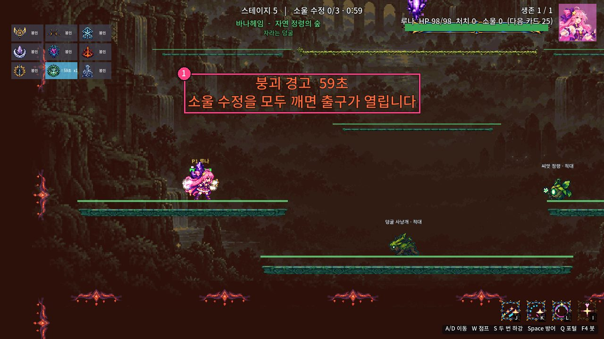

| | 문제 | 정도 |
|---|---|---|
| 1 | 경고 글자의 대비(8번의 1과 같음). 남은 시간이 위쪽 작은 글자와 가운데 경고 두 곳에 나뉘어 나온다 | 높음 |

### 20. 스토리: 일시정지, 결과, 엔딩

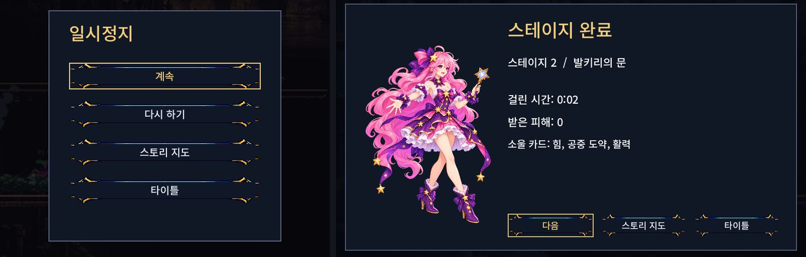

| | 문제 | 정도 |
|---|---|---|
| - | 큰 문제는 없다. 스토리 결과는 일러스트를 쓰고 배틀로얄 결과는 픽셀 동작을 써서 두 결과 화면의 구성이 다르다 | 낮음 |
| - | 스토리 결과 화면 오른쪽 아래가 비어 있다(기록이 세 줄뿐) | 낮음 |

## 화면을 가로지르는 문제

| | 문제 | 근거 |
|---|---|---|
| X1 | **글자 크기에 기준이 없다** | UI 코드(`scripts/ui/`)에 8px부터 48px까지 24가지 크기가 있다. HUD 글자 18종 가운데 16px 미만인 것 9종: 미니맵 8, 봇 패널 10, 스킬 키 11, 조작 줄 12, 위험 요소 13, 탄 수 13, 디버그 창 13, 카드 글 15, 알림 15 |
| X2 | **글꼴과 그림의 결이 다르다** | 글꼴은 Noto Sans KR(매끈한 고딕, 굵기 500 하나)이고, 캐릭터·틀·아이콘은 픽셀 그림이다. 굵기가 하나라 제목과 본문을 크기와 색으로만 가른다 |
| X3 | **틀 그림의 가운데가 비어 있다** | HUD 틀 5종(`assets/art/ui/frames/`)은 가운데가 투명한 테두리 그림이다(카드 틀 83%, 스킬 칸 73%가 투명). 뒤판을 따로 깔지 않은 카드와 스킬 칸에서는 글자·아이콘이 배경과 섞인다. 메뉴 버튼 틀은 옆선이 없다 |
| X4 | **색 대비를 배경에 맡긴다** | HUD 글자는 검은 외곽선 4px에 기대고 뒤판이 없다. 렐름 이름은 렐름 색, 경고는 주황이라 배경이 같은 계열이면 묻힌다 |
| X5 | **중요도가 크기·자리로 드러나지 않는다** | 내 체력, 생존자 수, 다음 붕괴, 소울, 목표가 모두 16~17px 글자다. 가장 큰 HUD 요소는 얼굴 그림(80px)과 스킬 칸(48px)이다 |
| X6 | **개발용 표시가 기본 화면에 섞여 있다** | 봇 패널(기본 켬), 조작 줄의 "F4 봇", 조작법의 개발 키 4줄, 설정의 아트 스타일·봇 패널, 타이틀의 "봇 경기 관전" |
| X7 | **창 모양에 따라 달라진다** | 메뉴는 1280×720 틀을 가운데 두고 배경만 늘린다. HUD는 가장자리에 붙는다(스킬 바만 빠짐, B1). 창이 작으면 글자가 같은 비율로 줄어든다 |
| X8 | **표기가 흔들린다** | "1~6" / "1-5", "Enter / J: 확인" / "Enter / J 계속"(쌍점 있음·없음), 영어 "CLEAR" / "Locked" |

한국어와 영어가 섞인 곳은 개발용 표시(봇 패널, F3 디버그 창)뿐입니다. 플레이어가 보는 글은 두 언어 모두 빠짐없이 번역되어 있습니다.

## 잘 되어 있는 것 (그대로 둘 것)

- 타이틀 배경 그림과 로고, 캐릭터 일러스트와 얼굴 그림
- 스토리 대화 상자(틀, 이름판, 말하는 쪽 강조)와 시작 카드(스테이지 그림)
- 스킬 아이콘 30개, 렐름 문장 9개, 카드 아이콘 6개
- 궁극기 컷인의 생각(캐릭터 색 띠에 얼굴과 기술 이름)
- 결과 화면에 들어 있는 정보(순위, 기록, 상 3개)
- 남색 바탕에 금색 강조라는 기본 색

## 다른 세션에 알릴 것

| 누구 | 내용 |
|---|---|
| 캐릭터 스킬 담당 | 리오의 U 스킬 아이콘(`rio_u.png`)이 없어 스킬 바에 글자 "U"만 나온다(총괄이 전함) |
| 시스템 담당 | 소울 카드 고르기 화면(7번)과 메뉴 항목은 카드 풀·연습 모드 작업과 겹친다. 고치기 전에 총괄을 거친다 |
| 총괄 | 렐름 배경 그림이 카메라 가장자리 여백(80px)을 채우지 못해 화면 옆에 빈 띠가 보인다(아스가르드 왼쪽 68px, 니플헤임 오른쪽의 삼각형) → B8로 고침 |
| 총괄 | 넓은 창 캡처 중 `Nova.gd:717 _spin_caught`에서 엔진 오류가 한 번 났다. D53에 적힌 "Nova 구체에 잡힌 몬스터가 사라질 때의 엔진 오류"(`lead/bot-kits`에서 고침)로 보인다 |

## 다음 단계

1. 사용자의 답(특히 불편한 화면)을 받는다.
2. 개선 방향 시안 2~3개를 실제 경기 화면 위에 만들어 시안 월드컵에 올린다(`reports/ui-direction-2026-11-25/`).
3. 사용자가 고른 방향만 게임에 넣는다.
