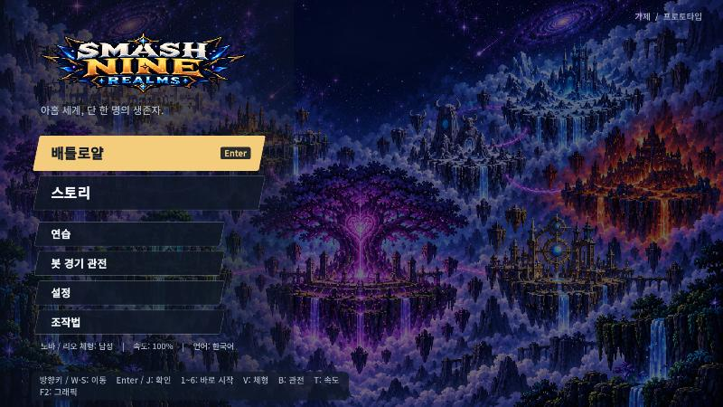

# UI 점검의 "중간" 항목 고치기 (2026-11-27, UI·디자인 담당)

「총괄」 지시로, UI 점검(`reports/ui-audit-2026-11-25/`)의 "중간" 항목 가운데 새 그림 없이 고칠 수 있는 것을 플레이어가 자주 보는 화면부터 묶음별로 고칩니다. 묶음마다 run_all → 병합 → 알림입니다.

문장 끝의 표시: **[잼]** 은 검사나 캡처로 확인한 것, **[코드]** 는 코드에서 읽은 것, **[추정]** 은 확인하지 않은 것입니다.

## 이미 풀린 "중간" 항목 (오늘까지의 일로)

버튼 틀(1-2), 캐릭터 칸과 무작위 자리(2-1), 작은 시작 버튼(2-4), 설정 제목 자리(3-1), 조작법의 빈 오른쪽(4-3의 일부), 위쪽 시계·렐름 글자(5-3), 스킬 키 글자 크기(5-4), 소울 막대(5-"-"), 생존자 수(5-"-"), 화면 밖 표시(10-1), 관전 표시(11-1), 라이벌 체력 막대(18-2). 경기 HUD B, 메뉴 B, 나머지 화면 B, 게임패드 화면에서 함께 풀렸습니다. [코드]

## 고를 것과 순서

| 묶음 | 항목 | 화면 |
|---|---|---|
| 1 | 13-5 내 순위를 크게, 13-1 우승 동작 그림 키우기 | 경기 결과 (경기마다) |
| 1 | 1-1·2-6 등 키 안내 줄에 뒤판 | 모든 메뉴 |
| 1 | 1-"-" 처음 실행할 때 언어 | 첫 실행 |
| 2 | 3-3 음량을 ←/→로 줄이고 올리기 | 설정 |
| 2 | 4-1 개발용 키를 따로 묶기 | 조작법 |
| 2 | 16-1 2.5초 뒤 넘어감을 보여 주는 막대 | 스토리 시작 카드 |

뺀 것: 조작 안내 줄과 카드 자리(5-5, 10-2, 사용자 결정 #231 대기), 스토리의 미니맵(18-1, 정할 일), 설정의 이름/값 나누기(3-2, 검사가 버튼 글 전체를 읽어 따로 정리), 지도의 길(15-1, 고르신 그림), 결과의 같은 캐릭터 구분(13-6, 방법 미정), 알림 크기 나누기(8-3, HUD B 알림 줄로 일부 풀림).

## 묶음 1

### 경기 결과: 내 순위와 우승 동작

- 오른쪽 위에 "내 순위 3 / 8"을 판 위에 크게 둡니다. 1위면 금색 글자와 금색 테두리입니다. 봇 경기 관전에는 나오지 않습니다. 졌을 때 남의 승리 화면처럼 보이던 문제(13-5)입니다. [잼]
- 우승 동작 그림을 정수 배율로 키웠습니다(192px 칸이면 2배). 478px 자리에 약 175px로 서 있던 것(13-1)이 지금은 약 250px입니다. 칸의 빈 가장자리가 자리 옆으로 나가도 오른쪽은 순위표 판이 덮습니다. [잼: 그림] [코드: 배율]

### 모든 메뉴: 키 안내 줄의 뒤판

- 타이틀처럼 키 안내 줄을 어두운 판 위에 둡니다. 판은 글자 폭만큼이고, 오른쪽 위 안내는 오른쪽 끝에 붙습니다. 밝은 그림 위에서 15px 옅은 글자가 안 읽히던 문제(1-1)입니다. 캐릭터 선택, 설정, 조작법, 스토리 화면 모두입니다. [잼]

### 처음 실행할 때의 언어

- 저장된 언어가 없을 때(처음 실행) 브라우저나 OS의 언어가 한국어면 한국어로, 아니면 영어로 시작합니다. 전에는 언제나 영어였고 한국어는 설정에서 바꿔야 했습니다. 고르는 순간까지는 아무것도 저장하지 않습니다. [코드]
- 검사 실행은 전처럼 영어입니다. [코드]
- 웹에서 엔진이 넘기는 언어는 브라우저가 고른 첫째 언어(`navigator.languages[0]`)입니다(엔진 스크립트의 설정 부분). [코드]
- 웹 빌드로 세 경우를 봤습니다. 저장이 비어 있는 새 주소는 주소만 바꿔 열었습니다. [잼]
  1. 새 주소(127.0.0.1:8063)에 브라우저 언어 한국어: 첫 화면이 한국어였습니다(탭 제목도 "스매시 나인 렐름즈 프로토타입").
  2. 또 다른 새 주소([::1]:8063)에 브라우저 언어를 영어로 흉내: 영어였습니다.
  3. 전에 쓰던 주소(localhost:8063, 저장 공간에 고른 언어가 있음)에 브라우저 언어 한국어: 영어였습니다. 저장된 선택이 먼저입니다.

### 검사

| 검사 | 결과 |
|---|---|
| `test_menu_text` | 통과. 새로 넣은 확인: 결과에 내 순위(1위, 4위, 관전에는 없음), 바뀐 화면 30개의 키 안내가 판 위에 있고 제자리 폭 안에 있음 [잼] |
| `test_language` | 통과. 처음 언어 고르기: ko → 한국어, en → 영어, ja·빈 값 → 영어 [잼] |
| `test_victory_screens`, `test_frontend_flow`, `test_story_flow`, `test_gamepad` | 통과 [잼] |
| 전체 | run_all ALL PASSED: 검사 66개와 긴 경기 1판, 36분(`00743caa`, 18:18~18:54) [잼] |

### 웹 빌드

- 47,169,927바이트로, 예산 45 MiB까지 15,993바이트 남습니다. 묶음 1이 약 1.6 KB를 썼습니다(새 글 한 줄 "내 순위"와 코드). [잼]

### 찍은 방법

- 게임 창을 화면 밖 자리(`--position -4000,-4000`)에 띄워 찍었습니다. PC를 2분 전에 누가 써서, 화면을 가리지 않으려고 이렇게 했습니다. "전"은 묶음 1 직전(main `a6b49051`과 같은 화면)에 찍은 것입니다. [잼]

## 병합

- 묶음 1 커밋: `00743caa`, 그리고 이 보고서. 병합 전 main(`af0511be`)과의 시험 병합에 충돌이 없었습니다(그사이 main은 로드맵뿐). main 병합 커밋 번호는 「총괄」에게 알렸습니다. [잼]
