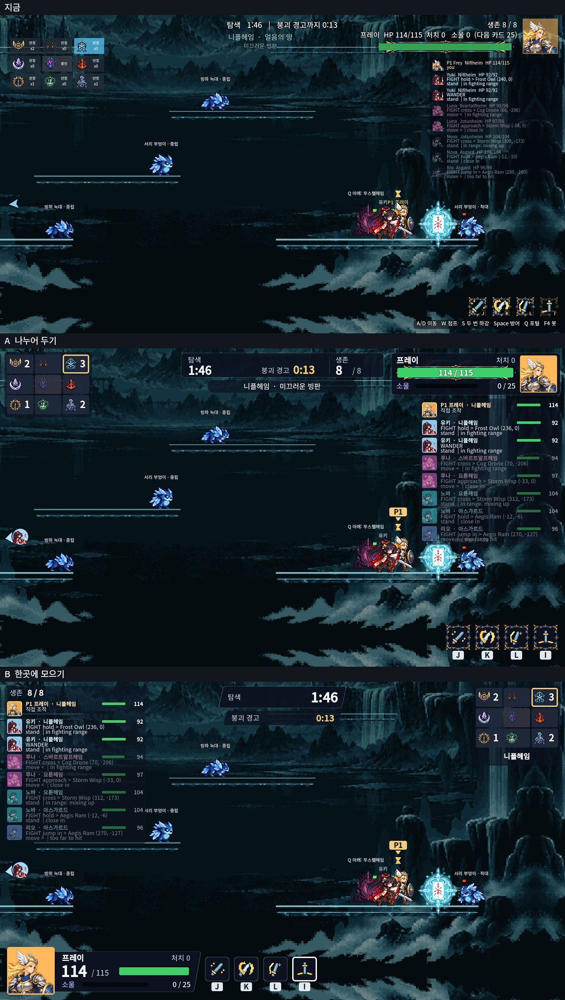
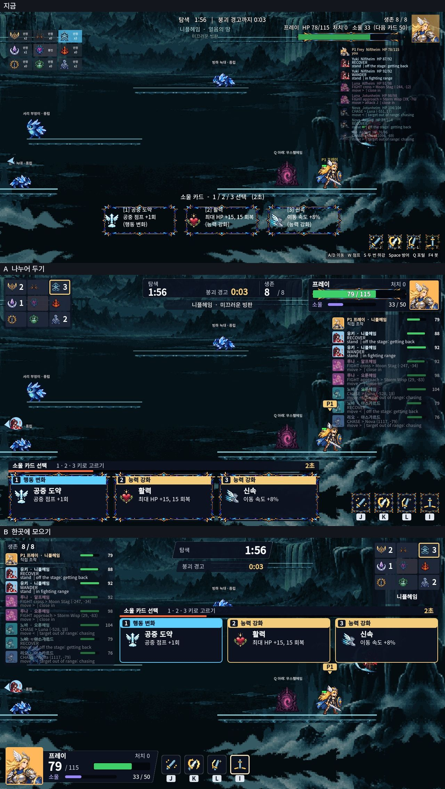
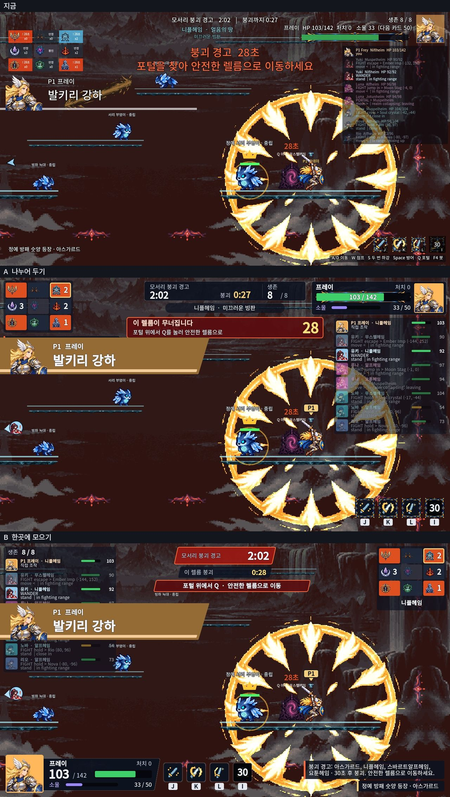
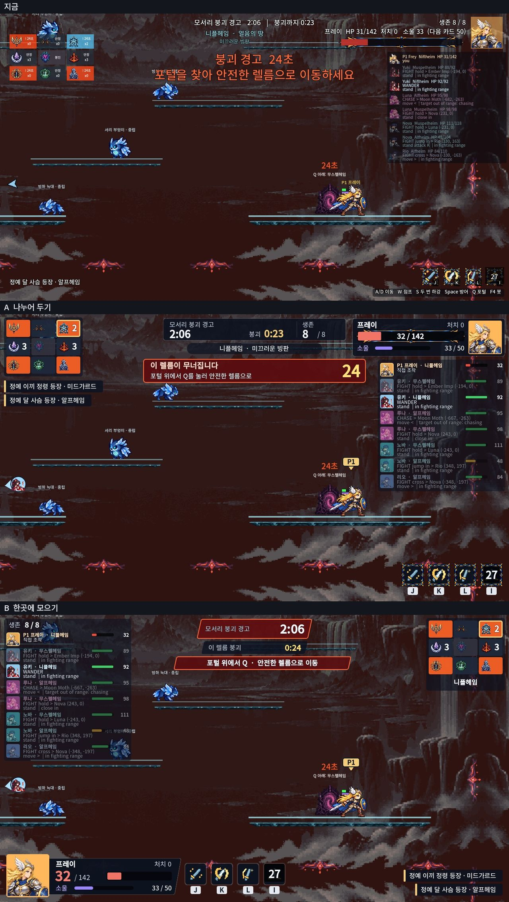
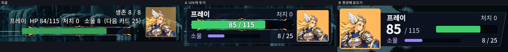
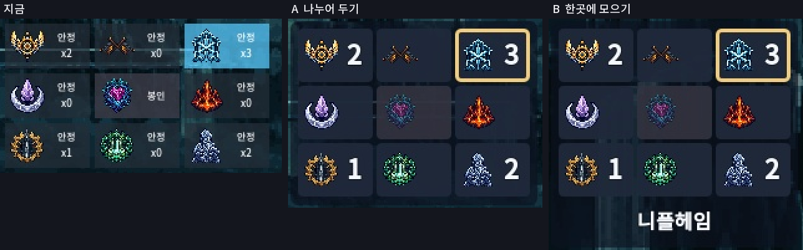
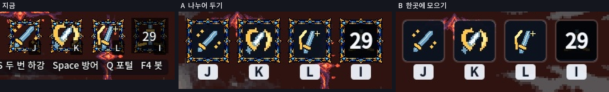
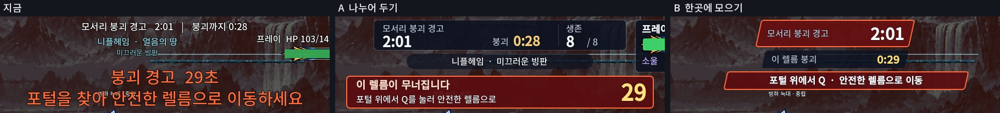
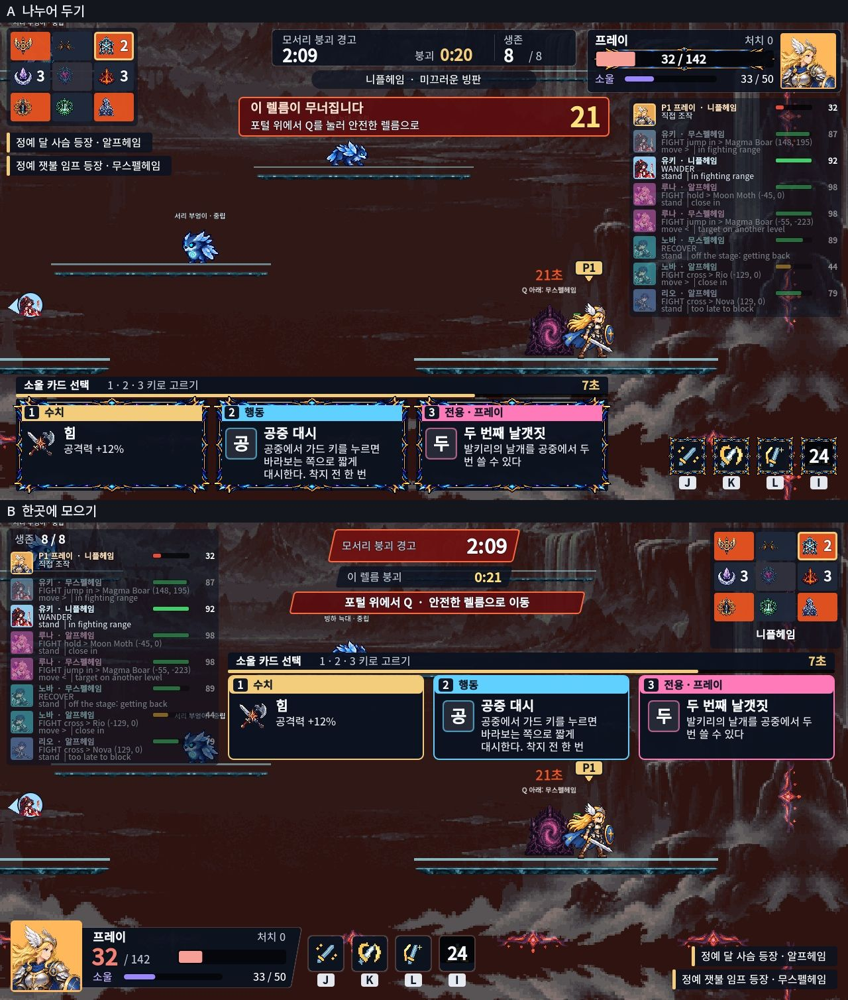

# 경기 HUD 방향 시안 (2026-11-25)

「UI·디자인 담당」 2단계입니다. 화면 점검(`reports/ui-audit-2026-11-25/`)에서 가장 손이 필요했던 **경기 HUD**를 어느 방향으로 고칠지 고르는 시안입니다. 메뉴 화면(타이틀·선택·설정·결과)은 이 방향이 정해진 뒤 다음 라운드로 올립니다.

## 정하실 것

1. **방향 고르기:** 시안 월드컵 https://claude.ai/artifact/B6VxzHK5etStnhK7L3bFAx 의 라운드 `2026-11-25-ui`에서 고릅니다. 항목 3개, 항목마다 3경기(지금 대 A, 지금 대 B, A 대 B)로 모두 9경기입니다.
2. **조작 줄을 남길지:** 두 시안에서는 오른쪽 아래의 조작 줄("A/D 이동 W 점프 …")을 빼고, 스킬 칸 아래에 키만 남겼습니다. 이 줄은 2026-10-08에 요청하신 것(D29)이라 빼는 것은 사용자가 정할 일입니다. 남긴다면 16px로 키워 경기 시작 뒤 20초 동안만 보이게 하는 것을 제안합니다.

항목마다 다른 안을 골라도 됩니다. 자리(어디에 둘지)와 모양(픽셀 틀인지 평평한지)은 따로 조합할 수 있습니다. 메모 칸에 "자리는 B, 모양은 A"처럼 적어 주시면 그대로 합칩니다.

## 보는 법

화면 전체를 찍은 영상이라 반으로 나누면 글자가 읽히지 않습니다. 그래서 이번 라운드는 **한 번에 한 시안만 원래 크기로** 보입니다.

- `Tab` 키나 영상을 누르면 같은 순간의 A와 B가 바뀝니다. 두 영상은 함께 재생되므로 바꿔도 장면이 어긋나지 않습니다.
- A와 B를 모두 한 번씩 본 뒤에 고를 수 있습니다. 고르기는 `←`(A) `↓`(비김) `→`(B)입니다.
- 느리게 보려면 속도 ½·¼을 누릅니다.

## 두 방향

같은 생각을 세게·약하게 한 것이 아니라, 정보를 두는 자리가 다른 두 가지입니다.

| | 지금 | A 나누어 두기 | B 한곳에 모으기 |
|---|---|---|---|
| 생각 | - | 지금 자리를 그대로 두고 또렷하게 | 내 정보를 한곳에 모으고 위는 가볍게 |
| 내 체력·소울 | 오른쪽 위, 글자 한 줄 + 막대 | 오른쪽 위 판. 숫자는 막대 안(18px), 소울은 다음 카드까지의 막대 | 왼쪽 아래. 체력은 큰 숫자(34px) + 막대, 소울 막대 |
| 스킬 | 오른쪽 아래, 48px 칸 | 오른쪽 아래, 56px 칸 + 칸 아래 키 | 왼쪽 아래(내 정보 옆), 56px 칸 + 키 |
| 시계 | 위 가운데, 글자 세 줄 | 위 가운데 판: 시간, 다음 일까지, 생존자 수 | 위 가운데 작은 판: 시간, 다음 일까지 |
| 지도 | 왼쪽 위, 글자로 상태 표시(8px) | 왼쪽 위, 색과 인원수(21px) | 오른쪽 위, 색과 인원수 + 지금 있는 렐름 이름 |
| 렐름·위험 요소 이름 | 위 가운데 두 줄 | 시계 아래 한 줄("니플헤임 · 미끄러운 빙판") | 지도 아래에 렐름 이름만(위험 요소 이름은 뺌) |
| 다른 참가자 | 봇 패널(10px, 영어) | 봇 패널을 내 정보 아래에(12px) | 왼쪽 위에 얼굴 띠(봇 패널을 켜면 펼친 목록) |
| 소울 카드 | 아래 가운데, 속이 빈 틀 | 아래 왼쪽, 기존 틀에 속을 채움 | 위쪽(시계 아래), 평평한 카드 |
| 붕괴 경고 | 주황 글자 두 줄 | 시계 아래 붉은 판 + 큰 숫자(40px) | 시계가 붉게 바뀌고 남은 시간 표시 + 할 일 한 줄 |
| 알림 글 | 왼쪽 아래 한 줄 | 지도 아래에 최대 3줄, 종류별 색 띠 | 오른쪽 아래에 최대 3줄, 종류별 색 띠 |
| 모양 | 픽셀 틀(속이 빔) | 픽셀 틀 + 어두운 바탕 | 틀 없이 평평하고 기울어진 판 |

### 두 안에 똑같이 들어간 것

어느 쪽을 골라도 들어갑니다. 점검에서 "높음"으로 적은 문제들입니다.

- **내 캐릭터 위의 P1 표시.** 작은 금색 글자 대신 금색 꼬리표가 머리 위를 따라다닙니다.
- **화면 밖 상대의 얼굴 표시.** 화살표만 있던 자리에 얼굴과 방향이 함께 나오고, 겹치면 옆으로 벌어집니다.
- **색과 숫자만 쓰는 지도.** "안정", "봉인" 글자를 없애고 붕괴 경고는 주황, 붕괴는 검정, 지금 있는 곳은 금색 테두리로 보입니다.
- **소울 카드:** 속이 찬 바탕, 종류별 색 머리띠, 줄어드는 시간 막대, 번호 키 표시. 막대는 게임의 고르는 시간 값을 읽으므로 5초가 8초로 바뀌어도(D54) 그대로 맞습니다.
- **궁극기 띠:** 캐릭터 색의 기울어진 띠 위에 얼굴과 기술 이름.
- **글자 크기:** 경기 중 글자는 모두 16px 이상입니다(봇 패널만 12px). 지금은 8px부터 있습니다.
- **한국어 줄바꿈:** 낱말 가운데서 끊기지 않고 띄어쓰기에서 끊깁니다.
- 탈락한 뒤 남을 볼 때는 이름 앞에 "관전"이 붙습니다.

## 같은 장면, 세 가지 HUD

모두 같은 경기의 같은 순간입니다. 프레이가 니플헤임에서 싸우고, 봇 패널은 켠 상태입니다.

### 평상시



### 소울 카드 고르기



### 붕괴 경고와 궁극기



### 체력이 낮을 때



## 자세히 (2배 확대)

내 체력과 소울:



지도:



스킬 칸(궁극기 쿨다운 중):



붕괴 경고(원래 크기):



## 새 카드 풀(D54)에 맞는지

D54에서 카드가 19장, 종류가 셋(수치·행동·전용), 고르는 시간이 8초가 됩니다. 가장 긴 문구("공중에서 가드 키를 누르면 바라보는 쪽으로 짧게 대시한다. 착지 전 한 번")와 아이콘이 아직 없는 카드를 두 시안에 넣어 본 것입니다. 실제 카드가 아니라 모양만 본 그림입니다.



- 세 종류는 머리띠 색으로 가릅니다: 수치는 금색, 행동은 하늘색, 전용은 분홍.
- 긴 문구는 세 줄까지 들어갑니다. 영어는 넣어 보지 않았습니다.
- 아이콘이 없는 카드는 이름 첫 글자를 칸에 넣었습니다(D54: 새 카드는 임시 글자로 시작).

카드 내용과 규칙은 「시스템 담당」 몫이고, 이 화면은 두 세션이 겹칩니다. 방향이 정해지면 넣기 전에 서로 알립니다.

## 숫자로 본 차이

| | 지금 | A | B |
|---|---|---|---|
| 경기 중 가장 작은 글자 | 8px (지도) | 16px | 16px |
| 봇 패널 글자 | 10px | 12px | 12px |
| HUD가 덮는 넓이 (봇 패널 제외) | 약 8% | 약 13% | 약 15% |
| 봇 패널이 덮는 넓이 | 약 9% | 약 11% | 약 12% |
| 새로 필요한 그림 | - | 없음 (기존 틀 사용) | 없음 |

- 넓이는 각 요소의 사각형 넓이를 더해 1280×720으로 나눈 어림값입니다. 지금 HUD는 글자 뒤에 판이 없어 실제로 가리는 넓이는 이보다 적습니다.
- 두 안 모두 지금보다 화면을 더 덮습니다. 글자를 키우고 바탕을 깐 값입니다. B가 더 넓은 것은 참가자 띠와 지도 아래의 렐름 이름 때문입니다.
- 두 안 모두 새 그림이 없어 웹 용량은 늘지 않습니다. 지금 44.9MiB이고 예산 45MiB까지 0.1MiB가 남아 있습니다(같은 날 일러스트를 웹 빌드에 넣은 뒤의 값, `reports/ui-audit-2026-11-25/README.md`의 B9).

## 담당 의견

고르는 것은 사용자이고, 아래는 점수가 갈릴 때 참고할 의견입니다.

| 항목 | 의견 | 까닭 |
|---|---|---|
| 평상시 HUD | A | 기존 픽셀 그림과 결이 맞고, 자리가 그대로라 다시 익힐 것이 없다. B는 체력 숫자가 가장 잘 읽히지만 화면 아래를 700px 가까이 덮어, 낮은 발판에서 싸우거나 떨어질 때 가린다 |
| 소울 카드 | B | 위쪽에 떠서 바닥의 싸움을 가리지 않는다. A는 아래 왼쪽 900px를 덮는다 |
| 붕괴 경고 | A | 40px 숫자가 가장 빨리 읽힌다. B는 시계 색이 바뀌는 방식이라 눈에 덜 띈다 |

B의 큰 체력 숫자는 A의 자리에도 넣을 수 있습니다.

## 고른 뒤 할 일

1. 고른 방향을 `scripts/ui/MatchHud.gd`에 넣습니다. 지금의 검사(`test_hud_frames`, `test_skill_bar`, `test_bot_panel`, `test_offscreen_markers`, `test_hud_layout`, `test_language`)를 새 배치에 맞추고, 한국어·영어·넓은 창을 다시 찍어 비교합니다.
2. 시안에서 확인하지 못한 것을 넣으면서 확인합니다.
   - 영어 문구의 길이
   - 스토리 모드 HUD(라이벌 체력 막대, 목표 표시). 스토리에서는 지도와 생존자 수를 숨기는 것이 맞아 보입니다
   - 16:9가 아닌 창
   - 16인 경기. B의 얼굴 띠는 두 줄이 필요하고, 봇 패널은 16줄이면 화면 높이를 넘습니다
3. 함께 고칠 작은 것: 시계의 "붕괴까지 0:28"과 경고의 "29초"가 1초 다릅니다(시계는 내림, 경고는 올림). 지금 게임에도 있는 차이이고 A 시안에도 그대로 보입니다. 넣을 때 맞춥니다.
4. 봇 패널은 켠 채로 둡니다(D29, 시험하는 동안). 공유 빌드 때 총괄이 다시 묻습니다.

## 만든 방법

- 시험 HUD: `smash-nine-prototype/tests/analysis/ui_audit/hud_proto.gd`. 실제 경기의 값(체력, 소울, 쿨다운, 렐름 상태, 카드, 봇 계획)을 매 프레임 읽어 그립니다. **게임은 이 파일을 읽지 않습니다.** 게임 코드와 그림은 바꾸지 않았습니다.
- 녹화: `ui_direction_capture.gd`. P1의 키가 부르는 함수를 스크립트가 같은 프레임에 불러, 세 영상이 같은 싸움을 보여 줍니다(24초: 칼 세 번, 점프, 피격, K, 소울 카드, 붕괴 경고, 궁극기, 낮은 체력).
  ```
  <godot> --audio-driver Dummy --fixed-fps 60 --path . -s tests/analysis/ui_audit/ui_direction_capture.gd -- --variant=now|a|b --out=<폴더> [--stills]
  ```
- "지금"은 2026-11-25의 실제 게임입니다(같은 날 고친 버그 B1~B8 포함).
- 영상: `art/cup/2026-11-25-ui/`(1280×720, 30fps, 9개 8.3MB). 라운드 파일: `tools/pick_cup/rounds/2026-11-25-ui.json`.
- 시안 월드컵 페이지에 "한 화면씩 보기"를 더했습니다(`tools/pick_cup/index.html`, 항목에 `"view": "single"`이 있을 때만. 예전 라운드는 그대로 나란히 보입니다).
- 그림: `python reports/ui-direction-2026-11-25/make_figures.py <녹화 폴더> <정지 화면 폴더>`
