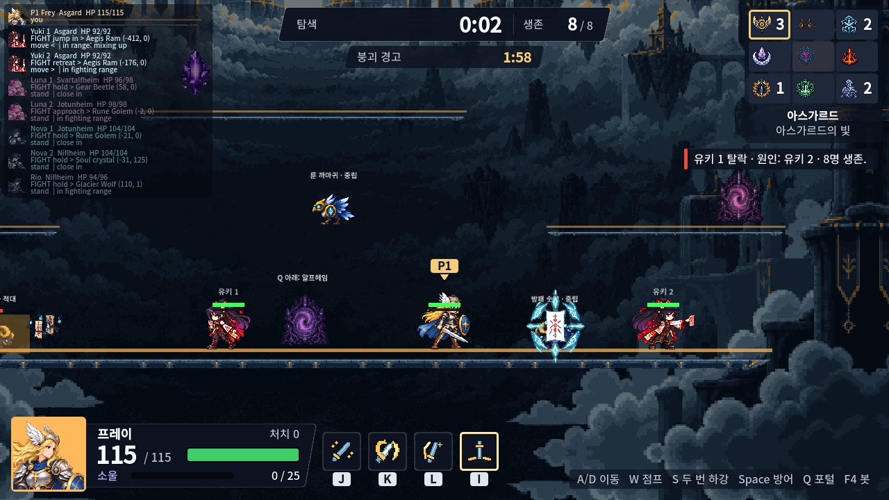
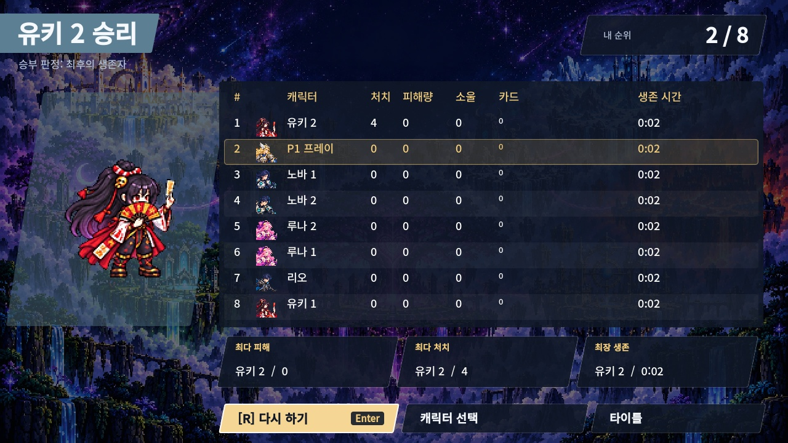
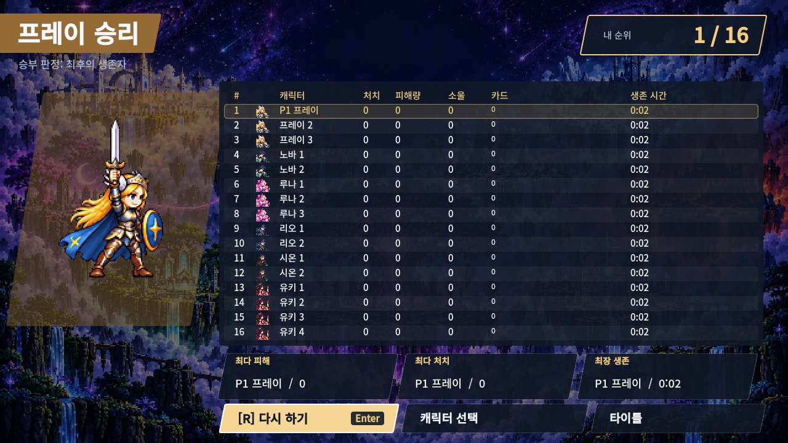
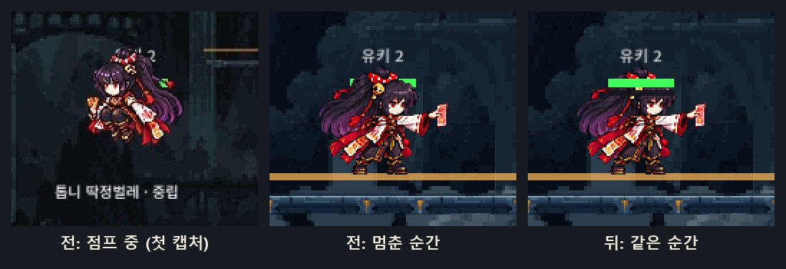

# 같은 캐릭터에 이름 뒤 번호 붙이기 (2026-11-27, UI·디자인 담당)

「총괄」이 세 방법 비교(reports/ui-nine-sixteen-2026-11-27, 3절)에서 고른 A안, 곧 이름 뒤 번호를 게임에 넣었습니다. 새 그림과 새 번역 줄은 없습니다.

문장 끝의 표시: **[잼]** 은 검사나 캡처로 확인한 것, **[코드]** 는 코드에서 읽은 것, **[추정]** 은 확인하지 않은 것입니다.

## 한 문장 결론

**한 경기에 같은 캐릭터가 둘 이상이면 이름 뒤에 번호가 붙습니다(노바 1, 노바 2). 머리 위 이름, 탈락 알림, 승자 알림, 봇 패널, 관전 이름판, 필살기 컷인, 승리 제목, 결과 표와 상이 모두 같은 번호를 씁니다.** [잼]

## 규칙

- 같은 이름이 한 경기에 둘 이상일 때만 번호를 붙입니다. 혼자인 캐릭터는 이름만 나옵니다. [잼]
- 번호는 경기 처음의 자리 순서로, 경기 시작 때 한 번 매깁니다. 경기 중에는 바뀌지 않고, 다시 하기는 새 경기라 새로 매깁니다. [코드]
- P1은 순서에는 셉니다. 그래도 "P1 프레이"로 번호 없이 보이고, 같은 캐릭터 봇은 "프레이 2"부터입니다. [잼]
- 봇 관전에는 P1이 없어서 첫 번째가 "프레이 1"입니다. [잼: 규칙 검사]
- 배틀로얄과 봇 관전에서만 매깁니다. 스토리는 적 이름이 "그림자 노바"처럼 달라서 겹치지 않고, 연습은 1대1이라 P1로 구분됩니다. [코드]
- 지금 8인 경기는 늘 세 캐릭터가 둘씩 나옵니다(캐릭터 6명, 자리 8개, 자리 배치 방식). 16인이면 P1의 캐릭터도 두 자리를 더 받습니다(P1 프레이, 프레이 2, 프레이 3). [잼]

## 그림

- 그림을 위해 같은 캐릭터 봇 둘(유키 1, 유키 2)을 P1이 있는 렐름으로 옮겼습니다. 탈락 알림도 그림을 위해 띄운 것이고, 실제로 탈락한 사람은 없습니다.
- 머리 위 이름은 "유키 1", "유키 2"입니다. 왼쪽 위 봇 패널(시험용, 영어)은 "Yuki 1", "Yuki 2", "Luna 1", "Luna 2"…이고, 혼자인 리오는 "Rio"입니다. 오른쪽 알림 줄은 "유키 1 탈락 · 원인: 유키 2 · 8명 생존."입니다. [잼]

- 같은 봇은 경기 내내 같은 번호를 가집니다. 그래서 결과 표에서 번호가 순위대로 늘어서지 않을 수 있습니다. 8인 결과에서는 루나 2가 루나 1보다 위에 있습니다. [잼]
- 상에서는 내 캐릭터가 "P1 프레이 / 0"처럼 표와 같은 이름으로 나옵니다(16인 결과). [잼]

## 바뀐 곳

| 보이는 곳 | 파일 | 보기 |
|---|---|---|
| 번호 매기기 | 새 `scripts/ui/FighterNames.gd`, `Main.gd`(자리를 다 만든 뒤 한 번) | |
| 머리 위 이름 | `PlayerBase.gd` | 노바 2, P1 프레이 |
| 머리 위 이름과 막대의 층 | `PlayerFactory.gd` | 그림 위, 효과 아래 (아래 "함께 고친 것") |
| 탈락 알림 | `Main.gd` | 노바 1 탈락 · 원인: 노바 2 · 7명 생존. |
| 승자 알림 | `MatchDirector.gd` | 노바 2 승리 (최후의 생존자). |
| 봇 패널 제목, 쫓는 대상, 디버그 줄 (영어) | `Main.gd`, `EnemyAI.gd` | Nova 2 … / CHASE > Nova 1 |
| 관전 이름판, 필살기 컷인, 승리 제목 | `MatchHud.gd` | 관전  노바 2 |
| 결과 제목, 표, 상 | `FrontendMenu.gd` | 노바 2 승리, 상 "P1 프레이 / 900" |

- 상에서는 내 캐릭터도 표처럼 "P1 프레이"로 씁니다. 전에는 상에만 "프레이"로 나와, 16인에서는 프레이 봇과 헷갈릴 수 있었습니다. [잼]
- 봇 패널의 얼굴은 캐릭터와 몸으로 찾아서 번호와 상관없습니다(시스템 담당 확인). [코드]

## 덤으로 고친 것: 한국어 P1 시온의 머리 위 이름

- 전에는 머리 위 이름이 "P1 Frey" 같은 합친 번역 줄에 기댔습니다. "P1 Xion" 줄은 없어서, 한국어에서 P1 시온의 머리 위 이름이 "P1 Xion"으로 나왔습니다. [코드]
- 이제는 이름을 번역한 뒤 붙여서 "P1 시온"이 됩니다. [잼: 번호 검사의 한국어 경기]
- 새 캐릭터 셋(Borok·Doron·Jupi)도 이름 번역 줄 하나씩이면 되고, "P1 …" 줄은 따로 필요 없습니다. [코드]

## 함께 고친 것: 머리 위 이름이 캐릭터 그림에 가려짐 (「총괄」 허락)

- 머리 위 이름과 HP·소울 막대가 캐릭터 그림보다 아래 층에 그려지고 있었습니다(`PlayerFactory.gd`: 그림 층 1, 이름·막대 층 0). 그래서 점프처럼 그림이 위로 솟는 자세에서는 이름이 가려졌습니다. 첫 캡처에서는 위쪽 유키가 "유키 2" 중 "2"만 보였습니다. [잼]
- 이제 이름과 막대가 그림과 같은 층(1)에 있고 그림보다 뒤에 붙어 있어서, 그림 위에 그려집니다. 기술 효과(층 2~7)보다는 여전히 아래입니다. [잼: 번호 검사]
- 위 그림의 왼쪽은 첫 캡처에서 점프한 유키 2입니다. 이름 대부분과 HP 막대가 머리 장식에 가려졌습니다. 가운데와 오른쪽은 두 번째 캡처의 한 순간을 멈춰 두고 층만 바꿔 두 번 찍은 것입니다. 가운데(전)는 HP 막대가 머리 리본에 가려지고, 오른쪽(뒤)은 다 보입니다. [잼]
- `PlayerFactory.gd`는 시스템 담당 파일이라 고친 줄을 알렸습니다.

## 검사

| 검사 | 결과 |
|---|---|
| `test_fighter_names` (새로 만듦) | 통과. 층 확인은 고치기 전 코드에서 실패하는 것을 먼저 봄 [잼] |
| `test_menu_text`, `test_frontend_flow` | 상 확인이 번호 붙은 이름을 기대하게 바꾼 뒤 통과(자리 2·3이 같은 캐릭터라 "Yuki 1", "Yuki 2") [잼] |
| 이름이나 층을 읽는 다른 검사 | `test_bot_panel`, `test_language`, `test_hud_layout`, `test_victory_screens`, `test_match_rules`, `test_gamepad`, `test_story_presentation`, `test_restart`, `test_bot_brain`, `test_monster_ecology`, `test_hit_sparks`, `test_effect_layout` 통과 [잼] |
| 전체 | run_all ALL PASSED: 검사 68개와 8인 봇 경기 오래 돌리기, 1,371초 (`86d50034`) [잼] |

- 새 검사는 두 부분입니다. 하나는 규칙만 따로 보는 것입니다(가짜 캐릭터로 자리 순서, P1, 봇만, 한국어, 사라진 캐릭터, 몬스터). 다른 하나는 실제 경기입니다. 영어 16인(P1 프레이)과 한국어 8인(P1 시온)에서 자리마다 번호, 머리 위 이름, 봇 패널 줄과 쫓는 대상, 탈락 알림, 관전 이름판, 컷인, 승자 알림, 승리 제목, 결과 제목·표·상을 확인합니다. 모든 자리에서 이름·HP·소울 막대가 그림 위, 효과 아래에 그려지는지도 봅니다. 스크립트·엔진 오류도 검사가 직접 모읍니다.
- 처음 돌렸을 때 새 검사가 3개 실패했습니다. 번호가 없는 캐릭터의 머리 위 이름은 그 프레임 끝에 그려지는데, 검사가 그보다 먼저 읽어서 기본값("프레이")을 봤기 때문입니다. 게임은 맞았고, 검사가 경기 시작 뒤 한 프레임 기다리게 고쳤습니다. [잼]
- 이 검사들은 PC가 Codex 작업 두 개와 다른 세션의 전체 검사로 꽉 찬 채 돌았습니다. 시작 화면 흐름은 평소 34초가 824초 걸렸지만, 프레임 수로 세는 감시라 통과했습니다. [잼]
- 첫 run_all은 측정 창(22:30) 전에 멈추는 장치를 달고 돌렸는데, PC가 21:13~01:32에 절전이라 65개 통과 뒤 22:31에 멈췄습니다. 01:34에 다시 돌려 모두 통과했습니다(위 표). [잼]

## 찍은 방법

- 게임 창을 화면 밖(`--position -4000,-4000`)에 띄워 찍었습니다. 스크립트는 `tests/analysis/ui_audit/fighter_numbers_capture.gd`입니다. [잼]

## 웹 빌드

- 이 묶음을 넣은 웹 빌드의 내려받기 크기는 47,175,699바이트입니다. 45 MiB 예산(47,185,920바이트)에서 10,221바이트가 남습니다. 9명·16인 묶음 때보다 3,395바이트 늘었습니다(새 이름 함수와 고친 줄; 검사 파일은 웹 빌드에서 빠짐). [잼]
- 남은 크기가 멈춰야 하는 5,000바이트보다 많아서 병합을 진행합니다. 다만 다음 몇 묶음이면 예산이 찹니다(예산 결정은 사용자 결정 #223을 기다림).
- 웹에서 화면을 따로 찍지는 않았습니다. 위 그림은 모두 PC 창에서 찍었습니다.

## 병합

- 커밋: `86d50034`, 그리고 이 보고서. 병합 전 main(`4a82e710`)과의 시험 병합에 충돌이 없었습니다. 그사이 main에 들어온 것은 보고서, 그림 작업 폴더, 로드맵뿐이라 게임 파일은 이 브랜치와 같습니다. [잼]
- main 병합 커밋 번호는 「총괄」에게 알렸습니다.
