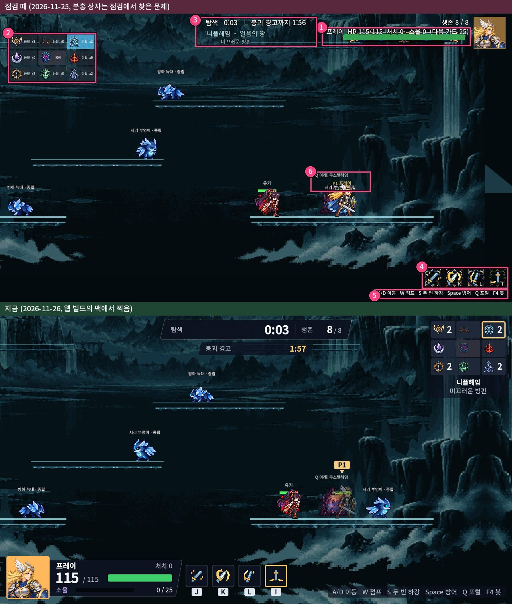
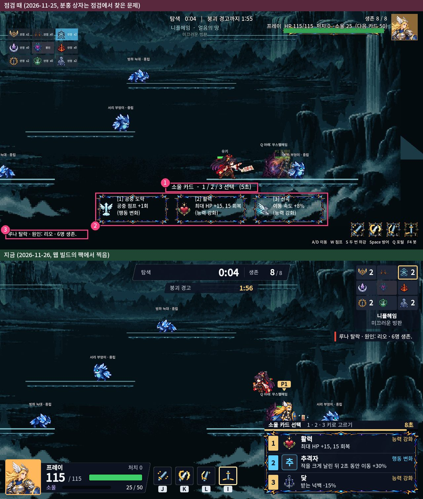
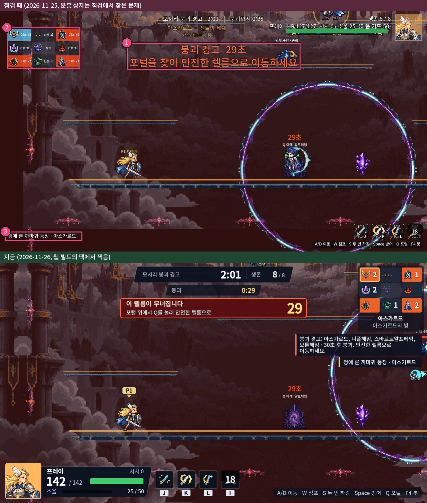
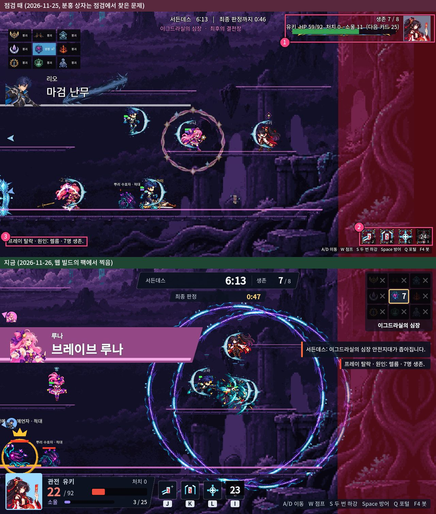
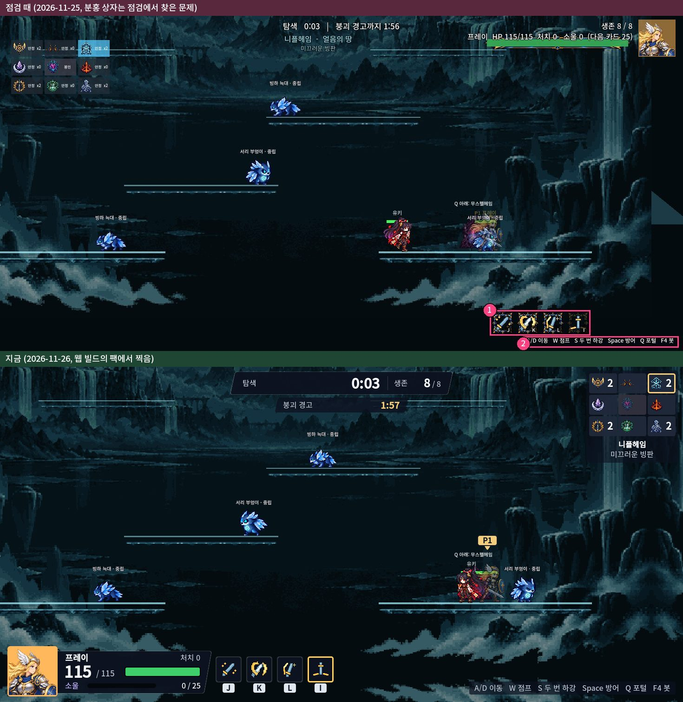
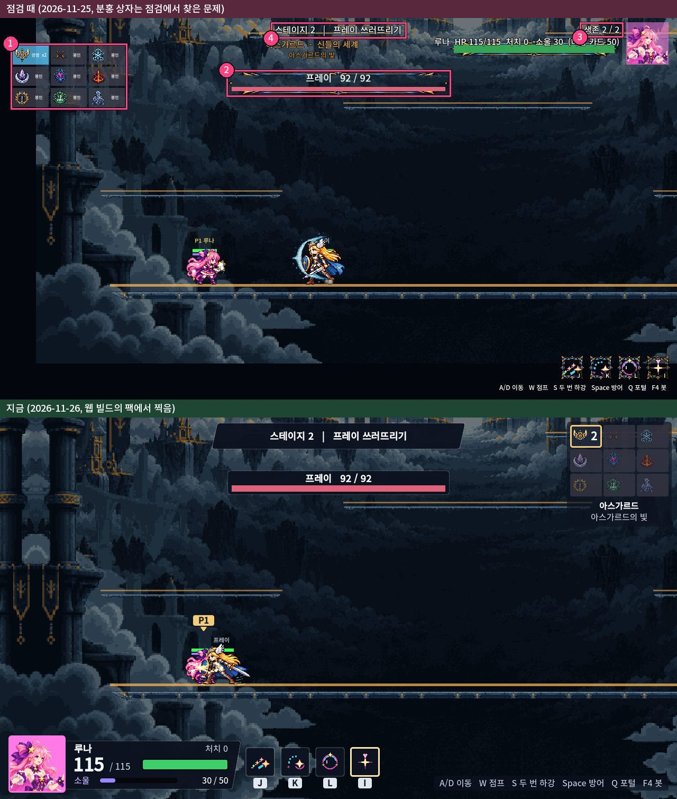
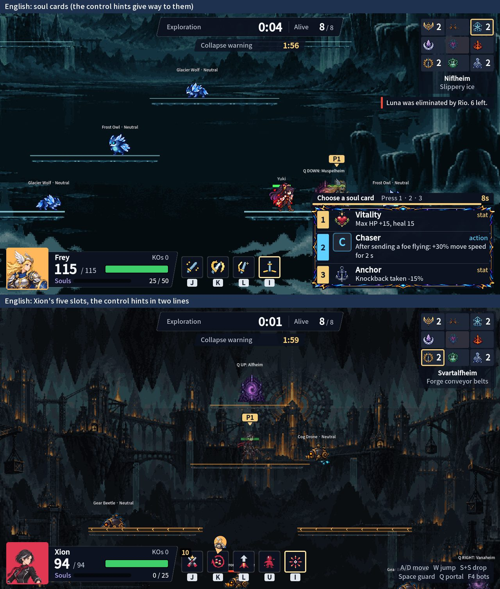
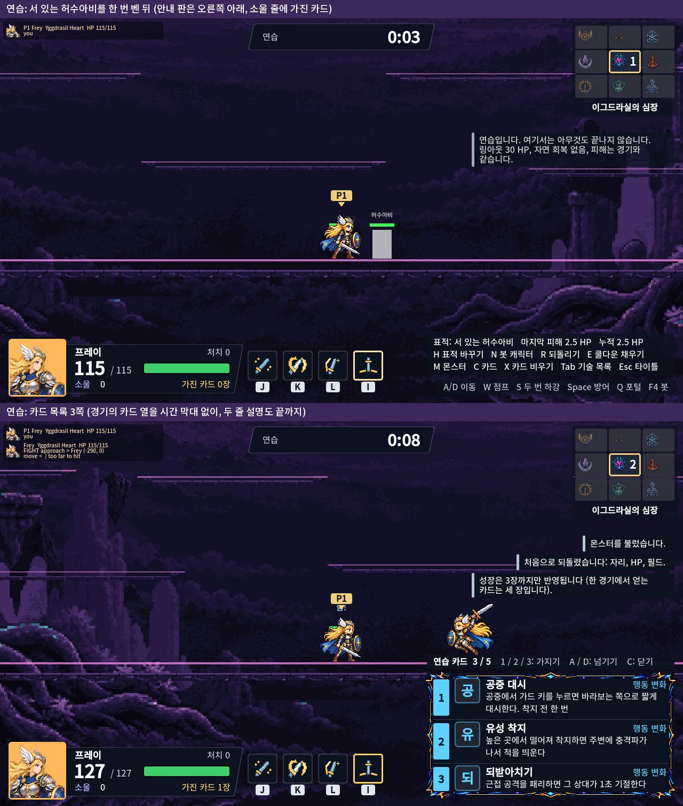

# 고르신 경기 HUD를 게임에 넣음 (2026-11-26, UI·디자인 담당)

「UI·디자인 담당」 3단계(적용)의 기록입니다. 시안 월드컵 라운드 `2026-11-25-ui`에서 고르신 대로 **전투 화면은 B(한곳에 모으기), 소울 카드는 A(아래 배치, 기존 틀), 붕괴 경고는 A(시계 아래 붉은 판)** 를 합쳐 넣었습니다. 시안은 `reports/ui-direction-2026-11-25/`, 점검은 `reports/ui-audit-2026-11-25/`에 있습니다.

문장 끝의 표시: **[잼]** 은 검사나 캡처로 확인한 것, **[코드]** 는 코드에서 읽은 것, **[추정]** 은 확인하지 않은 것입니다.

## 정하실 것

1. **조작 안내 줄을 남길지.** 오른쪽 아래의 "A/D 이동 W 점프 …" 줄입니다. 2026-10-08에 요청하신 것(D29)이라 남겨 두었습니다. 글자를 16px로 키웠고, 소울 카드가 열리면 그 자리를 카드에 내줍니다. 영어 문구는 한 줄로 두면 다섯 칸 스킬 바와 겹쳐서 두 줄로 나눴습니다.
2. **카드를 오른쪽 아래 세로 열로 둔 것.** A안은 카드를 화면 아래 왼쪽에 가로로 놓았는데, 고르신 B안은 내 정보 묶음을 그 자리에 둡니다. 그래서 카드를 오른쪽 아래에 세로로 쌓았습니다. 카드 모양(기존 틀, 속을 채운 바탕, 종류별 색, 줄어드는 시간 막대)은 A 그대로입니다.

두 가지는 총괄이 할 일 목록에 한 줄로 넣습니다.

## 한 문장 결론

**고르신 HUD가 들어갔습니다. 그사이 main에 들어온 소울 카드 19장(D54)과 연습 모드에도 맞췄고, 새로 쓴 배치 검사(4914개)를 포함한 검사가 통과합니다.** [잼]

- 점검 때 남겨 둔 겹침 세 곳을 고쳤습니다: 화면 밖 상대의 얼굴 표시가 지도에 얹힘, 그 표시끼리 겹침, P1 표시의 꼬리가 포털 글자를 가림. [잼]
- 넣으면서 겹침과 잘림 셋을 더 찾아 고쳤습니다: 영어 조작 안내 줄이 리오의 스킬 바에 겹침, 두 줄짜리 카드 설명이 한 줄로 잘려 "…"로 끝남, 긴 붕괴 경고 알림이 둘째 줄에서 잘림. [잼]
- 웹 빌드는 44.95 MiB(47,130,265바이트)입니다. 예산 45 MiB까지 55,655바이트 남습니다. 새 그림은 없고 코드만 늘었습니다. [잼]
- 아래 캡처는 모두 **웹 빌드에 들어가는 팩**(`index.pck`)을 창 모드로 띄워 찍었습니다. 브라우저에서 돌려 보지는 않았습니다.

## 1. 고르신 것과 넣은 것

| 항목 | 고르신 안 | 넣은 것 |
|---|---|---|
| 전투 화면 | B (B 2승, 지금 1승, A 0승) | 내 정보(얼굴, 이름, 처치 수, 큰 체력 숫자와 막대, 다음 카드까지의 소울)는 왼쪽 아래, 스킬 칸은 그 옆. 시계는 위 가운데, 지도는 오른쪽 위. 평평하고 기울어진 판 |
| 소울 카드 | A (A 2승, B 1승) | 기존 픽셀 틀 하나에 세 장을 줄로 담고 속을 채움. 번호 칸과 종류 이름을 종류 색(수치 금색, 행동 하늘색, 전용 분홍)으로, 머리 아래에 줄어드는 시간 막대 |
| 붕괴 경고 | A (A가 B를 이기고 B가 지금을 이김) | 시계 아래 붉은 판: 제목, 할 일 한 줄, 40px 숫자. 렐름 위험 요소 경고는 같은 자리의 노란 판 한 줄 |

- 경고 항목의 "A 대 지금" 경기는 기록되지 않았습니다. A가 B를 이기고 B가 지금을 이겨서 A로 판정했습니다.
- 메모는 없었습니다. 판정은 시안 월드컵의 `cup_verdicts`에 적었습니다.

## 2. 같은 장면, 전과 후

위는 11-25 점검 때의 캡처(분홍 상자는 점검에서 찾은 문제), 아래는 지금입니다. 같은 캡처 스크립트로 같은 시드의 같은 장면을 찍었습니다. 그사이 게임도 바뀌어서(소울 카드 등) 캐릭터의 자리와 체력은 조금 다를 수 있습니다.

### 평상시

### 소울 카드 고르기

### 붕괴 경고

### 탈락한 뒤 관전

### 넓은 창 (1470×720)

### 스토리 모드

스토리에서는 시계 자리에 스테이지와 목표가 나오고, 그 아래가 라이벌 체력 막대입니다. 붕괴 경고 판은 라이벌 막대 아래로 내려갑니다(스테이지 5의 "소울 수정을 모두 깨면 출구가 열립니다"). [잼]

### 영어

### 연습 모드

## 3. 넣으면서 정한 것

두 안을 합치면서 시안에 없던 자리를 정했습니다. 바꾸고 싶으면 대부분 상수 한두 개입니다(`scripts/ui/MatchHud.gd` 위쪽).

| 무엇 | 정한 것 | 까닭 |
|---|---|---|
| 소울 카드의 자리 | 오른쪽 아래, 세로 열(폭 464px) | 왼쪽 아래는 B의 내 정보 자리다. 다섯 칸 스킬 바의 오른쪽 끝(x 784)과 겹치지 않는 폭 |
| 생존자 수 | 시계 판 안("생존 8 / 8") | B는 왼쪽 위의 얼굴 띠로 보여 줬다. 다른 참가자의 상황은 시험용이라 실제 게임에서 빠진다고 하셔서(2026-11-25) 얼굴 띠는 넣지 않았다 |
| 알림 글 | 지도 아래, 최대 3개, 종류별 색 띠 | B는 오른쪽 아래였는데 그 자리는 카드와 조작 안내 줄이 쓴다. A의 자리(지도 아래)를 B의 지도 위치에 맞춰 썼다 |
| 위험 요소 이름 | 렐름 이름 아래 흐린 줄 | B는 뺐다. 니플헤임의 "미끄러운 빙판"처럼 싸우는 법이 바뀌는 정보라 남겼다 |
| 조작 안내 줄 | 오른쪽 아래, 16px, 카드가 열리면 숨김 | D29. 정하실 것 1 |
| 봇 패널 | 왼쪽 위, 예전 모양 그대로(F4) | 시험용 도구라 HUD 배치에 넣지 않았다. 켠 채로 둔다(D29) |
| 글자 크기 | 경기 중 글자 모두 16px 이상 | 시험용 도구(봇 패널, F3 디버그 글)만 예외. 검사가 확인한다 |

## 4. 그사이 main에 들어온 것과 맞춘 것

이 일을 하는 사이 「시스템 담당」이 소울 카드 19장(D54)과 연습 모드를 main에 넣었습니다. main을 이 작업에 합치면서 새 HUD를 둘에 맞췄습니다.

**소울 카드(D54)** [잼]

- 아이콘이 아직 없는 새 카드 13장은 이름의 첫 글자가 종류 색으로 나옵니다(위 캡처의 "추", "C").
- 설명은 세 줄까지 들어갑니다. 제목과 종류 줄까지 다섯 줄입니다. 19장 모두 한국어와 영어로 검사합니다.
- 시간 막대는 게임이 넘기는 고르는 시간(`time_total`, 사람은 8초)을 그대로 읽습니다.

**연습 모드** [잼]

- 시계: "연습"과 시간만 나옵니다. 생존자 수는 뺐습니다.
- 내 정보 묶음의 소울 줄: 소울 수와 "가진 카드 N장". 연습에서는 카드 제안이 열리지 않아 다음 카드까지의 막대는 뺐습니다.
- 연습 안내 줄(표적, 마지막 피해, 누적 피해, 키 목록): 오른쪽 아래 조작 안내 줄 바로 위의 판입니다. 예전 자리(왼쪽 아래)는 내 정보 묶음 자리라 옮겼습니다. 줄이 길면 항목 사이에서 나뉩니다.
- 카드 목록(C): 경기의 카드 열을 시간 없이 씁니다. "1장 보유"는 종류 자리에 붙습니다.
- `scripts/practice/PracticeSession.gd`에서 HUD에 닿는 일곱 줄을 바꿨고 「시스템 담당」에게 알렸습니다. 연습 검사(`test_practice_mode`)에서는 카드 글을 읽는 두 줄을 바꿨습니다. 확인하는 뜻은 그대로입니다.

**게임패드(「시스템 담당」이 만드는 중)** [잼]

- 패드 작업은 HUD 파일을 고치지 않고, 바깥에서 조작 안내 줄(`controls_label`)과 스킬 칸 아래 키 글자, 연습 안내의 둘째 줄을 패드 글자로 바꿉니다(로드맵, 2026-11-26).
- 새 HUD는 안내 줄과 연습 안내 판의 크기를 글에 맞춰 계산하므로, 바깥에서 글을 바꿔 넣어도 다음 프레임에 같은 방식으로 다시 배치합니다. 배치 검사가 패드 글을 써 넣고 한 프레임 뒤의 폭과 겹침을 봅니다. 「시스템 담당」에게 알렸습니다.

## 5. 고친 겹침과 잘림

| 무엇 | 전 | 고친 뒤 |
|---|---|---|
| 화면 밖 상대의 얼굴 표시 | 오른쪽 위 구석에서 지도에 얹힘, 같은 가장자리에서 서로 겹침 | 가장자리를 따라 미끄러져 HUD 판(지도, 시계, 내 정보, 스킬, 안내 줄, 카드, 알림, 봇 패널)과 다른 얼굴을 피함. 아래 가장자리는 HUD가 차지해서 판 위로 올라감 |
| P1 표시 | 포털 앞에 서면 꼬리가 "Q 아래: …" 글자를 가림 | 포털 글자(와 붕괴 카운트다운) 위로 올라감 |
| 영어 조작 안내 줄 | 487px 한 줄이 리오·노바·시온의 다섯 칸 스킬 바와 겹침 | 카드 열 폭(464px)을 넘으면 고른 길이의 두 줄 |
| 두 줄짜리 카드 설명 | 줄 간격을 높이에 넣지 않아 한 줄만 보이고 "…"로 끝남(영어 "Chaser", 연습 카드 목록의 한국어 새 카드) | 줄 간격까지 넣어 모든 줄이 보임 |
| 긴 알림 글 | 두 줄에서 잘림("…안전한 렐름으로…") | 세 줄까지 |

마지막 세 가지는 웹 빌드의 팩으로 찍은 캡처에서 찾았습니다. 그 전의 검사는 줄 수와 높이만 곱해 보았고 줄 간격을 빼먹었습니다. 지금 검사는 "보이는 줄 수가 전체 줄 수와 같은지"를 봅니다.

## 6. 검사

| 검사 | 결과 |
|---|---|
| `test_hud_layout` (새로 씀) | 4914개 통과. 1280×720, 1470×720, 1280×960 × 한국어·영어 × 네 칸(프레이)·다섯 칸(리오): HUD 판이 모두 화면 안에 있고 서로 안 겹침(알림 3개, 붕괴 경고, 가장 긴 카드 세 장, 연습 안내 줄을 띄운 채), 경기 글자 16px 이상, 얼굴 표시가 판과 서로를 피함, P1 표시가 포털 글자 위로, 체력 숫자가 막대 왼쪽에서 끝남, 카드와 알림의 모든 줄이 보임, 밖에서 써 넣은 게임패드 글자도 같은 폭으로 배치됨, 지도 칸의 인원수 [잼] |
| 검사가 정말 잡는지 | 얼굴 표시와 P1 표시의 고침을 빼면 실패, 줄 간격을 고치기 전의 HUD로는 알림 검사에서 실패 [잼] |
| HUD·언어·카드 | `test_hud_frames`, `test_bot_panel`, `test_skill_bar`, `test_offscreen_markers`, `test_ultimates`, `test_language`, `test_font_coverage`, `test_soul_cards`, `test_menu_text`, `test_backdrop_edges`, `test_import_modes` 통과 [잼] |
| 스토리·화면 흐름 | `test_story_presentation`, `test_story_text_fit`, `test_story_flow`, `test_story_late_flow`, `test_story_rewards`, `test_frontend_flow`, `test_victory_screens`, `test_bugfix_review` 통과 [잼] |
| 연습 모드 | `test_practice_mode` 772개 통과(혼자 돌려 179초) [잼] |
| 전체 | run_all: (아래 "병합"에 적음) |

타이밍으로만 실패한 것(다시 돌리면 통과):

- `test_practice_mode`의 "궁극기 도중 R로 되돌리기"가 내 다른 Godot 검사와 동시에 돌린 두 번 모두 실패했습니다. 실패한 곳이 매번 달랐고(프레이 4·30프레임, 리오 4·프레이 30프레임), 혼자 돌리면 통과합니다. 컴퓨터가 바쁘면 흔들리는 검사로 보여 「시스템 담당」에게 알렸습니다. [잼]
- `test_audio`가 한 번 "게임 시작 때 타이틀 음악"에서 실패했고 다시 돌리니 통과했습니다. 그때 다른 세션의 Godot가 함께 돌고 있었습니다. [잼]

## 7. 남은 것

- **브라우저 확인.** 캡처는 웹 빌드의 팩으로 찍었지만 브라우저에서 키를 눌러 보지는 않았습니다.
- **메뉴 화면 라운드.** 초안(`tools/pick_cup/rounds/drafts/2026-11-25-menu.json`)은 타이틀이 여섯 줄(연습 추가)이 되기 전에 찍어서 다시 찍어야 합니다. 이 HUD가 main에 들어간 뒤 시작합니다.
- **스토리 모드의 지도.** 스토리에서도 지도가 보입니다. 스토리는 렐름 하나에서 싸우는 일이 많아 숨기는 편이 맞아 보이지만, 스토리 화면은 따로 정할 일로 남겼습니다. [추정]
- **연습 모드의 기술 목록(Tab).** 「시스템 담당」이 만든 판이고 글자가 14~15px입니다. 연습 모드 모양을 다듬을 때 같이 봅니다.
- 리오의 U 아이콘(`skill_icons/rio_u.png`)은 아직 없어 스킬 칸에 글자 "U"가 나옵니다(로드맵의 리오 그림 후보 일).

## 만든 방법

- HUD: `smash-nine-prototype/scripts/ui/MatchHud.gd`. 스토리의 라이벌 막대와 목표는 `scripts/story/StorySession.gd`, 화면 밖 얼굴은 `scripts/Main.gd`가 얼굴 그림을 넘깁니다. 포털 글자는 `scripts/realms/RealmWorld.gd`가 `portal_labels` 무리에 넣습니다.
- 캡처: `smash-nine-prototype/tests/analysis/ui_audit/capture_ui_audit.gd`(경기·난전·스토리), `tests/analysis/lead/capture_practice.gd`(연습, 「시스템 담당」의 것). 둘 다 웹 빌드의 `index.pck`를 `--main-pack`으로 띄워 돌렸습니다.
- 비교 그림: `make_figures.py`.

## 병합

- 브랜치 `claude/funny-robinson-32c2a4`의 커밋: `8eb8090e`(새 HUD), `ef980d7a`(main을 합치며 소울 카드·연습 모드에 맞춤, 겹침 세 곳), `f09c11f6`(줄 잘림), `ca51ba00`(main 다시 합침), `2efc65f0`(바깥에서 쓴 글자의 배치), 그리고 이 보고서.
- run_all: RUN_ALL_RESULT
- main 병합 커밋: MERGE_COMMIT
