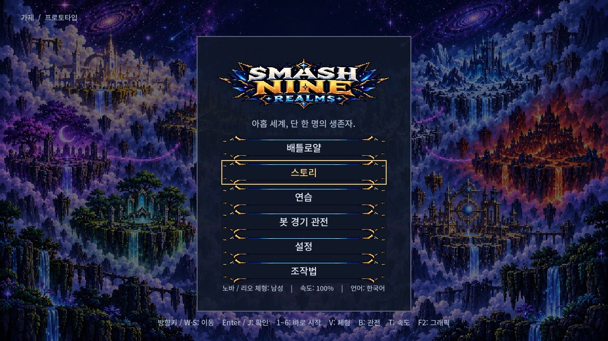
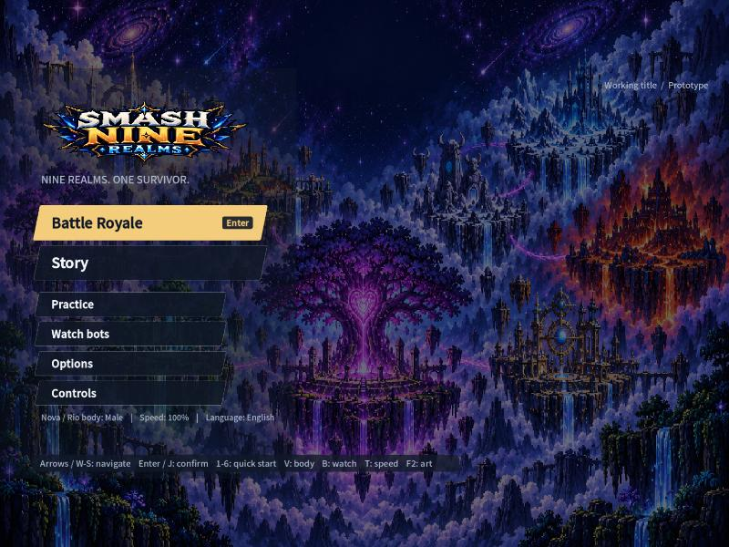
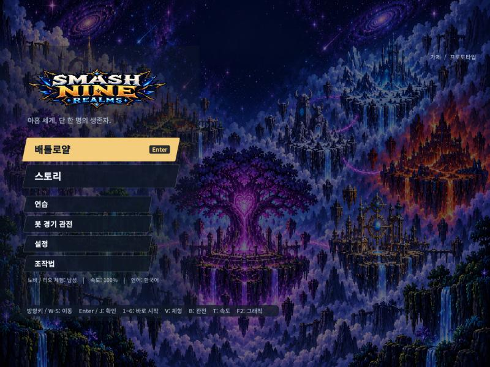
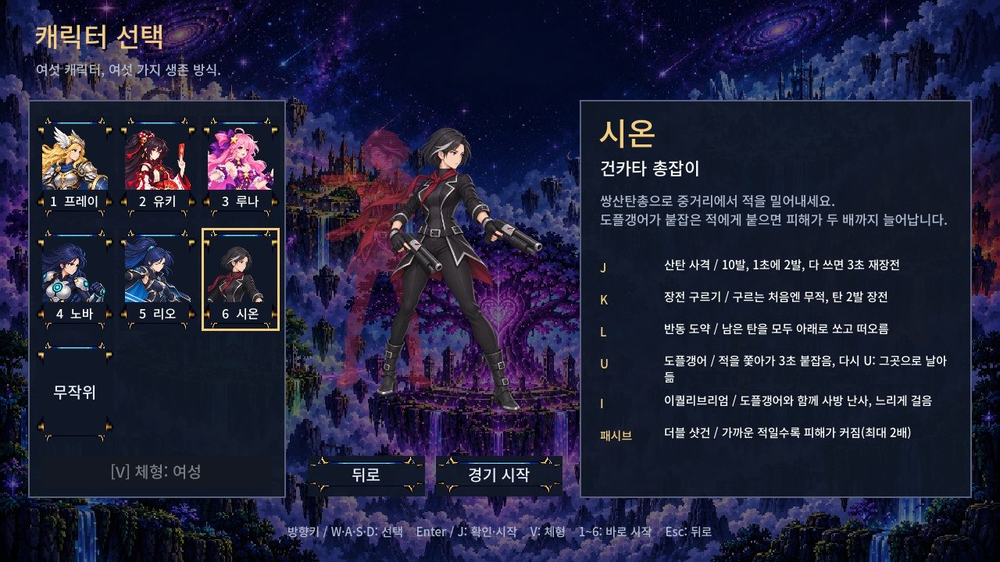
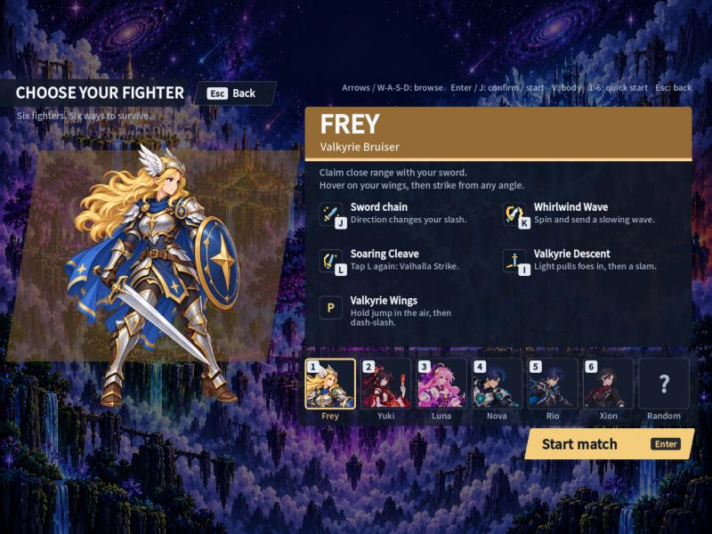
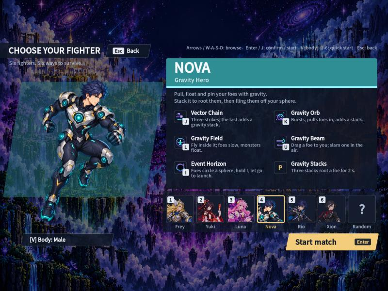
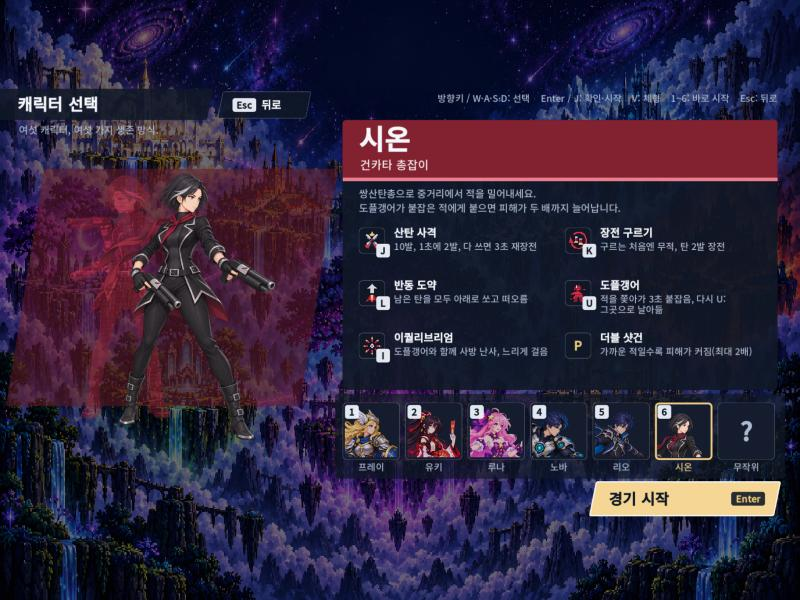
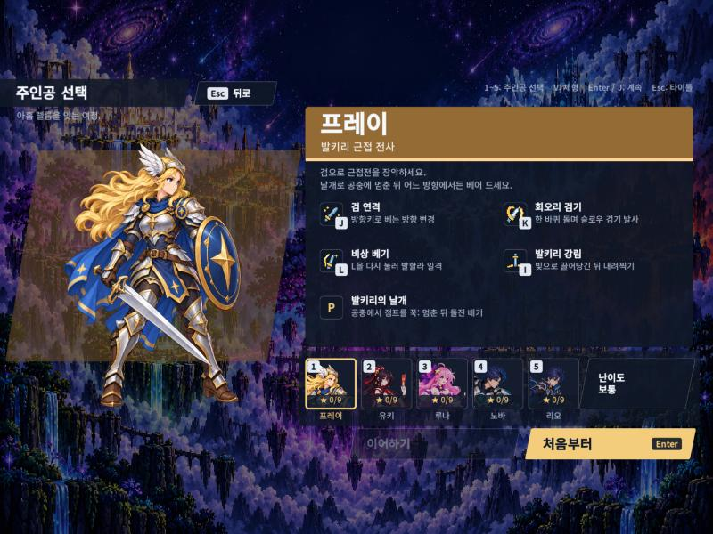

# 고르신 메뉴 화면을 게임에 넣음 (2026-11-27, UI·디자인 담당)

시안 월드컵 라운드 `2026-11-25-menu`에서 고르신 대로 **타이틀 B, 캐릭터 선택 B(한곳에 모으기)** 를 게임에 넣었습니다. 경기 HUD에서 고르신 B와 같은 모양(평평하고 기울어진 판)입니다. 시안은 `reports/ui-direction-2026-11-25/README.md`의 "메뉴 화면" 부분에 있습니다.

문장 끝의 표시: **[잼]** 은 검사나 캡처로 확인한 것, **[코드]** 는 코드에서 읽은 것, **[추정]** 은 확인하지 않은 것입니다.

## 한 문장 결론

**타이틀과 캐릭터 선택이 B로 바뀌었고, 스토리의 주인공 선택도 같은 화면이 됐습니다. 메뉴를 쓰는 검사는 모두 새 배치에서 통과합니다.** [잼]

- 판정: 타이틀 B 2승(지금 1승, A 0승), 캐릭터 선택 B 2승(A 1승, 지금 0승). 메모는 없었습니다. 판정은 시안 월드컵의 `cup_verdicts`에 적었고, 할 일 #230은 닫았습니다.
- 아래 "지금" 그림은 웹 빌드를 앱 안의 브라우저에서 열어 찍었습니다(800×600 창, 기기 배율 1.5). [잼]
- 설정·조작법·결과 화면과 스토리의 지도·대화·결과 화면은 아직 예전 모양입니다. 같은 방향으로 맞추는 것은 다음 일입니다.

## 타이틀

전 (라운드의 "지금"):

지금 (웹 빌드, 영어와 한국어):

- 가운데 패널을 없애고, 배경 그림 왼쪽에 어두운 띠를 깔아 메뉴를 세로로 놓았습니다.
- 배틀로얄과 스토리는 큰 버튼, 연습·봇 경기 관전·설정·조작법은 작은 버튼입니다. 고른 줄은 금색으로 바뀌고 오른쪽 끝에 Enter 표시가 붙습니다.
- 아래 안내 줄(방향키, Enter, 1~6, V, B, T, F2)은 판 위에 두었습니다. 시안에서는 키 셋만 보였지만, 기능이 있는 키라 모두 남겼습니다.

## 캐릭터 선택

전 (라운드의 "지금", 시온):

지금 (웹 빌드):

- 왼쪽: 일러스트를 크게, 그 뒤에 캐릭터 색의 기울어진 띠.
- 오른쪽: 캐릭터 색 이름 띠, 역할, 설명 두 줄, 기술 두 열(스킬 아이콘, 키, 이름, 설명 두 줄까지). U가 있는 캐릭터(노바, 리오, 시온)는 여섯 줄입니다.
- 아래: 캐릭터 목록 한 줄(숫자 키 표시, 고른 캐릭터는 금색 테두리와 이름), 마지막이 무작위.
- 체형 버튼은 체형이 둘인 캐릭터(노바, 리오)에서만 왼쪽 아래에 나옵니다. 금색 "경기 시작"(연습으로 들어오면 "연습 시작")은 오른쪽 아래입니다.
- 키 안내는 오른쪽 위의 한 줄입니다.

## 스토리 주인공 선택

- 같은 화면에 주인공 다섯 명이 나옵니다. 각 타일 아래쪽에 진행도(★ 3/9, 다 깨면 CLEAR)가 붙습니다.
- 무작위 자리(두 칸 폭)에 난이도, 아래에 "이어하기"와 금색 "처음부터"가 있습니다.

## 그대로 둔 것

- 버튼의 순서와 이름(타이틀 여섯 줄, 캐릭터 버튼, 무작위, 체형, 뒤로, 시작). 다른 코드와 검사가 이 순서로 읽습니다. [코드]
- 연습 줄과 "연습 시작", 숫자 키 바로 시작, V 체형, 게임패드의 메뉴 이동, 마우스. [잼]

## 바뀐 조작 하나

캐릭터 목록이 한 줄이 되어, 예전 세 칸 격자에서 "아래 키로 아래 줄 캐릭터"로 가던 것이 없어졌습니다. 이제 왼쪽·오른쪽 키(패드는 D-패드 좌우와 스틱)로 고르고, 아래 키는 목록 아래 버튼(체형, 시작)으로 갑니다. [잼]

## 검사

| 검사 | 결과 |
|---|---|
| `test_menu_text` | 통과. 숫자 키 안내가 네 화면에서 맞음. 기술 66줄이 두 열에서 패널 안에 있고 서로·설명과 겹치지 않으며, 이름은 한 줄에 다 들어가고 설명은 두 줄까지 모두 보임. 키 표시가 아이콘 칸 위에 있음 [잼] |
| `test_frontend_flow` | 통과. 아래 키가 목록 아래 버튼으로 가고 캐릭터는 그대로, 위 키로 목록에 돌아옴(예전 "아래 줄 노바" 확인을 바꿈) [잼] |
| `test_gamepad` | 178개 통과. "D-패드 아래로 노바"를 "D-패드 오른쪽 세 번으로 노바, 한 번에 한 칸"으로 바꿈 [잼] |
| `test_language`, `test_story_flow`, `test_story_late_flow`, `test_story_presentation`, `test_story_text_fit`, `test_audio`, `test_victory_screens`, `test_hud_frames` | 통과 [잼] |
| `test_practice_mode` | 메뉴 부분(타이틀 여섯 줄의 순서·겹침, "연습 시작" 폭) 통과. 따로 돌린 한 번은 알려진 흔들림인 "R로 싸우는 봇 되돌리기"(시온·리오)에서만 실패 [잼] |
| 전체 | run_all: (아래 "병합"에 적음) |

`test_frontend_flow`와 `test_gamepad`에서 바꾼 줄은 「시스템 담당」에게 알렸습니다.

## 웹 빌드

- 47,158,214바이트(44.97 MiB), 예산 45 MiB까지 27,706바이트. 새 그림은 없습니다. [잼]

## 병합

- 커밋: `f31b262a`(메뉴 B), `90dee94b`(HUD가 바뀐 화면을 따라감, 이 보고서의 앞 일), 그리고 이 보고서.
