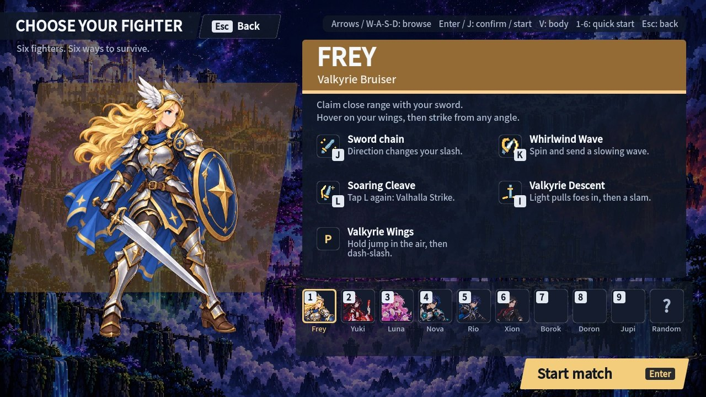
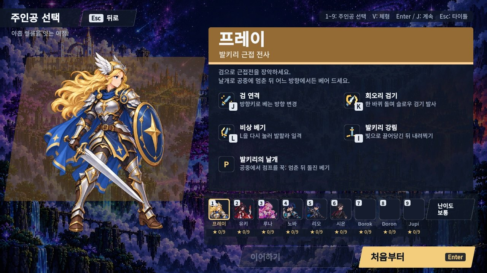
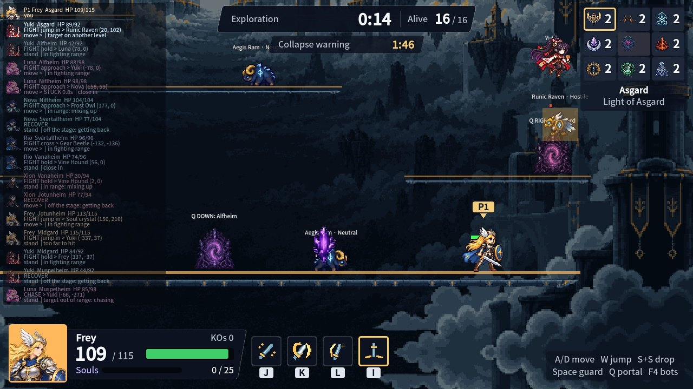
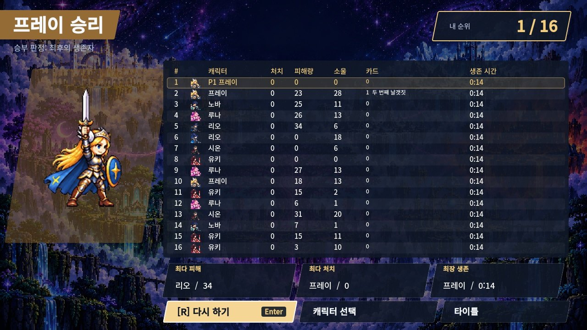
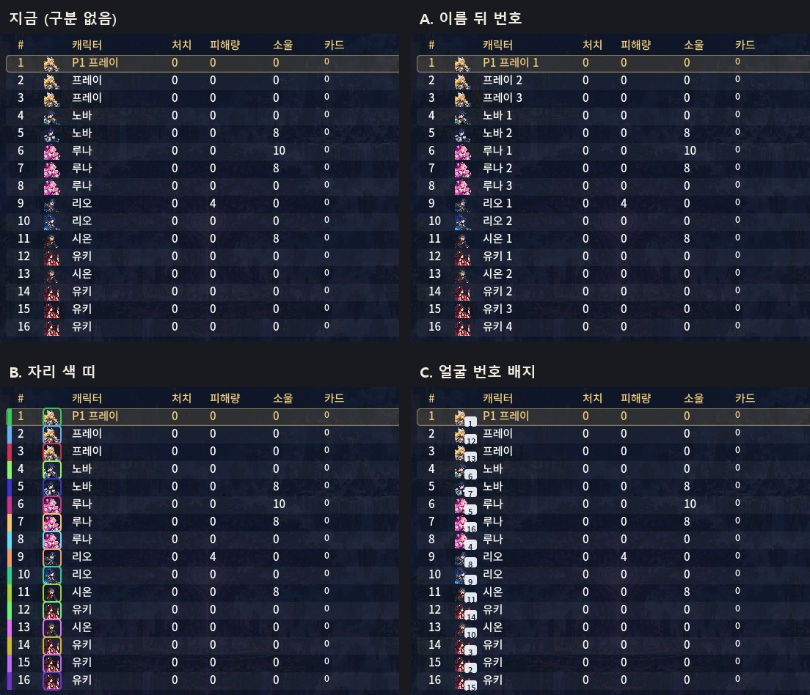

# 캐릭터 9명과 16인 경기에 화면 미리 맞추기 (2026-11-27, UI·디자인 담당)

「총괄」 지시로, 곧 들어올 두 가지에 화면을 미리 맞췄습니다. 하나는 새 캐릭터 셋(Borok·Doron·Jupi, D58)이 들어와 9명이 되는 것이고, 다른 하나는 16인 경기입니다. 새 그림은 없습니다. 9명은 검사와 캡처 안에서만 만든 가짜 캐릭터 셋으로 봤습니다(프레이 자료를 새 이름으로 베낀 것, 그림·기술 설명 없음).

문장 끝의 표시: **[잼]** 은 검사나 캡처로 확인한 것, **[코드]** 는 코드에서 읽은 것, **[추정]** 은 확인하지 않은 것입니다.

## 한 문장 결론

**9명이 되어도 캐릭터 선택·스토리 선택·결과가 깨지지 않고, 숫자 바로 시작 키는 1~9까지 됩니다. 16인 경기의 결과 표, HUD, 화면 밖 표시도 겹치거나 잘리지 않습니다. 같은 캐릭터 구분은 세 방법을 그림으로 비교했고, 정하실 일로 남깁니다.** [잼]

## 1. 캐릭터 9명

- **캐릭터 선택:** 아래 목록이 칸 일곱 개까지는 지금처럼 92px입니다. 그보다 많으면(9명과 무작위 = 10칸) 같은 폭을 나눠 쓰고, 10칸이면 62px입니다. 숫자 표시, 이름, 금색 테두리가 칸 크기를 따라갑니다. [잼]
- **숫자 바로 시작 키:** 1~6이던 것을 1~9로 늘렸습니다(입력 설정에 7·8·9를 더함). 지금 캐릭터는 6명이라 7~9는 눌러도 아무 일이 없습니다. 안내 줄의 "1-6"은 캐릭터가 늘면 저절로 "1-9"가 됩니다. [코드]
- **스토리 주인공 선택:** 주인공 9명과 난이도(두 칸)면 칸이 56px입니다. 이 크기에서는 숫자 표시와 진행도("★ 0/9")가 얼굴을 거의 가려서, 숫자 표시를 작게 하고 진행도를 이름 아래로 내렸습니다(92px 칸에서는 전처럼 칸 아래쪽). [잼]
- **기술 설명이 아직 없는 캐릭터:** 선택 화면과 연습 모드 기술 목록이 멈추지 않고, 기술 줄에 "—"를 보여 줍니다. 새 캐릭터의 설명을 쓰면 그 글이 나옵니다. [잼]
- **조작법:** "1 - %d" 줄이 캐릭터 수를 직접 읽어 9명이면 "1 - 9"가 됩니다(전부터 그랬음). [코드]
- **결과 화면:** 9명이면 아래 16인과 같은 촘촘한 줄이 됩니다. [잼]

## 2. 16인 경기

- **결과 표:** 9명 이상이면 줄 높이를 34px에서 22px로, 글자를 18px에서 15px로 줄여 16줄이 상 위에 모두 들어갑니다. 상 판은 표 아래로 조금 내려가고 낮아집니다. 8명 이하는 그대로입니다. [잼]
- **HUD:** 실제 16인 경기를 띄워 봤습니다. 시계의 "생존 16 / 16", 미니맵의 렐름별 인원은 겹치지 않습니다. 봇 패널(F4, 시험용)은 15줄이 화면 가운데쯤까지 내려오지만 플레이어 판과 겹치지 않습니다. [잼]
- **화면 밖 표시:** 다른 15명이 모두 화면 밖에 몰려 있는 경우를 HUD 배치 검사에 넣었습니다. 창 크기 셋과 두 언어에서 얼굴 표시가 서로·판과 겹치지 않습니다. [잼]
- 인원 선택에 16을 넣을지는 사용자가 정합니다. 설정의 인원은 지금처럼 4·6·8입니다. [코드]

## 3. 같은 캐릭터 구분 (정하실 일)

16인 경기의 실제 결과 화면 위에 세 방법을 얹어 비교했습니다(표의 왼쪽 부분). 게임에는 아직 넣지 않았습니다.

| | 방법 | 좋은 점 | 아쉬운 점 |
|---|---|---|---|
| A | 이름 뒤 번호 ("노바 1", "노바 2") | 작은 크기에서도 잘 읽힘. 글자만이라 알림 줄·봇 패널에도 그대로 씀 | 이름이 조금 길어짐 |
| B | 자리 색 띠 (줄 왼쪽 띠, 얼굴 테두리) | 화면 밖 표시·미니맵과 같은 색을 쓰면 경기 중에도 이어짐 | 색 16가지를 외워야 함. 색을 구별하기 어려운 사람에게 약함 |
| C | 얼굴 번호 배지 (자리 번호) | 자리 번호가 늘 같음 | 22px 얼굴 위라 너무 작고 어지러움 |

- 추천은 **A**입니다. 번호는 경기 처음의 자리 순서로 매겨, 같은 봇이 끝까지 같은 번호를 가집니다(그림의 번호는 비교용으로 결과 순서대로 매긴 것). 내 캐릭터는 "P1"이 이미 있으니 번호를 붙이지 않습니다. 같은 번호를 머리 위 이름, 알림 줄, 봇 패널에도 쓰면 경기 중과 결과가 이어집니다. [추정: 경기 중 표시는 아직 만들지 않음]
- 총괄이 정하거나, 모양 취향이 갈리면 시안 월드컵에 올립니다.

## 검사

| 검사 | 결과 |
|---|---|
| `test_menu_text` | 통과. 새로 넣은 확인: 가짜 캐릭터 셋을 더한 9명으로, 영어·한국어에서 선택 화면과 스토리 선택의 10칸이 목록 안에 겹치지 않게 있고 숫자 1~9가 보임. 설명 없는 캐릭터도 그려지고, 9명·16명 결과에서 모든 줄이 상 위에서 끝나며 내 순위가 맞음. 바뀐 화면 겹침 검사 36개 [잼] |
| `test_hud_layout` | 통과(8849개). 화면 밖 15명 경우를 더함 [잼] |
| `test_frontend_flow`, `test_story_flow`, `test_language`, `test_victory_screens`, `test_gamepad` | 통과 [잼] |
| 전체 | run_all: (아래에 적음) |

## 찍은 방법

- 게임 창을 화면 밖 자리(`--position -4000,-4000`)에 띄워 찍었습니다. 스크립트는 `tests/analysis/ui_audit/nine_sixteen_capture.gd`(9명 화면, 16인 경기와 결과)와 `duplicate_marks_capture.gd`(같은 캐릭터 구분 비교)입니다. 비교 스크립트는 찍는 동안만 결과 화면 위에 표시를 얹고, 게임 코드는 바꾸지 않습니다. [잼]

## 웹 빌드

- (병합 전에 적습니다.)

## 병합

- (아래에 적습니다.)
