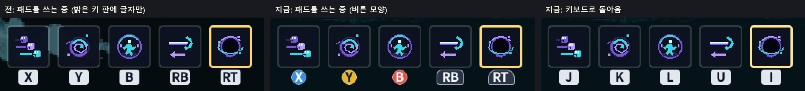
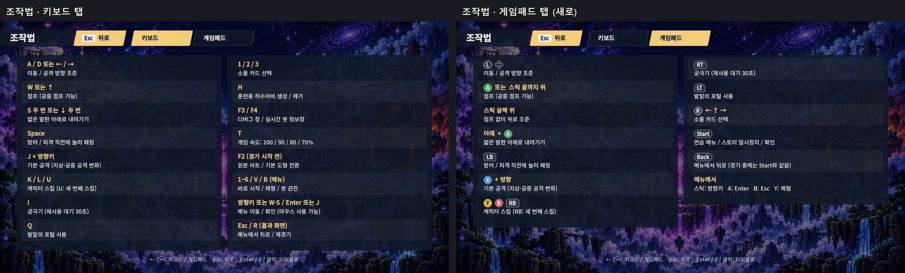
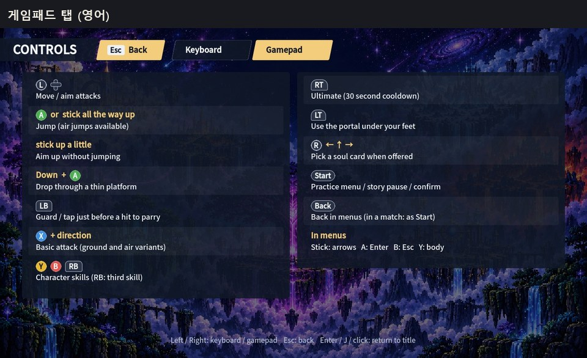
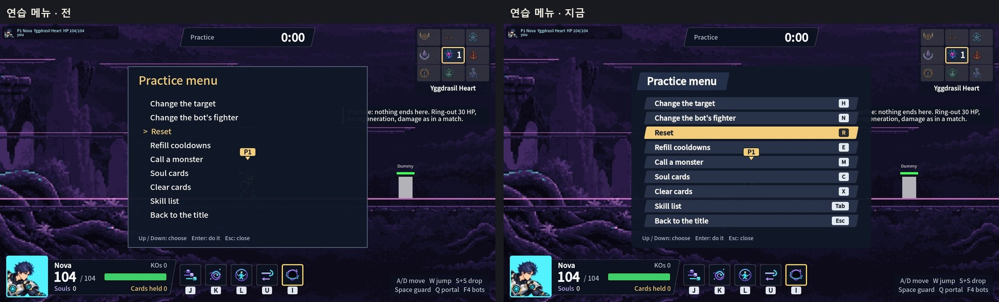
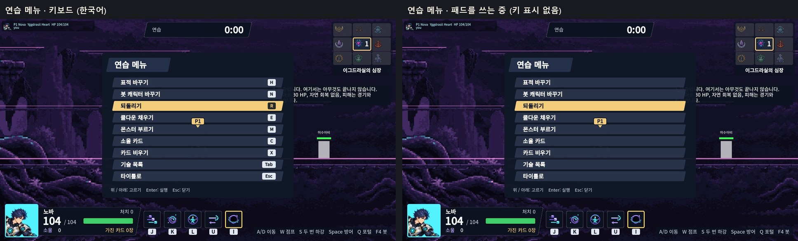
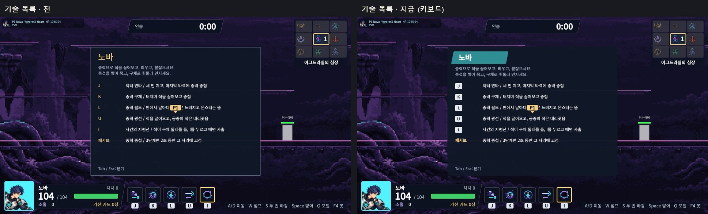
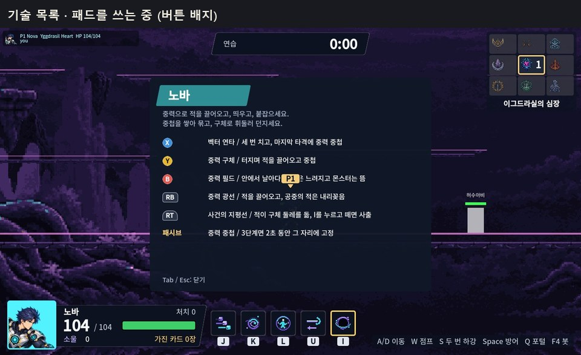

# 게임패드 화면 다듬기 (2026-11-27, UI·디자인 담당)

「총괄」 지시로, 게임패드 보고서(`reports/gamepad-2026-11-26/`) 6절에서 UI 몫으로 남긴 세 가지를 했습니다. 모두 글자와 그리기만으로 했고, 새 그림 파일은 넣지 않았습니다.

문장 끝의 표시: **[잼]** 은 검사나 캡처로 확인한 것, **[코드]** 는 코드에서 읽은 것, **[추정]** 은 확인하지 않은 것입니다.

## 한 문장 결론

**패드 버튼 이름이 버튼 모양 배지로 보이고, 조작법 화면에 게임패드 탭이 생겼으며, 연습 메뉴가 메뉴 B 모양이 됐습니다.** [잼]

## 1. 패드 버튼 배지

- A·B·X·Y는 늘 쓰는 색(초록·빨강·파랑·노랑)의 동그라미입니다. [코드]
- LB·RB는 어두운 판, LT·RT는 위가 더 둥근 어두운 판(방아쇠 모양)입니다. [코드]
- Start·Back은 작은 알약 모양, 스틱은 테두리가 있는 어두운 동그라미(L·R), 십자키는 어두운 십자입니다. [코드]
- 모두 평평한 판과 글자로 그립니다(`scripts/ui/PadBadges.gd`). 그림 파일은 없습니다. [코드]
- 버튼 이름은 번역하지 않습니다. 한국어에서도 패드에 찍힌 대로 "Back"입니다. [코드]

쓰는 곳:

- **경기 HUD의 스킬 칸 아래:** 패드를 쓰는 동안 X·Y·B·RB·RT가 이 배지로 보입니다. 키보드로 돌아오면 밝은 키 표시(J·K·L·U·I)로 돌아옵니다. 글자는 전처럼 시스템 담당의 `PadGlyphs`가 써 넣고, HUD는 그 이름을 보고 모양만 바꿉니다. 이름이 바뀔 때만 다시 그립니다. [잼]
- **조작법 화면의 게임패드 탭**(2절).
- **연습 모드의 기술 목록:** 패드를 쓰는 동안 키 대신 배지가 나옵니다(3절).

## 2. 조작법 화면의 게임패드 탭

- 조작법 화면 위에 "키보드"와 "게임패드" 탭을 두었습니다. 지금 보고 있는 탭은 금색입니다. [잼]
- 화면을 열 때 마지막으로 쓴 장치의 탭이 먼저 나옵니다(패드를 쓰는 중이면 게임패드). [코드]
- 왼쪽·오른쪽 키(패드는 스틱·십자키 좌우)로 탭을 바꿉니다. 처음 고른 버튼은 전처럼 "뒤로"라서, Enter를 누르면 타이틀로 돌아갑니다. [코드]
- 패드 표는 게임패드 보고서 1절의 배치를 따릅니다. 줄마다 버튼 배지 아래에 하는 일을 적었고, 하는 일이 키보드와 같으면 키보드 표의 글을 그대로 씁니다. [코드]
- 키 안내는 탭이 위쪽 자리를 쓰므로 판 아래로 옮겼습니다. [코드]

## 3. 연습 메뉴

- 메뉴 B처럼 평평한 판에, 제목은 기울어진 판 위에 둡니다. 줄은 기울어진 판이고, 고른 줄은 금색입니다. [잼]
- 줄 끝에는 그 줄의 키(H, N, R, E, M, C, X, Tab, Esc)를 키 표시로 둡니다. 패드를 쓰는 동안에는 숨깁니다. 패드로는 메뉴에서 고르기 때문입니다. [코드]
- 기술 목록(Tab)도 같은 판을 씁니다. 제목은 캐릭터 색의 판 위에, 키는 키 표시 위에 둡니다(패드면 X·Y·B·RB·RT 배지). 줄의 글과 자리는 그대로입니다. `test_practice_mode`가 그 글과 자리를 읽기 때문입니다. [코드]
- 메뉴의 줄, 순서, 키, 동작은 바꾸지 않았습니다(시스템 담당의 코드). [코드]

## 새 글

- 13줄을 새로 넣었습니다(한국어 포함). "키보드", "게임패드", 패드 표의 낱말(또는, 스틱 끝까지 위, 스틱 살짝 위, 아래, + 방향, 메뉴에서)과 하는 일 다섯 줄입니다. [코드]
- 조작법 화면의 키 안내 한 줄은 탭 안내를 더한 글로 바꿨습니다. [코드]

## 검사

| 검사 | 결과 |
|---|---|
| `test_hud_layout` | 통과(5393개). 새로 넣은 확인: 패드를 쓰면 스킬 칸의 키가 버튼 배지가 되고(A·B·X·Y는 제 색의 동그라미), 배지가 이름을 다 담은 채 칸 안에 있으며, 키보드로 돌아오면 밝은 키 표시로 돌아옵니다. HUD가 배지를 그리지 않게 빼면 실패합니다 [잼] |
| `test_menu_text` | 통과. 바뀐 화면 겹침 검사에 조작법의 게임패드 탭(영어·한국어)을 더했습니다. 이 검사가 처음에 오른쪽 위 안내와 "게임패드" 탭이 겹치는 것을 잡아서, 안내를 판 아래로 옮겼습니다 [잼] |
| `test_gamepad` | 통과(178개) [잼] |
| `test_practice_mode` | 통과(739개). 한 번은 "싸우는 봇이 15초 안에 서 있는 선수를 때려야 한다"에서 실패했습니다. 메뉴 모양과 상관없는 봇 동작이고, 그때 CPU가 100%였습니다. 따로 다시 돌려 통과했습니다 [잼] |
| (위 739개) | 시스템 담당의 실행은 793개였습니다. 빠진 54개는 기술 목록의 키 글자(J·K·L·U·I)였습니다. 키 표시 판의 자식으로 넣자, "패널의 라벨마다 패널에 맞는지" 확인에서 빠졌습니다(키 27개 × 언어 2). 키 글자를 다시 패널의 직접 자식으로 두어 확인이 돌아오게 고쳤습니다(`c701fcc7`). 793개는 아래 run_all에서 확인합니다 [코드] |
| `test_language`, `test_frontend_flow`, `test_audio` | 통과 [잼] |
| 전체 | run_all ALL PASSED: 검사 66개와 긴 경기 1판, 20분(17:31~17:51). main `75e54db2`(시스템 담당의 컨베이어·봇 패널 고침)을 합친 트리 `eb4e57cc`에서 돌렸습니다. `test_practice_mode`는 793개로 돌아왔습니다 [잼] |
| P1 표시 고침 뒤 | run_all 뒤에 넣은 P1 표시 고침에서 `test_gamepad`(178개)와 `test_practice_mode`(793개)가 통과했습니다 [잼] |

## 그림

"전"은 바꾸기 전의 웹 빌드 묶음(main `23b8ff7c`)으로, "지금"은 프로젝트 폴더로 같은 스크립트(`tests/analysis/ui_audit/pad_badges_capture.gd`)를 돌려 게임 창으로 찍었습니다. 찍기 전에 PC를 66분째 아무도 쓰지 않는 것을 확인했습니다. [잼]

경기 HUD의 스킬 칸(2배로 키움):

조작법 화면의 두 탭(한국어)과 게임패드 탭(영어):

연습 메뉴(전과 지금, 영어)와 한국어(키보드, 패드):

기술 목록(전과 지금, 패드):

- 연습 메뉴 위에 P1 표시가 겹쳐 보이는 것은 전부터 있던 일입니다("전" 그림에도 있음). 메뉴나 기술 목록이 열린 동안 P1 표시를 숨기게 고쳤습니다. 위 "지금" 그림은 고치기 전에 찍어서 아직 P1 표시가 보입니다. 고친 뒤에는 PC를 누가 쓰고 있어 창을 띄워 다시 찍지 않았습니다. [잼: 그림의 겹침, 검사 통과] [코드: 숨기는 줄]

## 웹 빌드

- 47,168,360바이트로, 예산 45 MiB까지 17,560바이트 남습니다(main의 다른 변경 포함). 새 그림은 없습니다. [잼]
- 이 화면들은 웹에서 찍지 못했습니다. 측정 전에 숨은 브라우저로 시도했지만, PC가 바빠(CPU 100%) 페이지가 응답하지 않았습니다. 위 그림은 게임 창 캡처만 근거입니다. [잼]

## 병합

- 커밋: `69a4d0a4`(배지, 패드 탭, 연습 메뉴), `482a6c1d`(HUD 배지 확인), `c701fcc7`(기술 목록 키 글자 자리), `eb4e57cc`(main 합침), 그리고 P1 표시 고침과 이 보고서.
- 시스템 담당이 측정 빌드에서 화면 밖 화살표 고침(`0b6a68a0`)의 효과를 쟀습니다. 4인 경기에서 웹 경고가 고치기 전 약 195프레임에 6개였는데, 고친 뒤 1개(경기 시작 때 처음 색을 넣을 때)였습니다. [잼, 시스템 담당]
