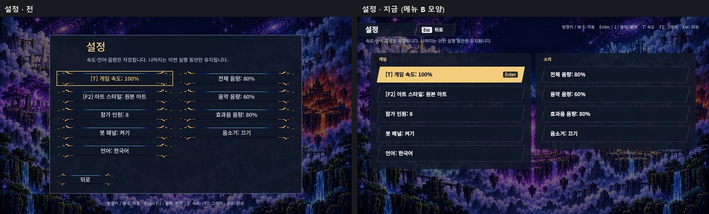
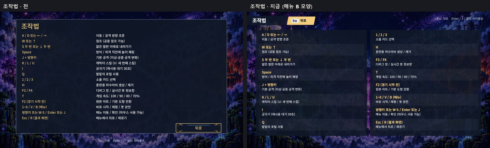
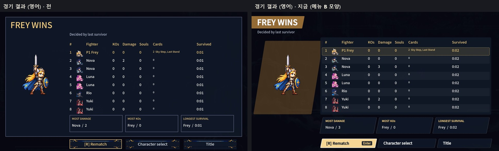
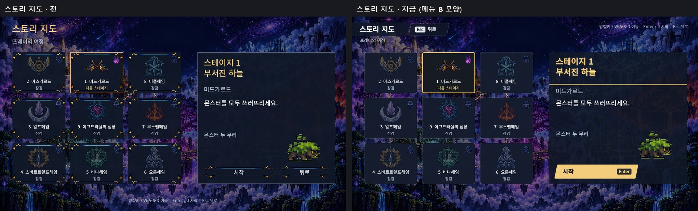
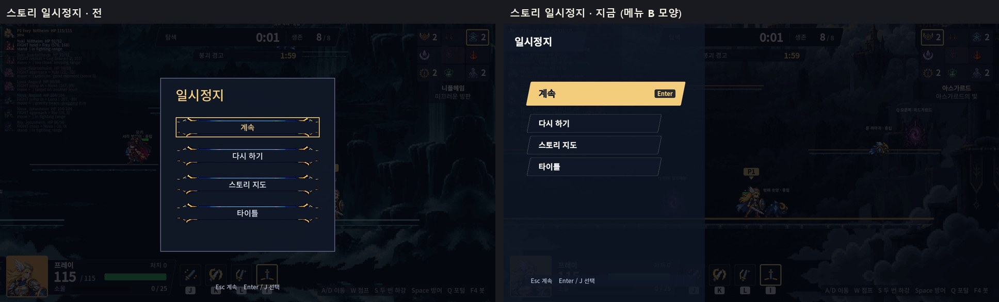
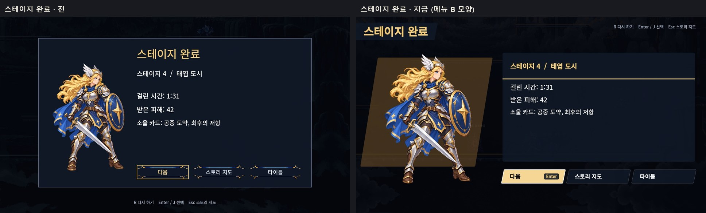
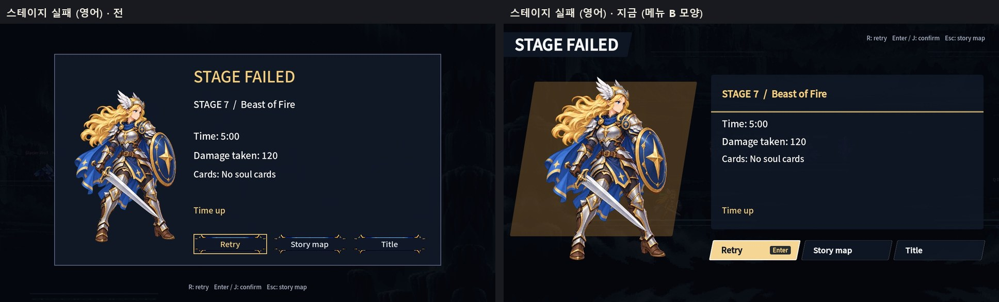
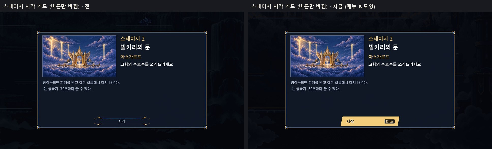
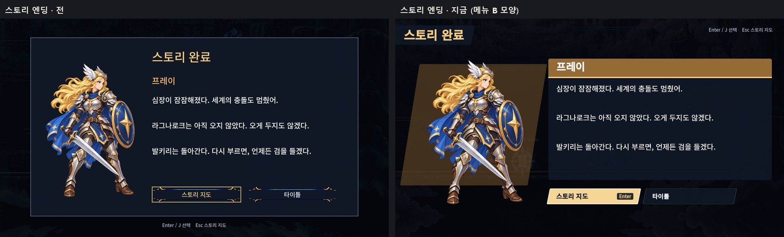

# 메뉴 B 모양을 나머지 화면에 입힘 (2026-11-27, UI·디자인 담당)

「총괄」 지시에 따라 결과·설정·조작법·스토리 화면을 메뉴 B 방향으로 맞췄습니다. 메뉴 B는 시안 월드컵 `2026-11-25-menu`에서 고르신 타이틀 B와 캐릭터 선택 B입니다. 새 그림 파일은 넣지 않았습니다.

문장 끝의 표시: **[잼]** 은 검사나 캡처로 확인한 것, **[코드]** 는 코드에서 읽은 것, **[추정]** 은 확인하지 않은 것입니다.

## 한 문장 결론

**설정, 조작법, 경기 결과, 스토리 지도·일시정지·결과·엔딩이 메뉴 B와 같은 모양이 됐습니다. 스토리에서 고르신 그림(시작 카드 틀, 대화창, 지도 그림)은 그대로입니다.** [잼]

## 메뉴 B에서 가져온 규칙

- 제목은 왼쪽 위에 둡니다. 화면 왼쪽 끝으로 이어지는 기울어진 판 위에 놓고, 그 옆에 Esc 표시가 붙은 "뒤로"를 둡니다. 캐릭터 선택 화면과 같습니다.
- 키 안내는 오른쪽 위의 한 줄입니다(일시정지는 타이틀처럼 왼쪽 아래 판 위).
- 테두리 패널 대신 평평하고 어두운 판을 씁니다.
- 버튼은 기울어진 판입니다. 고른 버튼은 금색이 되고 오른쪽 끝에 Enter 표시가 붙습니다. 그 화면의 주된 버튼(결과의 "다시 하기", 지도의 "시작", 스테이지 결과의 "다음" 등)은 처음부터 금색입니다.
- 캐릭터가 나오는 화면은 캐릭터 색의 기울어진 띠 위에 그림을 두고, 이름도 그 색의 띠에 씁니다. 캐릭터 선택 화면과 같습니다.

## 화면별

아래 그림의 왼쪽은 바꾸기 전 웹 빌드(main `23b8ff7c`), 오른쪽은 지금입니다. 같은 스크립트로 같은 순간을 찍었습니다. [잼]

### 설정

- 게임 설정 다섯 줄과 소리 설정 네 줄을 판 두 장에 나눴고, 판마다 "게임"과 "소리"라는 이름을 달았습니다.
- 줄마다 기울어진 버튼이고, Enter(또는 클릭)로 값을 바꿉니다.

### 조작법

- 16줄을 여덟 줄씩 판 두 장에 나눴습니다. 순서는 예전 표와 같습니다.
- 줄마다 키를 금색 굵은 글자로 쓰고 그 아래에 하는 일을 적었습니다. 캐릭터 선택의 기술 줄과 같은 짜임입니다.
- 한 줄 걸러 옅은 줄무늬를 넣었습니다.

### 경기 결과

- "프레이 승리"는 이긴 캐릭터 색의 판에, 승리 포즈는 같은 색의 띠 위에 둡니다. 무승부는 어두운 판에 금색 글자입니다.
- 순위표는 판 위에 놓고, 내 줄(P1)은 금색으로 밝혔습니다. 나머지 줄은 한 줄 걸러 줄무늬입니다.
- 상 세 개(최다 피해, 최다 처치, 최장 생존)는 기울어진 판입니다.
- "다시 하기"는 금색입니다. 버튼 순서(다시 하기, 캐릭터 선택, 타이틀)와 R 키는 그대로입니다.

### 스토리 지도

- 스테이지 칸은 캐릭터 선택의 목록 칸과 같은 평평한 칸입니다. 고른 칸에 금색 테두리가 둘립니다.
- 오른쪽 스테이지 설명은 판 위에 놓고, 제목 아래에 금색 선을 그었습니다. "시작" 버튼은 금색입니다.
- 지도의 뿌리 길, 인장, 다음 스테이지의 불꽃은 고르신 그림 그대로입니다.

### 스토리 일시정지

- 타이틀처럼 왼쪽에 어두운 띠를 깔고 메뉴를 세로로 놓았습니다. 멈춘 싸움은 오른쪽에 보입니다.
- "계속"은 크게, 나머지 셋(다시 하기, 스토리 지도, 타이틀)은 작게 놓았습니다.

### 스테이지 완료·실패

- 주인공 그림은 캐릭터 색의 띠 위에 둡니다. "스테이지 완료"는 금색 글자, "스테이지 실패"는 흰 글자입니다.
- 스테이지 이름, 걸린 시간, 받은 피해, 소울 카드는 판 위에 적었습니다.
- "다음"(실패하면 "다시 하기")은 금색입니다.

### 스테이지 시작 카드

- 카드의 틀과 그림은 고르신 스토리 그림이라 그대로 두었습니다. "시작" 버튼만 금색으로 바꿨습니다.

### 스토리 엔딩

- 주인공 그림은 캐릭터 색의 띠 위에, 이름은 같은 색의 띠에 대문자로 씁니다. 마지막 세 줄은 판 위에 놓았습니다.
- 엔딩에 주인공 일러스트를 쓰는 것(D43)은 그대로입니다.

## 그대로 둔 것

- 고르신 스토리 그림: 시작 카드의 틀과 그림, 대화창 틀과 이름판, 지도의 뿌리 길·인장·불꽃(SART, ART-70). [코드]
- 대화창 안의 "다음"과 "건너뛰기"는 예전 틀 모양입니다. 대화창 그림 안에 있는 버튼이라 손대지 않았습니다. [코드]
- 화면마다 버튼의 순서와 이름, 키(R, Esc, Enter/J, 방향키, 숫자 키). 다른 코드와 검사가 이 순서로 읽습니다. [코드]

## 새 글

- "GAME"(게임), "SOUND"(소리) 두 줄을 번역표에 넣었습니다. 설정 화면의 판 이름입니다. [코드]

## 검사

| 검사 | 결과 |
|---|---|
| `test_menu_text` (새 부분) | 통과. 바뀐 화면 28개(설정, 조작법, 결과·무승부, 스토리 지도·카드·일시정지·완료·실패, 주인공 다섯 명의 엔딩)를 영어·한국어로 봅니다. 글과 버튼이 화면 안에 있고 줄이 모두 보이며, 글끼리 또는 글과 버튼이 겹치지 않고(칸 안의 이름표는 뺌), 버튼끼리 떨어져 있고, 버튼 글이 Enter 표시 앞에서 끝나는지 봅니다 [잼] |
| `test_language`, `test_victory_screens`, `test_story_text_fit`, `test_story_presentation`, `test_frontend_flow`, `test_story_flow`, `test_audio`, `test_bot_panel`, `test_gamepad` | 통과 [잼] |
| 전체 | run_all: (아래 "병합"에 적음) |

## 찍은 방법

- 그림은 게임 창을 띄워 찍었습니다(`tests/analysis/ui_audit/later_screens_capture.gd`). 찍기 전에 PC를 34분째 아무도 쓰지 않는 것을 확인했습니다. 소리는 껐고, 설정 파일에 쓰는 것은 없습니다. [잼]
- "전" 그림은 바꾸기 전의 웹 빌드 묶음(`index.pck`, main `23b8ff7c`)으로, "지금" 그림은 프로젝트 폴더로 같은 스크립트를 돌렸습니다. 일시정지·결과·엔딩은 실제 게임처럼 경기를 띄운 뒤 그 위에 찍었습니다. [잼]
- 웹 빌드에서 찍은 것은 아래 "웹 빌드"에 따로 적습니다.

## 웹 빌드

- (15:00 이후, 성능 측정 시간이 끝난 뒤에 빌드하고 적습니다.)

## 병합

- 커밋: `47b27b93`(화면), 그리고 이 보고서.
