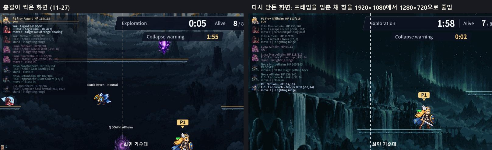
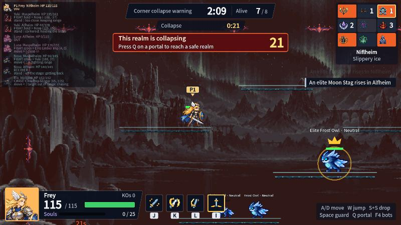

# 웹에서 경기장이 커져 보이던 것 (2026-11-27, UI·디자인 담당)

「총괄」이 정한 것: 웹에서도 보이는 영역은 데스크톱과 같은 1280×720(가로가 넓으면 늘어남)으로 두고, 기기 배율 때문에 경기장이 더 크게 보이는 것은 막는다. 이를 위해 원인을 찾고, 브라우저에서 기기 배율 1.5일 때 보이는 영역을 게임 안에서 쟀습니다.

문장 끝의 표시: **[잼]** 은 검사나 캡처로 확인한 것, **[코드]** 는 코드에서 읽은 것, **[추정]** 은 확인하지 않은 것입니다.

## 한 문장 결론

**게임은 기기 배율 1.5에서도 이미 1280×720을 보여 줍니다. 확대처럼 보인 것은, 숨은 브라우저 창에서 게임 프레임이 멈춘 사이 페이지가 작아져, 더 큰 크기로 남은 캔버스의 왼쪽 위만 찍힌 것이었습니다. 그래서 게임 코드는 바꾸지 않았습니다.** [잼]

## 잰 값 (게임 안에서 읽음)

웹 빌드를 앱 안의 브라우저(이 PC의 기기 배율 1.5)에서 열고, 1초마다 값을 찍는 임시 줄을 넣어 읽었습니다. 임시 줄은 재고 나서 되돌렸고 커밋하지 않았습니다. [잼]

| 페이지 크기 (CSS 픽셀) | 기기 배율 | 엔진이 읽은 배율 | 엔진 창 = 캔버스 (기기 픽셀) | 보이는 영역 (게임 단위) |
|---|---|---|---|---|
| 1280×720 | 1.5 | 1.50 | 1920×1080 | **1280×720** |
| 1920×1080 | 1.5 | 1.50 | 2880×1620 | **1280×720** |
| 1470×720 (가로가 넓음) | 1.5 | 1.50 | 2205×1080 | **1470×720** |

- 카메라 배율은 세 경우 모두 0.85였습니다. [잼]
- 기기 배율 1.5가 바꾸는 것은 선명도(엔진이 기기 픽셀로 그림)뿐입니다. 보이는 넓이는 데스크톱과 같은 규칙(1280×720, 가로가 넓으면 늘어남)을 따릅니다. [잼]
- 총괄이 적은 값(캔버스 1920×1080, CSS 1280×720, 배율 1.5)은 표의 첫 줄과 같습니다. 그 상태에서 보이는 영역은 1280×720입니다. [잼]

## 확대처럼 보인 까닭 (같은 화면을 다시 만듦)

- 두 화면 모두 P1이 화면 가운데가 아니라 오른쪽(가로 70~75%)에 있습니다. 엔진이 보이는 영역을 줄였다면 카메라가 P1을 가운데에 둡니다. 75%는 "제대로 그린 1280×720 화면에서 왼쪽 위 2/3만 보임"과 맞습니다. 시계 판이 오른쪽으로 밀리고, 미니맵과 왼쪽 아래 플레이어 묶음이 사라진 것도 같습니다. [잼]
- 다시 만든 순서 [잼]:
  1. 숨은 창에서 페이지를 1920×1080으로 키웠습니다. 캔버스가 2880×1620(CSS 1920×1080)이 되고 게임은 정상입니다.
  2. 게임 프레임을 멈췄습니다. 숨은 창은 원래 프레임을 거의 또는 전혀 돌리지 않습니다. 이 실험에서는 대신 돌리던 프레임 펌프를 멈췄습니다.
  3. 페이지를 1280×720으로 되돌렸습니다. 캔버스는 CSS 1920×1080 그대로 남습니다.
  4. 찍으면 캔버스의 왼쪽 위 1280×720 CSS만 담깁니다. 화면의 2/3가 1.5배로 보이는, 총괄 사진과 같은 모습입니다.
- 프레임을 다시 돌리자 0.4초 안에 캔버스가 1920×1080(CSS 1280×720)으로 돌아왔고, 화면도 정상이었습니다. [잼]

- 이 숨은 창의 페이지는 처음에 0×0이었다가, 첫 캡처 때 1280×720이 되어 그대로 남았습니다. 그 사이 프레임이 돌지 않으면 캔버스는 예전 크기에 남습니다. [잼]
- 측정 중 넓은 창(1470×720)으로 바꾸자마자 찍은 한 장도 잘려 찍혔습니다. 바로 뒤에 읽은 캔버스는 이미 새 크기였습니다. [잼] 창을 바꾼 직후의 캡처는 믿기 어렵다는 뜻으로 봅니다. [추정]
- 총괄 창에서 그 전에 페이지가 더 컸던 까닭(창 크기 바꾸기, 펌프가 멈춘 때 등)은 모릅니다. [추정]

## 엔진 코드에서 본 것 [코드]

- Godot 4.7 웹은 프레임마다 처음에 캔버스를 "페이지 크기 × 기기 배율"로 맞춥니다(`GodotDisplayScreen.updateSize`). 크기가 바뀌면 엔진 창 크기도 그 값으로 바꿉니다(`DisplayServerWeb::check_size_force_redraw` → `Window::_rect_changed_callback`).
- 기기 배율을 화면 배율(content scale)에 곱하는 길은 없습니다. 게임 코드도 창 크기나 화면 배율을 건드리지 않습니다.
- 그래서 실제 브라우저의 보이는 탭에서는, 창이나 배율이 바뀌어도 다음 프레임에 맞춰집니다. 다른 탭에 갔다 오면 그동안 프레임이 멈추지만, 돌아온 첫 프레임에 맞춰질 것입니다. [추정: 위 "다시 돌리자 0.4초 안에"에서]
- 사용자 PC(배율 1.5)에서 브라우저로 해도 이런 확대는 생기지 않을 것입니다. [추정: 같은 배율의 이 창에서 잰 값]
- 터치패드로 페이지를 확대(핀치)하는 것도 게임 위에서는 막혀 있습니다. 엔진이 캔버스 위의 휠을 막고(`preventDefault`), 페이지에 `user-scalable=no`와 `touch-action: none`이 있습니다.

## HUD 고침(`90dee94b`)과의 관계

- 총괄이 찾은 "HUD 자리가 어긋남"도 같은 캡처 현상이었습니다. 그 사진 속 HUD는 1280×720 자리에 제대로 있었고, 화면 전체가 잘렸을 뿐입니다. [잼: 같은 화면을 다시 만듦] 옛 HUD도 같은 상태라면 똑같이 잘렸을 것입니다. [추정]
- HUD 보고서(`reports/ui-hud-2026-11-26/`) 8절의 원인 설명("엔진이 배율을 더함")이 틀렸기에, 그 절에 정정을 달았습니다.
- 그때 넣은 HudRoot(보이는 영역이 1280×720보다 작으면 HUD를 통째로 줄임)는, 지금 설정에서는 쓰일 일이 없는 대비책이 됐습니다. 보이는 영역은 1280×720보다 작아지지 않습니다(stretch `expand`). [코드] 검사를 통과했고 해가 없어 그대로 두었습니다. 빼기를 원하시면 빼겠습니다.

## 한 일과 하지 않은 일

- 게임 코드는 바꾸지 않았습니다. [잼]
- `allow_hidpi` 끄기, 화면 배율 고정은 하지 않았습니다. 막을 확대가 없고, 끄면 배율 1.5 화면에서 그림이 흐려지기만 합니다. [코드]

## 숨은 창에서 웹 빌드를 찍을 때

- 프레임 펌프를 켠 채로 찍고, 창 크기를 바꾼 직후에는 한 프레임 이상 기다립니다.
- 찍기 전에 `canvas.style.width`가 `innerWidth`(px)와 같은지 봅니다. 다르면 그 캡처에는 예전 크기의 캔버스가 찍힙니다.
- 8060에서 다시 볼 때도 같습니다. 펌프를 켜거나 창이 보이는 상태에서 찍으면 확대가 없어야 합니다. 그래도 보이면 그 상태에서 `[innerWidth, innerHeight, devicePixelRatio, visualViewport.scale, canvas.width, canvas.height, canvas.style.width, canvas.style.height]` 값을 읽어 주세요.

## 파일

- `img/01-lead-vs-reproduced.jpg`: 총괄 캡처(`reports/ui-hud-2026-11-26/img/10-web-853x480-before.jpg`)와 다시 만든 화면(`img/src-zoom-reproduced.jpg`)을 나란히 놓은 그림. `make_figures.py`로 만듭니다.
- `img/02-after-frames-resume.jpg`: 프레임을 다시 돌린 뒤의 화면.
- 웹 빌드는 이번 main(`0b96dc87`)으로 다시 만들었습니다(임시 줄 없음). 47,160,743바이트로, 예산 45 MiB까지 25,177바이트 남습니다. [잼]
