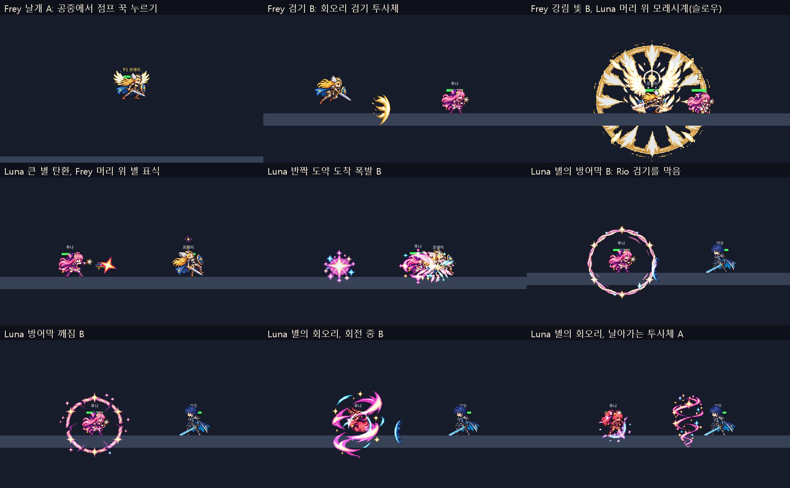

# Frey·Luna 이펙트 선택 적용 (2026-11-03)

사용자 선택: "Frey는 윙A, 웨이브B, 필살기B로 가고, 슬로우는 모래시계 이펙트. Luna는 사이클론 투사체는 첫번째로 하고, 본인 회전 중에는 두번째로. 나머지는 2번째 목록들로 진행."

엔진 창 캡처(`tests/analysis/lead/frey_kit_capture.gd`, `luna_kit_capture.gd`)를 1:1로 잘랐다. 보드 스크립트: [board.py](board.py).

## 넣은 것

| 캐릭터 | 기술 | 고른 후보 | 게임 파일 | 표시 |
|---|---|---|---|---|
| Frey | 발키리의 날개(공중 정지) | 날개 A | `effects/skill/frey_wings.png` | 0.5배(펼친 폭 약 117px), 몸 뒤, 왼쪽을 보면 뒤집음 |
| Frey | 회오리 검기(K) | 검기 B | `effects/frey_wave.png` | 1배, 날아가는 방향으로 돌림 |
| Frey | 회오리 검기의 슬로우 | 모래시계(A) | `ui/status/slow.png` | 슬로우 동안 머리 위. 기절·아머가 먼저 |
| Frey | 발키리 강림(I)의 빛 | 강림 빛 B | `vfx/frey_ult_light.png` | 2배(반경 330px), 0.45초 |
| Luna | 별의 방어막(L) | 방어막 B, 깨짐 B | `effects/skill/luna_barrier.png`, `luna_barrier_break.png` | 1배, 마지막 1초 깜박임, 깨지면 깨짐 그림 |
| Luna | 반짝 도약(K) | 도약 폭발 B | `effects/skill/luna_warp.png` | 1배, 나타난 자리 |
| Brave | 별의 회오리(L), 도는 동안 | 회오리 B | `effects/skill/luna_cyclone.png` | 1.25배, 몸 중심 |
| Brave | 별의 회오리(L), 쏜 회오리 | 회오리 A | `effects/skill/luna_cyclone_shot.png` | 1배 |
| Luna | 별빛 연사(J) | 작은 별·큰 별(하나뿐) | `effects/luna_star_shot.png`, `luna_star_big.png` | 1배 |
| Luna | 별의 마법 표식 | 별 표식(하나뿐) | `ui/status/luna_star_mark.png` | 머리 위 |
| Luna | 스킬 아이콘 | 5개(하나뿐) | `skill_icons/luna_{j,k,l}.png`, `luna_brave_{k,l}.png` | HUD |

"나머지는 2번째"는 A/B가 있는 방어막·깨짐·도약 폭발을 B로 읽었다. 후보가 하나뿐인 별 탄환·표식·아이콘은 그대로 넣었다(바꾸려면 말해 주세요).

## 코드

- `scripts/Vfx.gd` SPECS에 11종 등록(프레임·fps·앵커·가산 혼합).
- `Projectile.set_effect_art(effect)`: 투사체에 반복 그림을 붙이고 날아가는 방향으로 돌린다(왼쪽이면 뒤집음). Frey 검기와 Luna 별 탄이 쓴다. 예전 임시 그림(`frey_slash` 2번째 프레임, `luna_star.png`)은 뺐다.
- `PlayerBase._update_status_icon`: 슬로우(`control_slow_timer`) 동안 모래시계. Yuki 결계의 느려짐에도 같은 표시가 나온다.
- `LunaBarrier`: 그림이 있으면 그림이 깜박이고, 깨질 때 깨짐 그림(첫 프레임이 방어막과 같아 방어막은 바로 사라짐).
- 그림이 없거나 F2 프로토타입 모드면 예전 코드 도형이 그대로 나온다.

## 확인

- `test_skill_fx_art`에 새 그림 10종·슬로우 표시·별 표식 검사를 더했다(원본 모드에서 나오고 프로토타입 모드에서 안 나옴). 관련 테스트 13개 통과, 전체 테스트는 커밋 기록 참고.
- 엔진 창 캡처로 위치·크기를 봤다(위 보드). 웹 빌드(8060)는 다시 만들었고 경기까지 콘솔 오류 없음.

## 아직 고르지 않은 것

- Frey K 아이콘 A/B(`reports/codex-vfx-03/board.png` 오른쪽 아래). 지금은 예전 돌진 아이콘.
- 별의 광선 그림(하트 광선 그대로 둘지).
- 몸 동작 줄 후보: Frey `wing_hover`, Luna `star_warp`, Brave `brave_grab`(모션 뷰어). `whirl_spin`·`brave_cyclone`은 보류라 다시 그려야 한다.
- 날개 크기: 카드의 170px 대신 그린 크기 그대로 0.5배(117px). 더 크게 원하면 말해 주세요.
