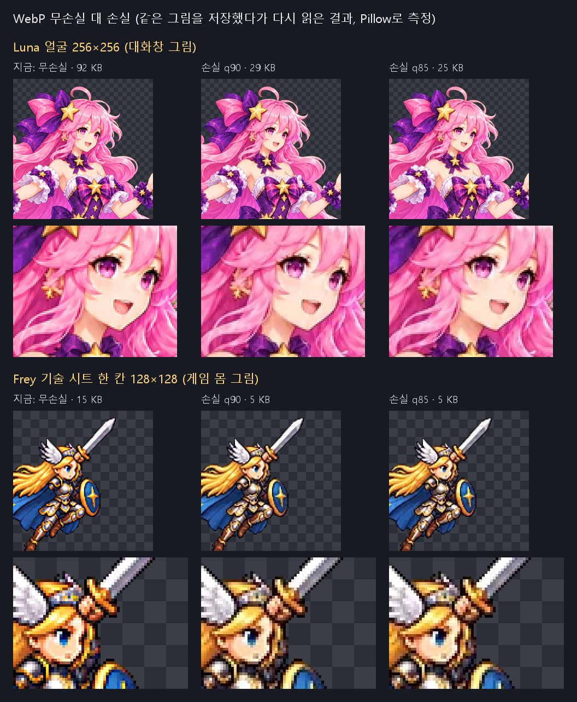
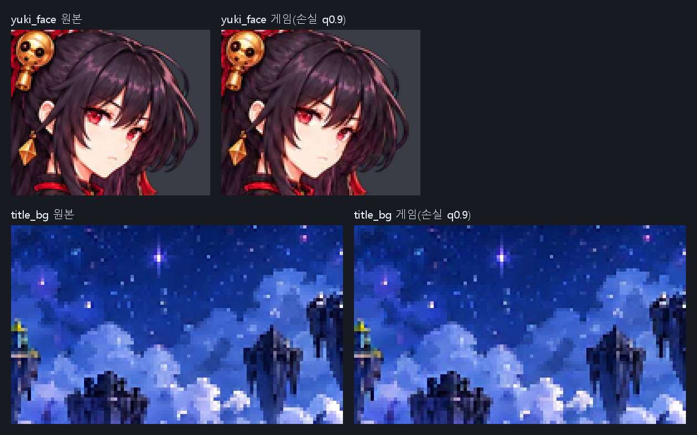

# 웹 빌드 용량 점검과 조각 압축 (2026-11-24, 총괄)

사용자: "시안 월드컵 할건데 그 동안 다른 작업 하고 있어."

그 시간에 방향 보고서(`reports/direction-2026-11-16.md`) 3단계의 "웹 용량 점검"을 했다. 단위 MB는 빌드 출력과 같은 1,048,576바이트다.

## 한 줄 요약

- **고친 것:** 플레이어가 내려받는 양이 **77.5MB에서 46.9MB로** 줄었다. 엔진(wasm)과 게임 묶음(pck)을 빌드 때 gzip으로 압축해 두고, 브라우저에서 푼다. 화면과 게임은 그대로다. 풀어 낸 파일이 원본과 바이트 단위로 같다.
- **커진 까닭:** 게임 묶음(pck)은 마지막 배포(v5, 10-15) 15.8MB에서 지금 39.5MB가 됐다. 늘어난 것은 거의 다 게임이 실제로 쓰는 그림과 소리다. 쓰지 않는 후보 파일은 보이지 않았다.
- **더 줄이려면:** 그림 저장 방식을 바꿔야 하고, 화질을 정하는 일이다. 추천은 얼굴·타이틀 배경만 손실 압축하는 것(약 2.8MB)이다. 몸 스프라이트는 지금처럼 무손실로 둔다.
- **적용 (사용자 "추천대로 해", D52):**
  - 얼굴·타이틀 배경을 손실 압축했다. 내려받는 양은 **44.2MB**로, 예산 45MB 안이다.
  - 글자 처리 데이터(ICU)는 확인해 보니 뺄 수 없어 그대로 둔다(6절).

## 1. 고친 것: 조각 파일을 미리 압축

### 원인

- `tools/build_web.ps1`은 5MB가 넘는 파일을 `.part0`, `.part1` … 조각으로 나눈다. Sites가 큰 파일을 거부하기 때문이다(10-07).
- 정적 호스트는 보통 모르는 확장자(`.part0`)를 압축하지 않고 그대로 보낸다. 그래서 엔진 37.7MB가 그대로 전송됐을 가능성이 크다. gzip이면 9.6MB다.
  - 소유자 전용 사이트라 실제 응답 헤더는 재지 않았다.
  - 이 방식이면 호스트가 어떻게 보내든 결과가 같다.
- 업로드 zip 크기(46.7MB)는 플레이어가 받는 양이 아니었다. zip이 압축을 대신 해 줘서 작게 보였을 뿐이다.

### 고친 것

| 파일 | 바뀐 것 |
|---|---|
| `tools/build_web.ps1` | wasm과 pck를 gzip으로 압축한 뒤 5MB 조각으로 나눈다. `-PartMB 0`(통째 파일)은 전과 같다. |
| `tools/web_part_loader.js` | 조각을 이어 붙인 뒤, 첫 두 바이트가 gzip이면 브라우저 내장 `DecompressionStream`으로 푼다. gzip이 아니면 그대로 넘긴다(예전 빌드도 돈다). 압축을 풀 수 없는 오래된 브라우저에는 "업데이트하라"는 오류가 나온다. |
| `design/tasks/CODEX-DEPLOY-01.prompt.md` | 조각 수(wasm 2개, pck 8개)와 "조각을 풀지 말고 그대로 올린다"를 적었다. 배포 방식은 같다. |

### 결과

| 파일 | 원본 | 조각으로 보내는 양 | 조각 수 |
|---|---|---|---|
| `index.wasm` (엔진) | 37.7MB | **9.6MB** | 8 → 2 |
| `index.pck` (게임) | 39.5MB | **37.0MB** | 8 → 8 |
| 나머지(html·js·아이콘) | 0.3MB | 0.3MB | — |
| 합계 | 77.5MB | **46.9MB** | |

pck는 거의 줄지 않는다. 그림(WebP)과 소리(OGG)가 이미 압축된 파일이기 때문이다.

### 확인 (로컬 웹 빌드, 8060)

- 시작 화면이 뜨고 콘솔 오류는 없다. 렌더러의 WebGL 버퍼 경고는 있지만, 로딩과는 상관없다.
- 브라우저가 받은 조각 10개의 크기가 위 표와 같다.
- 브라우저가 풀어 낸 wasm·pck의 SHA-256이 원본과 같다.
  - wasm `7eda9895…`, pck `4ac4be09…`
  - 크기도 Godot 설정의 `fileSizes`와 같다. 그래서 로딩 막대도 맞다.
- 필요한 브라우저: `DecompressionStream`이 있어야 한다.
  - Chrome·Edge 80 이상, Safari 16.4 이상, Firefox 113 이상
  - 2023년 중반 이후 브라우저는 모두 된다.
- `run_all`: 아래 "검사" 참고.

## 2. 무엇이 들어 있나 (지금 pck 39.5MB)

| 분류 | 파일 수 | MB |
|---|---|---|
| 캐릭터 몸·기술 시트 | 18 | 9.8 |
| 이펙트·함정 | 131 | 6.6 |
| 글자 처리 데이터(ICU) | 1 | 4.6 |
| 스토리 그림 | 24 | 3.3 |
| 얼굴 | 46 | 3.2 |
| 몬스터 | 29 | 3.2 |
| 음악 | 5 | 1.9 |
| 캐릭터 동작 줄(승리·패배·점프 등) | 46 | 1.9 |
| 렐름 배경 | 48 | 1.7 |
| 타이틀·UI | 52 | 1.5 |
| 코드·장면·기타 | — | 0.8 |
| 효과음 | 78 | 0.7 |
| 글꼴 | 1 | 0.3 |

### 늘어난 것 (v5 15.8MB → 39.5MB)

- **10-15 이후 새로 들어온 파일:** 13.8MB
  - 스토리 그림 3.3
  - 이펙트 2.0
  - 음악 1.9
  - 캐릭터 동작 줄·얼굴 4.0
  - Xion 1.0
  - 효과음 0.7
  - 궁극기 이펙트 0.5
  - 한국어 글꼴 0.3
- **다시 그린 파일:** 지금 13.0MB
  - 몬스터 3.1
  - Rio 2.4
  - 공격 이펙트 2.1
  - 예전 크기는 재지 않았다.
- **글자 처리 데이터(ICU):** 4.6MB. 프로젝트 설정에서 켠 적은 없다. Godot가 번역 언어를 보고 넣은 것으로 보인다(확인 필요).

### 쓰지 않는 파일

- 빌드에 들어간 그림·소리 486개를 폴더별로 나열했다. 그리고 코드가 이름을 만드는 규칙과 맞춰 봤다. 캐릭터·몬스터·렐름·스토리 이름이 그 규칙이다.
- 옛 판, 후보 파일, 시험 파일은 보이지 않았다. 다만 눈으로 대조한 것이고, 자동 검사는 아니다.
  - 시험 폴더, 생성 원본(`*_source`), 일러스트(`*_illustration`), 접촉 시트는 export 규칙으로 이미 빠져 있다.
  - **정정(2026-11-25):** 일러스트를 빼는 규칙은 맞지 않았다. 캐릭터 선택과 스토리 화면이 전신 일러스트를 그리는데 웹 빌드에는 없어서 얼굴 그림이 확대되어 나오고 있었다. 이 점검에서 "안 쓰는 파일"로 넘긴 것이 잘못이다. 「UI·디자인 담당」이 찾았고, 절반 크기 손실로 넣었다(D55, 내려받는 양 44.9MB).
- 남은 것은 초상화 대체 그림 7장(각 2~3KB)뿐이다. 빼도 의미가 없다.

## 3. 더 줄이는 방법 (정할 것)

- 줄어드는 양은 Pillow로 WebP를 다시 저장해서 쟀다. Godot 인코더가 약 12% 더 크게 나오므로 그만큼 보정했다.
- 스토리 그림과 시작 카드는 이미 손실 압축(q0.85)이다.

| 방법 | 줄어드는 양 | 대가 | 추천 |
|---|---|---|---|
| 얼굴 39장과 타이틀 배경을 손실 WebP(q0.9)로 | 약 2.8MB | 3배로 확대하면 가는 선이 조금 부드러워진다(아래 그림 윗줄) | **한다** |
| 글자 처리 데이터(ICU) 빼기 | 2.7MB | 한국어 줄바꿈이 띄어쓰기 단위로 바뀔 수 있다. 대화창·설명 글을 확인해야 한다 | 확인한 뒤 |
| 몸 스프라이트(몸·기술·몬스터 시트, 동작 줄)를 손실 WebP로 | 약 9.2MB | 색이 반 해상도로 저장돼 픽셀 경계가 번진다(아래 그림 아랫줄). "지금 시트의 디테일 유지" 기준과 부딪힌다 | 안 한다 |
| 이펙트 그림을 손실로 | 약 1.6MB | 더하기 섞기에서 어두운 부분에 얼룩이 보일 수 있다 | 안 한다 |
| 스토리 그림을 스토리에 들어갈 때 따로 받기 | 첫 로딩 3.3MB | 코드 작업이 크다 | 나중 |

- 추천대로 하면(얼굴·타이틀, ICU까지) 내려받는 양은 약 41.4MB다.
- 방향 보고서의 예시 예산 40MB를 지키려면 몸 스프라이트를 손실로 바꿔야 한다. 그래서 예산은 **45MB**를 추천한다.
  - 몸 그림의 질은 지킨다.
  - 앞으로 들어오는 일러스트(얼굴·CG·카드)는 손실(q0.85~0.9)로, 픽셀 그림은 무손실로 가져오는 규칙을 둔다.

- 윗줄(얼굴, 256×256): q90에서 92KB가 29KB가 된다. 3배로 확대해도 차이가 거의 없다.
- 아랫줄(Frey 몸 그림): q90에서 15KB가 5KB가 된다. 5배로 확대하면 머리카락·얼굴 경계의 색이 번진다.

## 4. 검사

- 바꾼 것은 빌드 도구(`tools/`)뿐이다. Godot 게임 코드는 바뀌지 않았다.
- 그래도 규칙대로 `run_all`을 돌렸다. 8인 소크까지 57개가 통과했다(ALL PASSED).

## 5. 정할 것 (사용자가 정함)

1. 얼굴·타이틀 배경 손실 압축(약 2.8MB, 추천)
2. ICU 빼기를 확인해 볼지(2.7MB)
3. 웹 예산(추천 45MB)

사용자 답: "추천대로 해". 결정 D52로 적었다.

## 6. 적용한 것 (2026-11-24)

### 얼굴 39장과 타이틀 배경: 손실 WebP q0.9

- `.import` 40개를 `compress/mode=1`, `compress/lossy_quality=0.9`로 바꾸고 다시 가져왔다.
- 게임 묶음에서 4.54MB가 1.84MB가 됐다(−2.70MB, 예상 2.8MB).
- **게임이 실제로 읽은 그림을 원본과 비교했다.**
  - `tests/analysis/lead/lossy_fidelity.gd`로 Godot가 디코드한 그림을 저장하고, `fidelity.py`로 원본 PNG와 비교했다.
  - 투명도를 곱한 색으로 비교했다. 배경 위에 실제로 보이는 값이다. 결과는 `fidelity.txt`에 있다.
  - 얼굴: PSNR 29.1~37.9dB(가운데 33.2). 가장 낮은 것은 Yuki 얼굴이다(가는 머리카락이 많다).
  - 타이틀 배경: 34.1dB.
  - 투명도(알파)는 모두 원본과 같다.
- 아래 그림은 가장 낮은 Yuki 얼굴과 타이틀 배경을 3배로 확대한 것이다.
  - 가는 머리카락과 밝은 별 한 점이 조금 부드러워진다.
  - 실제 크기에서는 차이가 보이지 않는다.

- 웹 빌드(8060)에서 시작 화면과 캐릭터 선택 화면(얼굴 6개와 큰 초상화)이 콘솔 오류 없이 나온다.

### 글자 처리 데이터(ICU): 그대로 둔다

- `internationalization/locale/include_text_server_data=false`로 두고 빌드해 봤다. 그래도 들어간다. 빌드 로그도 "편집기 내장 텍스트 서버 데이터를 사용합니다"라고 찍는다.
- 번역을 영어만 두고 빌드하면 빠진다. Godot 4.7은 한국어 번역이 있으면 ICU를 스스로 넣는다(한국어 줄바꿈용).
- 빼려면 빌드 뒤 pck 목록을 직접 고쳐야 한다. 엔진이 바뀌면 깨질 수 있는 방법이라 2.7MB 값어치가 없다.
- 시험한 설정은 되돌렸다(`project.godot` 변경 없음).

### 예산 45MB와 지키는 장치

- 내려받는 양은 **44.2MB**다(엔진 9.6 + 게임 34.2 + 나머지 0.3). zip은 43.9MB다.
  - 이 빌드에는 「캐릭터 스킬 담당」이 넣고 있던 Xion 기술 그림·Frey J 여운(커밋 전)이 들어 있다. 그 작업이 끝나면 숫자가 조금 바뀔 수 있다.
- `tools/build_web.ps1`이 빌드 끝에 `Download: 44.2 MiB (budget 45 MiB)`를 찍는다. 넘으면 `WARNING` 줄을 찍는다.
- `tests/test_import_modes.gd`(run_all)가 규칙을 검사한다. 그림 400장 가운데 일러스트 55장이 손실이다(얼굴 39, 장면 그림 6, 시작 카드 9, 타이틀 1).
  - 새 얼굴이 무손실로 들어오거나 픽셀 그림이 손실로 바뀌면 실패한다.
  - 두 경우 모두 일부러 바꿔서 실패하는 것을 확인했다.
- 그림 폴더 규칙은 `assets/art/README.md` "가져오기 압축 규칙"에 있다.
- `run_all`: 새 검사를 넣고 8인 소크까지 58개가 통과했다(ALL PASSED).
- 남은 여유는 0.8MB다. 앞으로 Rio·Yuki 새 키트 그림이 들어오면 예산을 넘을 수 있다. 그때 고를 길은 셋이다.
  - 스토리 그림을 스토리에 들어갈 때 따로 받기(3.3MB)
  - 이펙트 일부를 손실로
  - 예산 올리기
