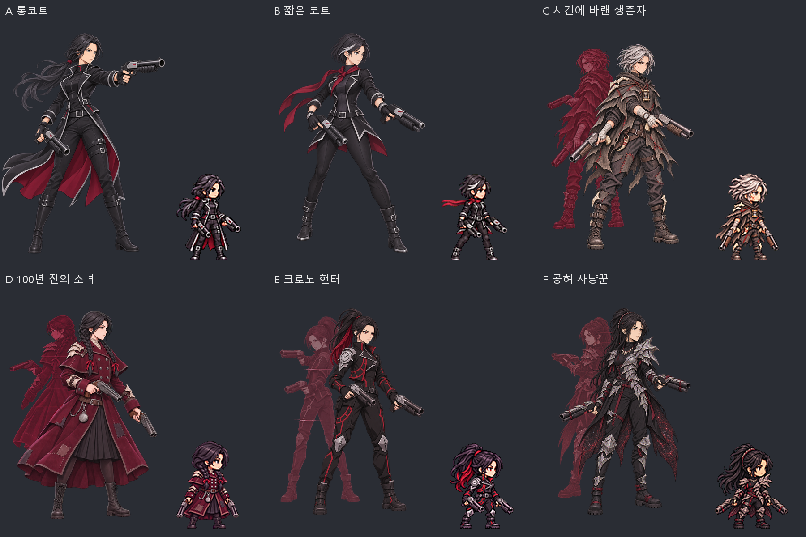
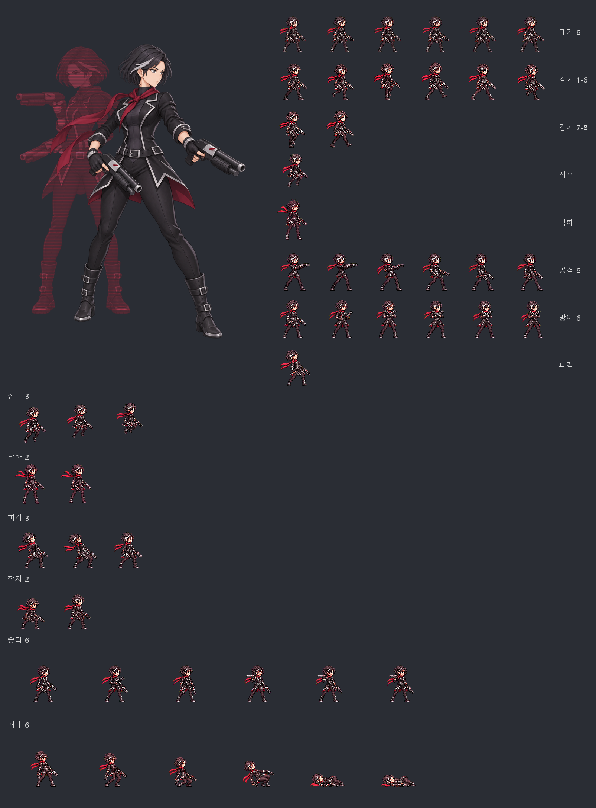

# Xion 그림: 외형 후보부터 게임 적용까지 (2026-11-19 ~ 11-24)

총괄 세션이 전한 요청(「이미지/스프라이트 담당」에게, 브리프 `reports/xion-kit-2026-11-18/art-brief.md`)으로 새 캐릭터 Xion의 외형 후보 두 가지를 만들었다. 고르는 사람은 사용자이고(D49), 고른 쪽으로 나머지 기본 시트를 그린다.

## 무엇을 했나

- **카드:** `design/tasks/CODEX-ART-94.md`. Codex 유닛 둘이 서로의 결과를 보지 않고 각각 한 방향을 그렸다.
  - **A, 롱코트**(`art-a`): 브리프 그대로.
  - **B, 짧은 코트**(`art-b`): 다리가 보이는 다른 해석.
- **각 후보가 만든 것:**
  - 메인 일러스트(1024×1536)
  - 얼굴(256×256)
  - 게임용 대기 동작 6프레임(128칸, 6.3fps)
- **리드 검수:**
  - 일러스트를 원본 크기로 봤다. 손가락, 방아쇠 손가락, 같은 모델의 산탄총(짧은 총신, 굵은 총구, 펌프)이 맞다.
  - 대기 동작은 2배·3배로 봤다.
  - 두 안 모두 문제없이 병합했다: A `a0a599ff`, B `a6c792dc`.
- **게임 속 녹화:** `smash-nine-prototype/tests/analysis/lead/cup_xion_look_capture.gd`
  - 실제 경기 화면 배율(0.85)이고, 가운데에 Xion, 왼쪽에 Frey, 오른쪽에 Rio(여)를 세웠다.
  - 맵은 가장 어두운 무스펠헤임과 가장 밝은 아스가르드다(배경 밝기를 잰 결과, 모든 맵이 어두운 편이다).
  - 후보 그림은 녹화할 때만 Xion의 대기 그림을 바꿔 끼운 것이다. 게임 코드와 게임 그림은 그대로다.
- **시안 월드컵:** 라운드 `2026-11-19`, 첫 항목 `xion-look`.
  - 영상(`compose_look.py`) 순서: 큰 그림·얼굴 → 무스펠헤임 → 아스가르드 → 4배 대기.
  - 아직 판정이 없던 Frey·Luna·Brave Luna 이펙트 8항목(라운드 `2026-11-05-night`, 기록 0건)도 이 라운드로 옮겼다. 페이지가 한 번에 한 라운드만 보여 주기 때문이다.

## 두 후보

| | A 롱코트 | B 짧은 코트 |
| --- | --- | --- |
| 옷 | 종아리 길이 검은 롱코트, 은색 테두리, 진홍 안감 | 엉덩이 길이 검은 코트, 은색 테두리, 진홍 스카프 |
| 머리 | 낮게 묶은 긴 검은 머리, 빨간 끈 | 은색 한 줄이 든 검은 단발 |
| 스프라이트 키 | 97–100px | 96–98px |
| 등신(유닛이 직접 잼) | 약 3.3: 머리가 다른 캐릭터보다 조금 작다 | 3에 가까움 |
| 디테일(Rio 여 대기 대비) | 118.8% | 115.5% |
| 유닛이 남긴 문제 | 발이 좌우로 최대 2px 흔들림, 5번째 프레임 호흡이 약함 | 발 윤곽이 최대 1.5px 변함, 스프라이트 스카프가 일러스트보다 짧음 |

게임 화면에서는 두 안 모두 다른 캐릭터보다 어둡다. 다만 은색 선과 진홍(A는 안감, B는 스카프) 덕분에 윤곽은 읽힌다.

## 2차: 이야기 설정으로 컨셉 C~F (사용자 요청 2026-11-19)

사용자가 A·B를 보고 요청했다.
- "컨셉을 조금 더 다양하게 해서 몇가지 시안을 더 만들어줘. 메인 이미지와 도트 idle 포즈 한 프레임만."
- 설정: "한 소녀가 누군가에 의해 100년 간 시간의 개념이 없는 공간에서 시공간 괴물들을 사냥하며 살아남았고, 이후 현실로 돌아왔다."
- "도플갱어는 협력하는 또 다른 시간선의 Xion이라는 것으로 해서 일러스트에도 홀로그램 같은 모습으로 들어가게."

카드는 `design/tasks/CODEX-ART-95.md`다. Codex 유닛 둘이 서로의 결과를 보지 않고 두 컨셉씩 그렸다(`art-a` C·D 병합 `7f7f62ac`, `art-b` E·F 병합 `551e45cb`). 각 컨셉은 메인 일러스트 하나와 128px 대기 한 프레임이다. 일러스트에는 뒤에 진홍 반투명 홀로그램으로 다른 시간선의 Xion이 함께 있다. 리드가 네 일러스트의 손·총·홀로그램을 원본 크기로 확인했다.

| 안 | 컨셉 | 생김새 | 게임 속(가장 어두운 맵) |
| --- | --- | --- | --- |
| A | 롱코트 (1차) | 종아리 길이 검은 롱코트, 진홍 안감, 낮게 묶은 긴 머리. 홀로그램 없음 | 은색 선으로 윤곽만 읽힘 |
| B | 짧은 코트 (1차) | 엉덩이 길이 검은 코트, 진홍 스카프, 은색 한 줄 단발. 홀로그램 없음 | 빨간 스카프가 눈에 띔 |
| C | 시간에 바랜 생존자 | 잿빛 머리, 괴물 가죽 판초, 모래시계 목걸이, 붕대 감은 손, 뼈 손잡이 펌프 산탄총 | 밝은 머리 덕분에 가장 잘 보임 |
| D | 100년 전의 소녀 | 버건디 케이프 코트, 땋은 머리와 빨간 리본, 주름치마, 멈춘 회중시계, 쌍열 산탄총 | 붉은 맵에서는 조금 묻힘, 밝은 맵에서는 괜찮음 |
| E | 크로노 헌터 | 검은 전술복, 진홍 시간 문양, 시계판 어깨 장식, 진홍 속머리 포니테일 | 진홍 머리·선이 잘 보임 |
| F | 공허 사냥꾼 | 괴물 갑각 갑옷, 별무늬 안감 망토, 이빨 목걸이, 반쯤 묶은 긴 머리 | 갈색 갑각이라 가장 묻히는 편 |

유닛이 남긴 문제:
- C~F 스프라이트의 머리가 Rio보다 조금 크다(C·D 약 14–18%).
- 작은 장식(손가락, 시계)은 1배에서 약하다.
- F의 홀로그램 분신은 두 번째 총이 보이지 않는다.

**시안 월드컵:** 항목 `xion-concept`이 1차의 `xion-look`(A·B, 기록 0건)을 대신한다. 여섯 안이 한 번씩 붙는 15경기다.
- A·B도 같은 형식(큰 그림 + 대기 한 프레임 + 게임 속)으로 다시 만들었다. 그래서 두 영상이 같은 순간에 같은 것을 보여 준다. 영상은 `compose_concept.py`로 만든다.
- 녹화 스크립트에는 한 프레임 후보와 `--still`(첫 프레임만)을 더했다.

고른 안이 머리 크기 기준(3등신, Rio와 같은 머리)에서 벗어나 있으면, 2단계(ART-96)에서 대기 동작부터 맞춘다.

## 3차: 사용자가 고른 B로 기본 그림 전부 (2026-11-23 ~ 11-24)

**사용자 선택:** 시안 월드컵에서 **B(짧은 코트)가 5전 5승(15점)으로 1위**였다. 그다음은 A 12점, D 9점, C 6점, E·F 1점이다. 판정은 총괄이 `cup_verdicts`에 남겼다. 사용자 지시는 "전부 진행해"다(11-23, 총괄을 거쳐). 다른 안에 남긴 사용자 메모는 C "너무 남성같다", "일러스트 팔 오류", D "일러스트 신체 비율 수정 필요", E "일러스트가 애매하다"이고, B에는 메모가 없었다.

| 단계 | 카드 | 유닛 | 만든 것 | 병합 |
| --- | --- | --- | --- | --- |
| 1 | ART-96 | `art-b` | 대기 앵커 v2: 스카프 두 꼬리를 일러스트 길이로 늘림(v1은 약 20% 짧았음), 높이 97px, 머리는 Frey·Rio와 같은 크기 | `06a849b5` |
| 1 | ART-96 | `art-a` | 일러스트 v2: B 본체는 그대로(90% 축소, 오른쪽으로 이동), 뒤에 다른 시간선의 Xion을 홀로그램으로 넣음. 게임 도플갱어와 같은 공식(진홍 한 색, 줄무늬, 밝은 띠, 알파 0.62) | `684bad2b` |
| 2 | ART-97 | `art-b` | 걷기 8(마네킹 방식), 점프 3, 낙하 2, 피격 3, 착지 2 | `acaebfd1` |
| 2 | ART-97 | `art-a` | 공격 6, 방어 6, 승리 6(192칸) | `657002af` |
| 2 | ART-97 고침 | `art-a` | 승리의 발 흔들림 13 → 0.5px(행 전체에 같은 가로 기준점), 패배 6(포즈마다 넉넉한 칸) | `dd0d0f95` |

**게임에 넣은 것:** `reports/xion-art-2026-11-19/install_b.py`로 넣었다.
- `xion_sheet.png`(대기, 걷기, 점프, 낙하, 공격, 방어, 피격)
- `xion_jump/fall/hurt/land.png`(피격 3프레임은 새로 생김)
- `xion_victory/defeat.png`
- `xion_illustration.png`(홀로그램 분신 포함)
- `xion_face.png`

기본 시트의 점프·낙하·피격 한 장은 각 동작 줄의 2·1·1번째 그림이다. 기술 동작 시트(`xion_moves_sheet.png`)는 아직 임시이고, 「캐릭터 스킬 담당」이 이 외형으로 Codex 후보를 만든다.

**검사:**
- `test_sprite_frames`에 Xion 기본 시트를 더했다. 이제 9장을 검사하고 통과한다.
- `test_xion_kit` 통과. 전체 검사(`tests/run_all.ps1`) 57개 모두 통과(ALL PASSED).
- 8060 웹 빌드: 선택 화면의 새 얼굴·일러스트, 경기 속 새 스프라이트와 HUD 얼굴, 콘솔 오류 없음.
- 리드가 모든 줄을 4배로 봤다. 의상, 스카프, 두 총, 얼굴이 가려지지 않는지를 확인했다.

**유닛이 남긴 작은 문제(채택하며 남김):**
- 공격 4번째 그림의 펌프 동작이 약하다. 이 줄은 예비용이고, J는 기술 시트로 나간다.
- 패배 1번째의 반동과 4번째의 넘어짐이 약하다.
- 걷기에서 상체 가로 위치가 최대 5px 차이 난다.

## 파일

- 후보: `art/bakeoff/xion/{a,b,c,d,e,f}/` (B의 최종 줄은 `art/bakeoff/xion/b/*-b2.*`)
- 유닛 보고서: `reports/codex-art-94a/`, `94b/`, `95a/`, `95b/`, `96a/`, `96b/`, `97a/`, `97a-fix/`, `97b/`
- 시안 월드컵 영상: `art/cup/2026-11-19/xion-concept/{a..f}.mp4` (1차 `xion-look/`은 쓰지 않음)
- 라운드 파일: `tools/pick_cup/rounds/2026-11-19.json`
