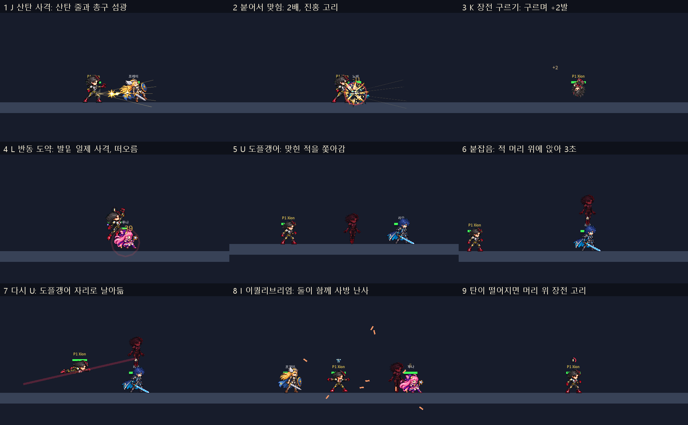
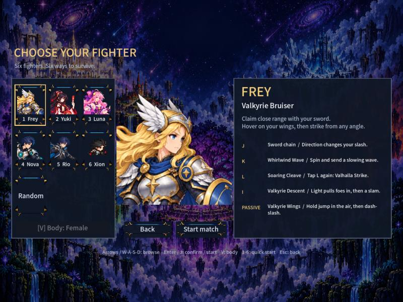
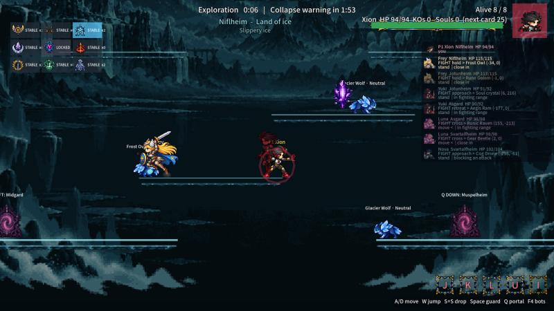

# 새 캐릭터 Xion(시온) 넣기 (2026-11-18, D51)

사용자 흐름:

1. 총괄 세션을 거쳐 "신규 캐릭터 생성. 총잡이이며, 컨셉은 건카타", "여성으로. 이름은 Xion"이 왔다.
2. 사용자가 직접 스킬 세트를 줬고, 리드가 평가했다([평가](../xion-concept-2026-11-18/user-kit-review.md)).
3. 사용자가 도플갱어를 고쳤다: "공격 한번에 사라지면 지나치게 약해진다. 대신 속도를 기본 캐릭터들의 절반으로 하고, 적이 공격하면 밀려나며 일정시간 더 느려지게 한다. 지속시간은 30초."
4. 사용자가 "이대로 넣기"라고 답했다.

플레이 스타일은 **중거리 견제와 암살**이다.

엔진 창 캡처(`tests/analysis/lead/xion_kit_capture.gd`)를 1:1로 잘랐다. 보드 스크립트는 [board.py](board.py)다. 그림은 모두 임시다(아래 "그림").

## 기술

| 키 | 이름 | 하는 일 |
|---|---|---|
| 패시브 | 더블 샷건 | J가 적을 밀어낸다. 적이 가까울수록 피해가 커진다: 60px 안이면 2배, 250px이면 1배. 총알은 쏜 자리에서 잰다. 1.6배 이상이면 진홍 고리가 뜬다 |
| J | 산탄 사격 | 쌍산탄총 10발, 1초에 2발. 누른 방향으로 쏘고 사거리는 약 250px. 다 쓰면 재장전 3초. 6초 동안 쏘지 않으면 바로 가득 찬다 |
| K | 장전 구르기 | 180px를 구른다. 처음 0.2초는 무적이고 탄 2발을 채운다. 쿨다운 1.5초, 공중에서는 한 번 |
| L | 반동 도약 | 남은 탄을 모두 발밑으로 쏘고 점프 한 번만큼 뜬다. 탄 한 발에 피해 2. 착지 전 한 번 |
| U | 도플갱어 | 30초 동안 떠다니며 마지막으로 맞힌 적을 200px/s로 쫓는다. 처음 닿은 적을 3초 붙잡아 머리 위에 앉는다(행동 불능, 피해만 들어가고 밀리지 않음). 적이 때리면 밀리고 2초 동안 절반 속도. 쿨다운 10초 |
| U 다시 | 날아들기 | 붙잡은 적이 500px 안이면 0.2초 만에 그 머리 위로 날아든다(지형 통과). 도착하면 도플갱어가 사라지고 적이 풀린다 |
| I | 이퀄리브리엄 | 2.5초 동안 사방으로 난사한다. 도플갱어도 함께 쏜다(붙잡은 채로도). 이동은 40%이고, 시작할 때와 끝날 때 탄창이 가득 찬다 |

수치는 평가 문서의 시작 값 그대로다. 자세한 값은 `design/SKILLS.md` Xion 절에 있다.

## 리드가 더 정한 것 (넣으면서)

평가 문서의 19개 외에 넣으면서 정했다.

| 정한 것 | 다르게 할 수 있는 것 |
|---|---|
| J를 쏠 수 없는 0.5초 간격 안에서도 다음 발 0.15초 전부터 누른 것은 기억했다가 쏜다(사람만) | 간격 안의 누름은 버림 |
| 땅에서 아래 J는 발밑이 아니라 **낮게 앞으로** 쏜다(발밑은 바닥이라 맞을 적이 없음). 공중 아래 J는 바로 아래 | 땅 아래 J도 바로 아래 |
| 착지로 K·L이 다시 생기는 것은 **동작 중이 아닐 때**만. L의 준비 시간이 땅 위라서 바로 다시 쓰이던 것을 막음 | — |
| 쫓을 적이 없으면 도플갱어는 Xion 뒤(46px)를 따라다닌다. 그때도 닿는 적은 붙잡는다 | 제자리에 머묾 |
| 날아드는 동안 Xion이 맞으면 그 자리에서 멈추고, 도플갱어는 사라지며 적이 풀린다 | 날아드는 동안 무적 |
| Xion이 쓰러지거나 다른 렐름으로 가면 도플갱어가 사라지고 적이 풀린다 | — |
| I 도중 0.6초 슈퍼아머가 끝난 뒤 맞으면 난사가 멈춘다. 탄창은 가득 찬다 | 끝까지 쏨 |
| 머리 위 장전 고리는 상태 아이콘(기절 등)이 떠 있으면 왼쪽으로 비킨다 | — |
| 소리는 임시 복사본이다: K = `dash`, L = `hit_launch`, U = `skill_cast`, I = `ult_start`. J는 다른 캐릭터처럼 공용 휘두르기 소리 | 소리 세션에서 새로 |

## 플레이로 볼 것 (밸런스는 판단하지 않음)

- **L을 붙어서 쓰면 세다.** 탄 10발을 바로 아래 적에게 쏘면 2배가 붙는다. 캡처 4에서 Luna가 39를 받았다. 평가 문서에서 "붙어 있으면 최대 40"으로 짚은 그대로다.
- **도플갱어는 없앨 수 없다.** 30초 동안 쫓아오니 결국 붙잡히기 쉽다. 사람은 때려서 밀어낼 수 있지만 봇은 일부러 때리지 않는다.

## 바뀐 공용 부분

- **붙잡힘**: `PlayerBase.apply_pin_hold`·`release_pin_hold`·`is_pinned`.
  - 그 자리에 고정되고(공중이면 공중에) 아무것도 못 한다.
  - 맞으면 피해만 들어간다. 넉백·경직·취소는 없고 금빛 번쩍임도 없다.
  - 위치가 고정이라 링아웃도 없다.
  - 그 위에 Brave 붙잡기는 걸리지 않는다.
- **스킬 바 칸 숫자**: `skill_counter(slot)`.
  - MatchHud가 칸 왼쪽 위에 그린다.
  - Xion은 J 칸에 탄 수를, U 칸에 도플갱어 남은 초를 보인다. 날아들 수 있으면 "!"가 뜬다.
  - 재장전 중에는 J 칸에 그늘과 초가 보인다.
- **캐릭터 선택 화면**: 6명과 Random이 되어 3열로 바뀌었다.
  - 다섯 이하이면 예전 2열 그대로다.
  - 숫자 6으로 빠른 시작이 된다(`choose_6`).
  - 문구 "1~6: 바로 시작"과 "여섯 캐릭터, 여섯 가지 생존 방식"을 영·한으로 넣었다.
- **스토리 모드**: `CharacterRegistry.get_story_character_ids()`(데이터 `"story": false`)로 Xion을 뺐다. 영웅 고르기와 9스테이지 그림자 무리 모두에서 빠진다. 스토리 화면은 예전처럼 5명, 2열이다.
- **봇**:
  - Xion 거리 프로필이 생겼다.
  - 복귀 기술을 캐릭터가 고를 수 있다(`recovery_attack()`). Xion은 L로 복귀하고, 탄이 없으면 공중 K로 먼저 채운다.
  - L은 아래에 적이 있을 때만 쓴다.
  - K는 Rio처럼 낭떠러지 쪽이면 쓰지 않는다.
  - 도플갱어: 적을 맞히면 깔고, 붙잡으면 0.3초 뒤 날아든다(Xion 코드 안).

## 그림

모두 임시다. Nova 여성체(무기를 들지 않은 몸)를 검정·은·진홍으로 다시 칠했다.

- 색은 이렇게 바꿨다: 파랑·보라 → 숯색, 하늘색 빛 → 진홍, 흰 판 → 은색. 피부는 그대로다.
- 몸 동작 11줄은 Nova 줄을 빌렸고, 이름은 Xion 것이다(`assets/art/xion/README.md`).
- 만든 스크립트는 [make_standin_art.py](make_standin_art.py)다.

| 필요한 것 | 누가 |
|---|---|
| 메인 일러스트·얼굴·기본 시트(쌍산탄총, 검정 롱코트·은색 선·진홍 섬광, 3등신 제안) | 「이미지/스프라이트 담당」 ([브리프](art-brief.md)) |
| 기술 동작 11줄 | Codex SKM 후보 → 시안 월드컵(D49): 산탄 사격 옆·번갈아·위·아래·공중 아래, 구르기, 반동 도약, 도플갱어 시전, 날아들기, 난사, 떠다니는 도플갱어 |
| 이펙트 | Codex VFX 후보 → 시안 월드컵: 총구 섬광, 산탄 줄, 발밑 일제 사격, 도플갱어 모습·머리 위 자세, 날아들기 궤적, 난사 탄, 가까이 맞힌 표시, 머리 위 장전 고리 |
| 아이콘 5개 | Codex VFX 후보: `xion_j`·`xion_k`·`xion_l`·`xion_u`·`xion_i` (지금은 글자) |

## 확인

- `test_xion_kit`(15가지): 다음을 확인했다.
  - 데이터와 임시 그림 줄
  - 스토리 제외
  - 사격 간격·탄 1발·밀어내기·사거리
  - 재장전 3초·6초 채움·빈 누름
  - 거리 배율(2배·1.5배·1배, 총구 기준)
  - 구르기(무적·180px·+2발·10발 상한·공중 한 번)
  - 반동(탄 전부·뜨기·피해·착지 전 한 번·탄 없으면 안 됨)
  - 공용 붙잡힘
  - 도플갱어: 200px/s, 쫓기, 한 개만, 머리 위, 3초 뒤 사라짐, 쿨다운
  - 도플갱어 밀기·느려짐: 자기 공격·몬스터·자기 총알은 통과, 붙잡는 중엔 안 밀림
  - 30초
  - 날아들기(도착·풀림·몸 다시 단단, 500px 넘으면 안 됨)
  - 이퀄리브리엄(탄창·40%·두 총구·양쪽 적중·끝나면 가득)
  - 스킬 바 숫자
  - 봇(도플갱어·날아들기·복귀 기술)
- 전체 테스트(`tests/run_all.ps1`): 결과는 아래 "결과"에 적는다.
- 엔진 캡처: 위 보드.
- 웹 빌드(http://localhost:8060): 아래 "결과"에 적는다.

## 결과

- **전체 테스트(소크 포함): ALL PASSED.** 봇 8인 소크(시드 1001)에 Xion이 봇으로 나와 끝까지 돌았다. 134초에 쓰러졌고, 그때까지 피해 52를 줬다.
- **처음 돌렸을 때 실패 5개를 고쳤다.** 모두 캐릭터가 다섯이라고 가정한 테스트였다.
  - 캐릭터 구조: 5명을 6명으로.
  - 선택 화면: 3열이 되어 아래 칸이 Nova, Random은 6번째 뒤, 숫자 6 = Xion, Xion 6줄.
  - 스토리 데이터·얼굴: 스토리 영웅만 돌게.
  - 동작 줄: Xion 임시 줄 목록 추가.
- **검토 중 찾은 버그를 고쳤다.** 붙잡힌 적이 계속 맞으면 맞을 때마다 히트스톱이 생기고, 그동안 적 쪽 붙잡힘 시간이 멈춘다. 그래서 도플갱어가 3초 뒤 사라져도 적이 계속 묶여 있었다. 이제 도플갱어가 사라지면 늘 풀어 준다.
  - `test_xion_kit`에 "계속 맞는 3초" 확인을 넣었다.
  - 고치기 전 코드로 돌리면 실패한다(붙잡힘 2.95초가 남음).
- **웹 빌드:** 새로 만들어 http://localhost:8060 에서 확인했다.
  - 선택 화면이 3열(Frey·Yuki·Luna / Nova·Rio·Xion / Random)이다. 문구는 "Six fighters. Six ways to survive."다.
  - 숫자 6으로 Xion 경기가 바로 시작된다.
  - 경기에서 U를 누르면 도플갱어가 나와 Xion 뒤를 따라다닌다.
  - 스킬 바는 아이콘 대신 글자로 나온다(아이콘은 아직 없음). J·U 칸 왼쪽 위의 작은 숫자는 웹 화면에서 작게 보인다. 값은 테스트로 확인했다.
  - 콘솔 오류는 없다.

