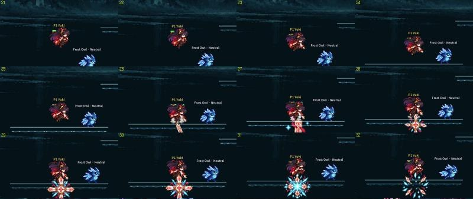

# Yuki 봉인부·부적: 적힌 대로 움직이게 고침 (2026-11-25~26, 시스템 담당)

버그 수정 보고서다. 기술의 수치와 규칙은 바꾸지 않았다. 설계 문서와 코드에 적혀 있던 동작이 실제로는 한 번도 일어나지 않던 것을, 일어나게 했다. 사용자가 정할 것은 없다.

문장 끝의 표시: **[잼]** 은 경기나 실험에서 잰 것, **[코드]** 는 코드에서 읽은 것, **[추정]** 은 재지 않은 것이다. 피해는 경기 안에서 실제로 깎인 HP다.

## 한 문장 결론

**Yuki의 봉인부(K)는 "공격 한 번에 찢어진다"고 적혀 있었지만 무엇으로도 찢어지지 않았고, 부적(J)은 발판을 그대로 통과했다. 둘 다 고쳤다.** [잼]

- 원인은 Rio 분신 때와 같다. 공격 영역은 정적인 몸을 만나지 못한다(4절). [잼]
- 고친 뒤 봇 경기 8판에서 Yuki 한 명이 한 판에 봉인부를 5.4번 찢기고, 부적이 발판에서 7.9번 펼쳐지고 1.7번 사라진다. [잼]
- Yuki의 결과: 같은 8판에서 준 피해 81 → 96, 평균 순위 6.1 → 5.5위, 승 0 → 0. 24판으로 늘리면 준 피해 72 → 93, 평균 순위 5.9 → 5.6위, 승 0 → 0이다. [잼]
- 고친 뒤에도 Yuki는 평균 순위가 가장 낮고, 승이 없는 캐릭터는 Yuki뿐이다. 이 숫자가 새 키트의 출발점이다. [잼]
- 측정하다가 Rio의 스크립트 오류 두 개를 더 찾아 함께 고쳤다(6절).

## 1. 무엇이 안 되고 있었나

| 물건 | 적혀 있던 것 | 실제 (고치기 전) |
|---|---|---|
| 봉인부 (K) | "최대 2개이며 5초 뒤 사라지고 공격 한 번에 찢어진다" (`design/SKILLS.md`) | 어떤 공격으로도 찢어지지 않았다. 5초가 지나거나 Yuki가 L로 터뜨려야만 사라졌다 |
| 부적, 직선 (J · 공중 J) | 발판을 만나면 사라진다 (`YukiTalisman._on_body_entered`) | 벽과 발판을 통과해 뒤에 있는 상대를 맞혔다 |
| 부적, 낙하·대공 (공중 ↓J · ↑J) | 발판을 만나면 그 자리에서 펼친다 (같은 함수) | 낙하 부적은 바닥을 뚫고 떨어져, 바닥에서 펼쳐지지 않았다 |

- 봉인부: 다섯 캐릭터의 근접 공격과 투사체를 70px 거리에서 맞혀 봤고, 하나도 찢지 못했다. [잼]
- 부적: 벽 뒤에 선 상대(벽 중심에서 130px)가 직선 부적에 맞았다. 260px 위에서 떨어뜨린 낙하 부적은 펼쳐지지 않고 바닥 윗면보다 642px 아래까지 내려갔다. [잼]
- 부적 쪽은 문서에는 없고 코드에만 있던 규칙이다. 발판을 만났을 때의 갈래가 코드에 있었지만 한 번도 실행되지 않았다. 이번에 `SKILLS.md`의 J 줄에도 적었다. [코드]

## 2. 고친 것

| 파일 | 바꾼 것 |
|---|---|
| `characters/yuki/YukiSeal.gd` | 정적인 몸(`StaticBody2D`)을 움직이는 몸(`AnimatableBody2D`)으로. 물리 동기화는 만들 때부터 끈다 |
| `characters/yuki/Yuki.gd` | 봉인부를 장면에 넣기 전에 자리를 정한다 |
| `characters/yuki/YukiTalisman.gd` | 부적 영역의 `monitorable`을 켠다 |

- 그대로인 것: 봉인부 최대 2개, 5초, 발동 중(L)에는 찢어지지 않음, Yuki 자신의 공격은 봉인부를 지나감, 부적의 피해·속도·수명·펼침 크기. [코드]
- 자리를 먼저 정하는 까닭: 물리 동기화가 켜진 몸은 장면에 들어간 뒤에 옮기면 원래 자리로 돌아간다. Rio 분신이 세계 원점에 서 있던 버그와 같은 함정이다. [잼, 11-25]
- `monitorable`을 켜도 다른 것에 영향이 없다. 게임 안에 "영역을 만났다"를 듣는 영역이 없다. [코드]
- 봇 경기에서 세도록 세 가지를 센다: `seal_torn`, `talisman_stopped`, `talisman_burst_on_platform`.

## 3. 검사

모두 실제 누름과 실제 겹침으로 한다. 손으로 `apply_hit`를 부르지 않는다. 장면마다 세계 원점과 (9000, 6000) 두 곳에서 한다.

| 검사 | 장면 | 고치기 전 코드에서 |
|---|---|---|
| `tests/test_yuki_objects.gd` | 봉인부가 놓인 자리에 있다 / 상대의 휘두르기가 찢는다 / 상대의 투사체가 찢는다 / Yuki의 부적은 자기 봉인부를 지나간다 / L은 여전히 터뜨린다 / 직선 부적이 벽에서 끝난다 / 낙하 부적이 바닥에서 펼쳐진다 | 7장면 가운데 4장면 실패(실패 문구 5개): 휘두르기, 투사체, 벽, 바닥 [잼] |
| `tests/test_hittable_bodies.gd` | 맞는 물건(`apply_hit`)은 정적인 몸이 아니다 / 발판을 찾는 영역은 `monitorable`이 켜져 있다 / 엔진의 사실 자체 | 두 규칙 모두 실패 [잼] |

- 둘 다 `tests/run_all.ps1`에 넣었다. 같은 실수가 다시 들어오면 전체 검사가 막는다.
- `AGENTS.md`에 규칙 한 문단을 적었다: 맞아야 하는 물건은 정적인 몸으로 만들지 않는다, 장면 검사는 원점 밖에서도 한다.
- 고치기 전 코드에서 실패한다는 것은 `808d67e9`에 두 검사 파일만 옮겨 다시 돌려 확인했다(2026-11-26). [잼]
- 전체 검사(`tests/run_all.ps1`): 검사 63개와 봇 경기 1판이 모두 통과했다. 커밋 `30bb717c`, 2026-11-26. [잼]

## 4. 원인과 훑어본 결과

**엔진의 사실:** `monitorable`이 꺼진 영역은 정적인 몸(`StaticBody2D`)을 만나지 못한다. 움직이는 몸(`AnimatableBody2D`, `CharacterBody2D`)은 만난다. [잼, `test_hittable_bodies.gd`가 매번 다시 확인한다]

근접 공격(`scripts/Attack.gd`)과 투사체(`scripts/Projectile.gd`)의 영역은 `monitorable`이 꺼져 있다. 그래서 휘두르기도 투사체도 정적인 몸에는 닿지 않는다. [코드]

**맞아야 하는 물건 6개 (`apply_hit`가 있는 스크립트, `characters/`와 `scripts/` 70개를 읽음):** [코드]

| 스크립트 | 몸의 종류 | 공격이 닿나 |
|---|---|---|
| `PlayerBase` (선수) | CharacterBody2D | 예 |
| `RealmMonster` (몬스터) | CharacterBody2D | 예 |
| `SoulCrystal` (크리스탈) | CharacterBody2D | 예 |
| `XionDouble` (홀로그램 분신) | CharacterBody2D | 예 |
| `RioDecoy` (분신) | AnimatableBody2D | 예. 11-25에 고침, 그 전에는 정적인 몸 |
| `YukiSeal` (봉인부) | AnimatableBody2D | 예. 이번에 고침, 그 전에는 정적인 몸 |

**발판을 만나도록 짜인 영역:** Yuki 부적 하나뿐이다. 다른 투사체는 선수와 몬스터 층만 보므로 처음부터 발판을 지나가게 되어 있다. Rio의 던진 검은 영역이 아니라 광선(ray)으로 발판을 찾는다. [코드]

## 5. 측정: 같은 8판, 고치기 전과 후

- 전: `808d67e9`(main, D56 기준선). 후: `30bb717c`(이 수정 + 6절의 Rio 수정).
- 시드 2001~2008, 봇 8명, `--fixed-fps 60`, 최대 480초. 스크립트 오류는 전 0건, 후 0건이다. Rio 수정을 넣기 전의 첫 "후" 측정에서는 시드 2002에 1건이 있었다(6절). [잼]
- 원자료: `soak-before.txt`, `soak-after.txt`. 표는 `python reports/yuki-objects-2026-11-25/yuki_summary.py <전> <후>`로 다시 만든다.

### Yuki (8판에 11자리, 자리당 한 판 평균) [잼]

| | 전 | 후 |
|---|---|---|
| 준 피해 (HP) | 81.2 | 96.4 |
| 평균 순위 (8명 중) | 6.1 | 5.5 |
| 승 | 0 | 0 |
| J 누름 | 72.3 | 82.7 |
| K 누름 (봉인부 설치) | 17.7 | 19.8 |
| L 누름 | 7.4 | 9.4 |
| I 누름 | 3.5 | 4.1 |
| 봉인부가 공격에 찢어짐 | 셀 수 없음 | 5.4 (설치 218개 가운데 59개, 27%) |
| 낙하·대공 부적이 발판에서 펼쳐짐 | 셀 수 없음 | 7.9 |
| 직선 부적이 발판에서 사라짐 | 셀 수 없음 | 1.7 |

- "셀 수 없음": 고치기 전 코드에는 세는 장치가 없다. 그때는 일어나지 않는다는 것을 3절의 장면 검사로 확인했다.
- 부적이 발판을 만난 것은 J 누름 910번 가운데 106번(12%)이다. [잼]

### 경기와 다른 캐릭터 (기준 8판) [잼]

| | 전 | 후 |
|---|---|---|
| 경기 길이 중앙값 | 286초 (4:46) | 290초 (4:50) |
| 링아웃 합계 | 95 | 86 |
| 선수끼리 타격 합계 | 4,940 | 5,044 |

| 평균 순위 (승) | 전 | 후 |
|---|---|---|
| Luna | 2.4 (4) | 3.3 (2) |
| Rio | 3.8 (2) | 4.1 (1) |
| Frey | 4.5 (1) | 4.9 (1) |
| Nova | 4.6 (1) | 4.7 (2) |
| Xion | 5.2 (0) | 4.2 (2) |
| Yuki | 6.1 (0) | 5.5 (0) |

- 다른 캐릭터의 순위가 움직인 것을 이 수정의 효과로 읽으면 안 된다. 뒤의 24판에서 같은 차이가 나오지 않는다. [잼]

### 한 판씩 보면 크게 흔들린다 [잼]

| 시드 | Yuki 자리당 준 피해, 전 → 후 | 순위, 전 → 후 |
|---|---|---|
| 2001 | 61 → 70 | 4 → 5 |
| 2002 | 43 → 170 | 8·6 → 5·4 |
| 2003 | 151 → 77 | 6·2 → 8·5 |
| 2004 | 115 → 38 | 7·5 → 8·6 |
| 2005 | 32 → 61 | 6 → 5 |
| 2007 | 88 → 167 | 8 → 3 |
| 2008 | 48 → 96 | 8·7 → 7·5 |

- 2006번에는 Yuki가 없다.
- 일곱 판 가운데 다섯 판에서 오르고 두 판에서 내렸다. 한 판의 변화가 −77 ~ +127이다.
- 경기는 처음 달라진 한 번의 충돌부터 전부 달라진다. 그래서 8판의 평균 차이(81 → 96)만으로는 "수정 때문에 올랐다"고 말할 수 없다. 아래에서 24판으로 늘려 쟀다.

### 24판으로 늘려 잰 것 (시드 2001~2024) [잼]

8판만으로는 방향을 말할 수 없어서 16판을 전후로 더 쟀다. 프로젝트의 기준 표는 위의 8판이다. 원자료: `soak-before-24.txt`, `soak-after-24.txt`.

| Yuki (24판에 32자리, 자리당 한 판 평균) | 전 | 후 |
|---|---|---|
| 준 피해 (HP) | 72.4 | 92.5 |
| 평균 순위 (8명 중) | 5.9 | 5.6 |
| 승 | 0 | 0 |
| 4위 안에 든 자리 | 7 | 9 |
| 꼴찌(8위)인 자리 | 8 | 5 |
| J · K · L · I 누름 | 73.0 · 16.2 · 6.3 · 3.2 | 84.0 · 21.1 · 8.6 · 4.0 |
| 봉인부가 공격에 찢어짐 | 셀 수 없음 | 5.8 (설치 675개 가운데 185개, 27%) |
| 낙하·대공 부적이 발판에서 펼쳐짐 | 셀 수 없음 | 8.3 |
| 직선 부적이 발판에서 사라짐 | 셀 수 없음 | 2.0 |

- Yuki가 나온 20판 가운데 14판에서 자리당 준 피해가 올랐고 6판에서 내렸다. 판마다의 차이는 평균 +24, 표준편차 53이다.
- 준 피해는 오른 쪽이 우세하다. 다만 판마다 흔들림이 커서 "얼마나 올랐다"는 숫자는 24판으로도 거칠다. 평균 순위는 거의 그대로이고 승은 여전히 0이다.
- 오른 까닭은 재지 않았다. 낙하 부적이 바닥에서 펼쳐져 땅에 선 상대에게 닿게 된 것이 한 가지 후보다. [추정]
- 스크립트 오류는 더 잰 32판(전 16, 후 16)에서 0건이다.

| 경기 (24판) | 전 | 후 |
|---|---|---|
| 경기 길이 중앙값 | 285초 | 283초 |
| 링아웃 합계 | 286 | 307 |
| 선수끼리 타격 합계 | 14,970 | 15,451 |

| 평균 순위 (승), 24판 | 전 | 후 |
|---|---|---|
| Luna | 3.0 (10) | 2.9 (10) |
| Rio | 4.1 (6) | 3.9 (5) |
| Frey | 4.5 (2) | 5.0 (1) |
| Xion | 4.7 (4) | 4.0 (6) |
| Nova | 4.8 (2) | 5.6 (2) |
| Yuki | 5.9 (0) | 5.6 (0) |

- 8판에서 보이던 차이는 24판에서 사라지거나 뒤집힌다. Luna는 8판에서 2.4 → 3.3위였지만 24판에서는 3.0 → 2.9위다. 링아웃은 8판에서 95 → 86으로 줄었지만 24판에서는 286 → 307로 늘었다.
- Nova(4.8 → 5.6위)와 Xion(4.7 → 4.0위)의 차이가 이 수정과 이어지는 까닭은 찾지 못했다. 흔들림으로 본다. [추정]
- 소울 카드(D54)를 넣을 때의 "전" 기준선은 이 보고서의 "후"(`30bb717c`)다.

## 6. 함께 고친 것: Rio의 스크립트 오류 두 개

측정 경기에서 하나가 나왔고, 같은 실수가 더 있는지 코드를 훑어 하나를 더 찾았다. 둘 다 "기다리는 사이에 사라진 대상을 그대로 쓴" 오류다. 수치와 규칙은 바꾸지 않았다. 커밋 `30bb717c`.

| | 마검 난무 (I) | 그림자 반격 (L) |
|---|---|---|
| 언제 | 검 6자루를 0.05초 간격으로 던지는 사이에 표적이 사라질 때 | 반격으로 사라져 있는 0.1초 사이에 공격자가 사라질 때 |
| 어떻게 찾았나 | 수정 뒤 첫 8판 측정의 시드 2002에서 1건 [잼] | 코드를 훑다가 발견. 엔진 실험과 장면 검사로 재현 [잼]. 측정 경기에서는 나온 적 없음 |
| 영향 | 시전이 중간에 끊긴다. 남은 검이 나가지 않고, Rio가 다음에 맞을 때까지 I 키가 먹지 않는다 [코드] | 오류 한 줄. 회피 뒤의 짧은 잠금(0.1초)이 빠진다 [잼] |
| 수정 | 던질 때마다 아직 있는 표적만 남긴다 | 공격자가 남아 있을 때만 뒤로 가서 벤다. 없으면 회피만 한다 |
| 검사 (`tests/test_rio_kit.gd`) | 궁극기를 실제로 누르고, 첫 검 뒤에 표적 하나를 없앤다: 6자루가 모두 나간다 | 상대의 실제 휘두르기를 받고, 사라진 사이에 공격자를 없앤다: 짧은 잠금으로 끝난다 |
| 고치기 전 코드에서 | 실패 [잼] | 실패 [잼] |

- 사라지는 대상은 몬스터다. 선수는 탈락해도 노드가 남으므로 이 오류를 내지 않는다. [코드]
- 훑은 범위: 게임 코드(`characters/`, `scripts/`)의 `await` 15곳을 모두 읽었다. 반복문 안에 있는 것은 Rio 난무의 두 곳뿐이다. 나머지는 노드를 들고 기다리지 않거나, 기다린 뒤에 `is_instance_valid`로 확인한다(Luna 사이클론). 더 고칠 곳은 없다. [코드]
- 난무 오류가 측정에 준 영향: 8판 가운데 시드 2002 한 판만 달라졌다. 나머지 7판은 이 수정 전후가 글자 하나까지 같다. [잼]

## 7. 남은 것

- **Yuki는 여전히 가장 약하다.** 고친 뒤 8판 평균 5.5위, 24판 평균 5.6위이고 어느 쪽에서도 0승이다. 24판에서는 Nova(5.6위)가 바로 붙어 있다. 이번 수정은 적힌 대로 움직이게 한 것이지 강하게 만든 것이 아니다. 새 키트를 정할 때 이 숫자에서 시작한다. [잼]
- 봉인부는 이제 설치한 것의 27%가 상대 공격에 찢어진다. 전에는 0%였으니 봉인부만 보면 약해진 것이다. 봉인부의 수명이나 설치 수를 손보는 것은 새 키트에서 사용자가 정할 일이다.
- **웹 빌드에서 본 것:** 웹 빌드(`30bb717c`)에서 Yuki로 직접 공중 ↓J를 눌러, 낙하 부적이 발판 위에서 펼쳐지는 것을 봤다(아래 그림, 왼쪽 위부터 시간 순서). 봉인부가 찢어지는 장면은 웹에서 연출하지 못했다. 그쪽은 장면 검사(실제 휘두르기와 실제 투사체)와 봇 경기(24판에 185번)로 확인한 것이다. [잼]
- **웹 내려받기:** 44.9 MiB(47,089,061바이트)다. 예산 45 MiB까지 약 95KB 남았다. 지난 빌드(봇 키트 병합 때 47,083,637바이트)보다 5KB 늘었다. [잼]

